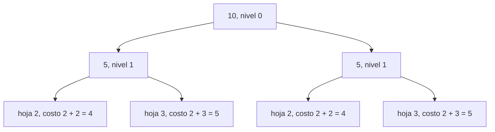

# Informe de corrección: Taller 4, simulación de partículas

Asignatura de Fundamentos de Programación Funcional y Concurrente.

## Argumentar la corrección

Sea $f : A \to B$ la especificación de una función y $P_f$ el programa en
Scala que la implementa. Se demuestra que $P_f$ es correcto probando

$$\forall a \in A : P_f(a) == f(a)$$

Los programas de los puntos 2 y 4 recorren datos con una función interna
`aux` de recursión de cola, es decir, son programas iterativos. Para argumentar
su corrección se formaliza la iteración con:

* un estado $s$ de la iteración,
* el estado inicial $s_0$,
* el estado final $s_f$,
* una invariante $\text{Inv}(s)$, una relación que se cumple en todo estado,
* la función $\text{transformar}(s)$, que pasa de un estado al siguiente.

Y se demuestran cuatro cosas:

1. $\text{Inv}(s_0)$: el estado inicial cumple la invariante.
2. $(s \neq s_f \land \text{Inv}(s)) \rightarrow \text{Inv}
   (\text{transformar}(s))$: la transformación conserva la invariante.
3. $\text{Inv}(s_f) \rightarrow \text{respuesta}(s_f) == f(a)$: el estado
final contiene la respuesta correcta.
4. Siempre se llega a $s_f$ (terminación), con una medida que decrece en cada paso.

Cuando la función es recursiva en árbol (como el reparto por mitades del punto 4), se usa inducción
fuerte sobre el tamaño de la entrada.

Notación: $P(x) \rightarrow e$ indica un paso de evaluación del programa
según el modelo de sustitución.

**Tipos usados en el taller.** Un sistema es un arreglo $s = [p_0, \ldots,
p_{n-1}]$ con $n = \lvert s \rvert \geq 0$. La partícula $p_j$ tiene posición
$r_j \in \mathbb{R}^2$, velocidad $v_j \in
\mathbb{R}^2$ y masa $m_j \in \mathbb{R}$.
$\lVert v \rVert$ es la norma de $v$ (`norma`).

**Aritmética.** Las especificaciones se escriben sobre números reales exactos.
El programa suma con `Double`, que redondea. Por eso las igualdades que se demuestran
son exactas sobre $\mathbb{R}$, y en la ejecución se cumplen salvo error de redondeo; las
pruebas del taller comparan con una tolerancia, como pide el enunciado.

## Punto 2. Magnitudes globales

### Especificación

Para un sistema $s$ de $n$ partículas, con la suma vacía igual a $0$:

$$E(s) = \sum_{j=0}^{n-1} \tfrac{1}{2}\, m_j \,\lVert v_j \rVert^2 \qquad\qquad M(s) = \sum_{j=0}^{n-1} m_j$$

$$C(s) = \begin{cases} \dfrac{1}{M(s)} \displaystyle\sum_{j=0}^{n-1} m_j\, r_j & \text{si } M(s) \neq 0 \\[2ex] (0,\,0) & \text{si } M(s) = 0 \end{cases}$$

Sean $P_E$, $P_M$ y $P_C$ los programas `energiaSecuencial`, `masaTotal` y
`centroDeMasaSecuencial`:

```Scala
def energiaSecuencial(s: Sistema): Double = {
    @tailrec
    def aux(i: Int, acc: Double): Double =
      if (i >= s.length) acc
      else {
        val v = s(i).vel.norma
        aux(i + 1, acc + 0.5 * s(i).masa * v * v)
      }
    aux(0, 0.0)
}

def masaTotal(s: Sistema): Double = {
    @tailrec
    def aux(i: Int, acc: Double): Double =
      if (i >= s.length) acc
      else aux(i + 1, acc + s(i).masa)

    aux(0, 0.0)
}

def centroDeMasaSecuencial(s: Sistema): Vector2 = {
    @tailrec
    def aux(i: Int, suma: Vector2, masa: Double): (Vector2, Double) = {
      if (i >= s.length) (suma, masa)
      else aux(i + 1, suma + s(i).pos * s(i).masa, masa + s(i).masa)
    }

    val (suma, masa) = aux(0, Vector2(0.0, 0.0), 0.0)
    if (masa == 0.0) Vector2(0.0, 0.0)
    else Vector2(suma.x / masa, suma.y / masa)
}
```

Se desea demostrar que $P_E(s) = E(s)$, $P_M(s) = M(s)$ y $P_C(s) = C(s)$
para todo sistema $s$.

### Método

Las tres funciones acumulan una suma recorriendo el índice $i$ de $0$ a $n$.
En lugar de repetir la demostración tres veces, se demuestra un solo lema sobre ese
patrón (Lema 1) y se verifica que cada función es una instancia suya.

### Lema 1: acumular una suma

Sea $V$ igual a $\mathbb{R}$, a $\mathbb{R}^2$ o a $\mathbb{R}^2 \times
\mathbb{R}$, con la suma componente a componente
y el neutro $0_V$. Sea $g : \{0, \ldots, n-1\} \to V$. Sea $A_g$ el programa

```Scala
def aux(i: Int, acc: V): V =
  if (i >= n) acc
  else aux(i + 1, acc + g(i))
```

Entonces $A_g(0, 0_V) = \displaystyle\sum_{j=0}^{n-1} g(j)$.

**Demostración.** Se formaliza la iteración:

* Estado: $s = (i, acc)$.
* Estado inicial: $s_0 = (0, 0_V)$.
* Estado final: $(i, acc)$ con $i \geq n$. La respuesta es $acc$.
* Invariante: $\text{Inv}(i, acc) \equiv 0 \leq i \leq n \;\land\; acc =
\displaystyle\sum_{j=0}^{i-1} g(j)$.
* Transformación: $\text{transformar}(i, acc) = (i + 1, \ acc + g(i))$.

**1. $\text{Inv}(s_0)$.** $0 \leq 0 \leq n$ y $acc = 0_V$, que es la suma vacía.

**2. La invariante se conserva.** Sea un estado $(i, acc)$ que no es final, es decir $i < n$, y
que cumple $\text{Inv}$.
Entonces $i + 1 \leq n$, y por la invariante:

$$acc + g(i) = \sum_{j=0}^{i-1} g(j) + g(i) = \sum_{j=0}^{i} g(j) = \sum_{j=0}^{(i+1)-1} g(j)$$

Por lo tanto $\text{Inv}(i + 1,\ acc + g(i))$.

**3. El estado final contiene la respuesta.** En un estado final $i \geq n$,
y la invariante da $i \leq n$, luego $i = n$ y $acc = \sum_{j=0}^{n-1} g(j)$.

**4. Terminación.** La medida $n - i$ es un natural, porque $i \leq n$ por la invariante.
Cada transformación la disminuye en $1$. Un natural no puede disminuir indefinidamente, así que tras
exactamente $n$ transformaciones se llega a $i = n$, que es un estado final.

Luego $A_g(0, 0_V) = \sum_{j=0}^{n-1} g(j)$. $\blacksquare$

### `energiaSecuencial` y `masaTotal`

Ambas son instancias del Lema 1 con $V = \mathbb{R}$:

| Función | $g(j)$ | Línea del programa |
|---------|--------|--------------------|
| `energiaSecuencial` | $\tfrac{1}{2}\, m_j \,\lVert v_j \rVert^2$ | `acc + 0.5 * s(i).masa * v * v`, con `v = s(i).vel.norma` |
| `masaTotal` | $m_j$ | `acc + s(i).masa` |

Por el Lema 1, $P_E(s) = \sum_j \tfrac{1}{2} m_j \lVert v_j \rVert^2 = E(s)$ y $P_M(s) = \sum_j m_j = M(s)$. $\blacksquare$

### `centroDeMasaSecuencial`

La función interna lleva dos acumuladores a la vez, así que es una instancia
del Lema 1 con
$V = \mathbb{R}^2 \times \mathbb{R}$ y $g(j) = (m_j\, r_j,\ m_j)$: la primera
componente es `suma + s(i).pos * s(i).masa` y la segunda es `masa + s(i).masa`. Por el Lema 1:

$$\text{aux}(0, (0,0), 0.0) = \Big(\sum_{j=0}^{n-1} m_j\, r_j,\ \
\sum_{j=0}^{n-1} m_j\Big) = \big(S,\ M(s)\big)$$

Después de `aux` el programa divide una sola vez, fuera del ciclo. Hay dos casos:

* **$M(s) = 0$.** La condición `masa == 0.0` se cumple y el programa devuelve $(0, 0) = C(s)$.
* **$M(s) \neq 0$.** El programa devuelve $(S_x / M(s),\ S_y / M(s)) = \frac{1}{M(s)}\, S = C(s)$.

Por lo tanto $P_C(s) = C(s)$. $\blacksquare$

La división se hace al final y no dentro de `aux`: dividir paso a paso
promediaría promedios parciales, que no es la suma ponderada entre la masa total.

### Terminación

La terminación de las tres funciones es la del Lema 1: la medida $n - i$ baja
de a $1$ y se anula en $i = n$. Con el
sistema vacío $n = 0$ y `aux(0, ...)` ya está en un estado final.

### Casos límite

* **Sistema vacío ($n = 0$):** $E = 0$, $M = 0$ y $C = (0, 0)$. Las tres funciones
 devuelven esos valores sin recorrer nada.
* **Masa total cero con partículas** (todas de masa $0$): $M(s) = 0$, y
 `centroDeMasaSecuencial` devuelve el origen en lugar de dividir entre cero.
* **Una partícula de masa cero entre otras:** contribuye $0$ a las dos sumas,
  así que no mueve el centro de masa.

### Encadenamiento de los llamados

Con el sistema del informe de proceso, cada flecha es una llamada de cola y en
cada estado se cumple la invariante:

$$
\begin{aligned}
P_E(\text{sistema}) &\rightarrow \text{aux}(0, 0.0) \rightarrow \text{aux}(1, 25.0) \rightarrow \text{aux}(2, 27.0) \\
&\rightarrow \text{aux}(3, 28.5) \rightarrow \text{aux}(4, 128.5) \rightarrow 128.5
\end{aligned}
$$

| Estado $(i, acc)$ | $\sum_{j=0}^{i-1} \tfrac{1}{2} m_j \lVert v_j \rVert^2$ | ¿Se cumple $\text{Inv}$? |
|-------------------|------------------------------------------------------|--------------------------|
| $(0, 0.0)$ | suma vacía $= 0$ | sí |
| $(1, 25.0)$ | $25$ | sí |
| $(2, 27.0)$ | $25 + 2$ | sí |
| $(3, 28.5)$ | $25 + 2 + 1.5$ | sí |
| $(4, 128.5)$ | $25 + 2 + 1.5 + 100$ | sí, y $i = n$: estado final |

El resultado $128.5$ coincide con $E(\text{sistema}) = 25 + 2 + 1.5 + 100$.
Para el centro de masa:

$$
\begin{aligned}
\text{aux}(0, (0,0), 0) &\rightarrow \text{aux}(1, (0,0), 2) \rightarrow \text{aux}(2, (4,0), 3) \rightarrow \text{aux}(3, (4,18), 6) \\
&\rightarrow \text{aux}(4, (8,22), 8) \rightarrow \big((8,22),\ 8\big) \rightarrow \left(\tfrac{8}{8},\ \tfrac{22}{8}\right) = (1,\ 2.75)
\end{aligned}
$$

que coincide con $C(\text{sistema}) = \frac{1}{8}\,(0\cdot 2 + 4\cdot 1 +
0\cdot 3 + 2\cdot 2,\ 0 + 0 + 6\cdot 3 + 2\cdot 2) = \frac{1}{8}(8, 22)$.

### Conclusión del punto 2

Se demostró, con la invariante $acc = \sum_{j<i} g(j)$ del Lema 1, que
`energiaSecuencial`, `masaTotal` y `centroDeMasaSecuencial` coinciden con $E$, $M$ y $C$ para todo sistema,
incluido el vacío, y que las tres terminan tras $n$ pasos.

## Punto 4. Trabajo y profundidad

### Especificación

El enunciado define el trabajo como el número total de operaciones, una por partícula,
que no baja por repartirlo, y la profundidad como el número de veces que se parte a la mitad
hasta llegar al umbral más el trabajo del tramo que queda sin partir.
En el modelo de costos de `parallel`, $D(\text{parallel}(e_1, e_2)) = \max\big(D(e_1), D(e_2)\big) + c_2$, con $c_2 = 1$ por cada
partición, y un tramo secuencial de $k$ partículas cuesta $k$.

Sea $\tau = \max(\mu, 1)$ el tope del umbral $\mu$. Un tramo de tamaño $k > \tau$ se parte en uno de tamaño
$\lfloor k/2 \rfloor$ y otro de tamaño $k - \lfloor k/2 \rfloor$ (la división entera del punto medio
`m = desde + (hasta - desde) / 2`), y un tramo de tamaño $k \leq \tau$ se resuelve en secuencial. Las especificaciones son:

$$W(n) = n \qquad\qquad D_\tau(k) = \begin{cases} k & \text{si } k \leq \tau
\\[1ex] 1 + \max\big(D_\tau(\lfloor k/2 \rfloor),\ D_\tau(k - \lfloor k/2
\rfloor)\big) & \text{si } k > \tau \end{cases}$$

$$\widehat{T}(n, p, \mu) = D_\tau(n) + \frac{W(n)}{p} \qquad (p \geq 1)$$

$\widehat{T}$ es la estimación usual $T_P \approx D + W/P$. $D_\tau$ está bien definida: si
$k > \tau \geq 1$ entonces $k \geq 2$, y las dos mitades están entre $1$ y $k - 1$,
de modo que la recursión se hace sobre valores estrictamente menores.

Cuando $n$ es una potencia de $2$ todas las hojas quedan en el mismo nivel y con el mismo tamaño,
y $D_\tau$ coincide con la frase del enunciado. En los demás casos manda la rama más costosa,
como en $D(\text{parallel}) = \max(\ldots) + c_2$.

Sean $P_W$, $P_D$ y $P_T$ los programas `trabajo`, `profundidad` y `tiempoEstimado`:

```Scala
def trabajo(n: Int): Int = n


def profundidad(n: Int, umbral: Int): Int = {
    val tope = math.max(umbral, 1)

    @tailrec
    def aux(tamanos: List[Int], nivel: Int, mejor: Int): Int =
      if (tamanos.isEmpty) mejor
      else {
        val (hojas, partibles) = tamanos.partition(_ <= tope)
        val nuevoMejor = (mejor :: hojas.map(nivel + _)).max
        aux(partibles.flatMap(k => List(k / 2, k - k / 2)).distinct, nivel + 1, nuevoMejor)
      }

    aux(List(n), 0, 0)
  }

def tiempoEstimado(n: Int, p: Int, umbral: Int): Double = profundidad(n, umbral) + trabajo(n).toDouble / p
```

Se desea demostrar que $P_W(n) = W(n)$, $P_D(n, \mu) = D_\tau(n)$ y $P_T(n, p, \mu) = \widehat{T}(n, p, \mu)$.

### `trabajo`

$P_W(n) \rightarrow n = W(n)$. $\blacksquare$

### El árbol de particiones y la conservación del trabajo

El **árbol de particiones** de un tramo de tamaño $k$ tiene la raíz de tamaño
$k$ en el nivel $0$. Un nodo de tamaño
$k > \tau$ tiene dos hijos, de tamaños $\lfloor k/2 \rfloor$ y $k - \lfloor k/2 \rfloor$,
en el nivel siguiente. Un nodo de tamaño $k \leq \tau$ es una hoja, que se resuelve en secuencial.

**Lema 2.** La suma de los tamaños de las hojas del árbol de raíz $k$, contadas con repetición, es $k$.

**Demostración**, por inducción fuerte sobre $k$.

*Caso base $k \leq \tau$.* El árbol es una sola hoja de tamaño $k$.

*Caso de inducción $k > \tau$.* Entonces $k \geq 2$. Sean $a = \lfloor k/2
\rfloor$ y $b = k - a$, ambos menores que $k$, de
modo que la hipótesis de inducción (HI) vale para ellos. Las hojas del árbol
de $k$ son las hojas del árbol de $a$ junto
con las del árbol de $b$, así que la suma de sus tamaños es $a + b = k$ por la HI. $\blacksquare$

El enunciado cuenta una operación por partícula e ignora el costo constante
de cada partición. Con el Lema 2, los tramos secuenciales suman exactamente $n$ partículas
para todo umbral: el reparto no pierde ni repite trabajo. Por eso el trabajo no baja
ni sube por repartirlo.

### Lema 3: la profundidad es el máximo sobre las hojas

Sea $H_\ell(k)$ el conjunto de tamaños de las hojas del nivel $\ell$ del
árbol de particiones de raíz $k$. Entonces:

$$D_\tau(k) = \max\big\{\, \ell + h \;\big|\; \ell \geq 0,\ h \in H_\ell(k)
\,\big\}$$

**Demostración**, por inducción fuerte sobre $k$.

**Caso base $k \leq \tau$.** El árbol es una sola hoja en el nivel $0$, así
que $H_0(k) = \{k\}$ y el máximo es $0 + k = k = D_\tau(k)$.

**Caso de inducción $k > \tau$.** Sean $a = \lfloor k/2 \rfloor$ y $b = k - a$,
ambos menores que $k$, de modo que la hipótesis de inducción (HI) vale para ellos.
Una hoja del nivel $\ell \geq 1$ del árbol de $k$ es una hoja del nivel $\ell - 1$ del
árbol de $a$ o del de $b$, y el árbol de $k$ no tiene hojas en el nivel $0$.
Entonces:

$$\max_{\ell,\, h} (\ell + h) = 1 + \max\Big(\max_{\ell',\, h \in H_{\ell'}
(a)} (\ell' + h),\ \max_{\ell',\, h \in H_{\ell'}(b)} (\ell' + h)\Big)
\overset{\text{HI}}{=} 1 + \max\big(D_\tau(a),\ D_\tau(b)\big) = D_\tau(k)$$

Por inducción fuerte, el lema vale para todo $k$. $\blacksquare$

### `profundidad`

**Teorema 1.** $\forall n \geq 0, \ \forall \mu : P_D(n, \mu) = D_\tau(n)$.

**Demostración.** Sea $L_\ell$ el conjunto de tamaños de los nodos del nivel
$\ell$ del árbol de $n$:

$$L_0 = \{n\} \qquad L_{\ell + 1} = \big\{\, \lfloor k/2 \rfloor,\ k -
\lfloor k/2 \rfloor \;\big|\; k \in L_\ell,\ k > \tau \,\big\}$$

Las hojas del nivel $\ell$ son $H_\ell = \{k \in L_\ell \mid k \leq \tau\}$.
Se formaliza la iteración de `aux`:

* Estado: $s = (T, \ell, m)$, que corresponde a `(tamanos, nivel, mejor)`.
* Estado inicial: $s_0 = (\{n\}, 0, 0)$, que es `aux(List(n), 0, 0)`.
* Estado final: $T = \varnothing$. La respuesta es $m$.
* Invariante: $\text{Inv}(T, \ell, m) \equiv T = L_\ell \;\land\; m =
\max\Big(\{0\} \cup \{\, j + k \mid j < \ell,\ k \in H_j \,\}\Big)$.
* Transformación: con `hojas` $= \{k \in T \mid k \leq \tau\}$ y `partibles` $= T \setminus$ `hojas`,
  $\text{transformar}(T, \ell, m) = (T', \ell + 1, m')$, donde $m' = \max\big(\{m\} \cup \{\ell + k \mid k \in \text{hojas}\}\big)$
  y $T'$ son los tamaños $\lfloor k/2 \rfloor$ y $k - \lfloor k/2 \rfloor$ de cada $k \in$ `partibles`, sin repetidos.

**1. $\text{Inv}(s_0)$.** $T = \{n\} = L_0$, y $m = 0 = \max(\{0\} \cup
\varnothing)$, porque para $\ell = 0$ no hay niveles $j < 0$.

**2. La invariante se conserva.** Sea $(T, \ell, m)$ con $T \neq \varnothing$
y $\text{Inv}$. Como $T = L_\ell$, se tiene
`hojas` $= H_\ell$ y `partibles` $= \{k \in L_\ell \mid k > \tau\}$.
Entonces:

* $T' = L_{\ell + 1}$ por la definición de $L_{\ell+1}$.
* Quitar repetidos (`distinct`) no cambia el conjunto de tamaños.
* $m' = \max\big(\{0\} \cup \{j + k \mid j < \ell,\ k \in H_j\} \cup \{\ell + k \mid k \in H_\ell\}\big) = \max\big(\{0\} \cup \{j + k \mid j < \ell + 1,\
k \in H_j\}\big)$.

Por lo tanto $\text{Inv}(T', \ell + 1, m')$.

**3. El estado final contiene la respuesta.** Si $T = \varnothing$ entonces
$L_\ell = \varnothing$. Como $L_{j+1}$ solo depende
de $L_j$, también $L_j = \varnothing$ y $H_j = \varnothing$ para todo $j \geq
\ell$. Luego

$$m = \max\Big(\{0\} \cup \{\, j + k \mid j \geq 0,\ k \in H_j \,\}\Big)$$

El conjunto de las hojas no es vacío (el árbol es finito y tiene al menos
una) y todos sus costos $j + k$ son $\geq 0$,
así que agregar el $0$ no cambia el máximo. Por el Lema 3, $m = D_\tau(n)$.

**4. Terminación.** Si $L_{\ell+1} \neq \varnothing$, sus tamaños salen de
nodos $k > \tau \geq 1$, es decir $k \geq 2$, y sus
hijos miden a lo sumo $\lceil k/2 \rceil < k \leq \max L_\ell$. Entonces
$\max L_\ell$ es un natural que decrece estrictamente en cada nivel no vacío, y no
puede decrecer indefinidamente. Existe un nivel con $L_\ell = \varnothing$, que es un estado final.

Luego $P_D(n, \mu) = D_\tau(n)$. $\blacksquare$

El lema no pide que la profundidad siga la mitad mayor. Con $n = 11$ y $\tau
= 5$ las mitades son $5$ y $6$: la de $5$ ya es
una hoja y cuesta $1 + 5 = 6$, mientras que la de $6$ cuesta $1 + 1 + 3 = 5$.
La profundidad es $6$ por la hoja de la mitad
menor, y el programa la encuentra porque toma el máximo sobre todas las hojas.

### `tiempoEstimado`

**Teorema 2.** Para $p \geq 1$, $P_T(n, p, \mu) = \widehat{T}(n, p, \mu)$.

**Demostración.**

$$P_T(n, p, \mu) \rightarrow P_D(n, \mu) + P_W(n).\text{toDouble} / p \;=\;
D_\tau(n) + \frac{n}{p} = \widehat{T}(n, p, \mu)$$

La penúltima igualdad usa el Teorema 1 y $P_W(n) = n$. La conversión
`toDouble` se hace antes de dividir: con una división entera el resultado
sería $\lfloor n / p \rfloor$ y se perdería la parte decimal. $\blacksquare$

**Cotas elementales.** Como $D_\tau(n) \geq 0$ y $n/p \geq 0$, para $p \geq 1$
se cumple

$$\widehat{T}(n, p, \mu) \geq D_\tau(n) \qquad\text{y}\qquad \widehat{T}(n, p, \mu)
\geq \frac{n}{p}$$

Son las cotas elementales $T_P \geq D$ y $T_P \geq W/P$ que también cumple el tiempo real, así que la estimación es coherente con ellas. Además $\widehat{T}$ no crece
al aumentar $p$, porque solo $n/p$ depende de $p$ y decrece.

### Terminación

`trabajo` y `tiempoEstimado` no son recursivas. `aux` de `profundidad`
termina porque el máximo de los tamaños del nivel decrece estrictamente (paso 4 del Teorema 1).

### Casos límite

* **$n = 0$:** $0 \leq \tau$, así que $D_\tau(0) = 0$. El programa evalúa `aux(List(0), 0, 0)`, ve la hoja $0$,
  calcula $\max(0, 0 + 0) = 0$ y termina con `List()`, devolviendo $0$.
* **$n \leq \tau$:** no hay particiones, $D_\tau(n) = n$ y el programa devuelve $n$ en el nivel $0$.
* **Umbral $\mu \leq 0$:** $\tau = 1$, así que `profundidad(n, 0)` y `profundidad(n, 1)` coinciden y la recursión no queda sin fondo.
* **$p = 0$:** no pertenece a la especificación ($p \geq 1$). En `Double` la división da infinito.
* **Desbordamiento de `Int`:** $D_\tau(k) \leq k$ para todo $k$. Si $k \leq \tau$ es una igualdad; si $k > \tau$, entonces
  $k \geq 2$ y $D_\tau(k) = 1 + \max(D_\tau(a), D_\tau(b)) \leq 1 + \lceil k/2 \rceil \leq k$ por la hipótesis de inducción. Por el
  Lema 3, cada costo $\ell + h$ de una hoja es a lo sumo $D_\tau(n) \leq n$, así que ni `nivel + _` ni `mejor` superan
  $n$, que es un `Int`. La suma $\text{profundidad} + n/p$ se hace en `Double`.

### Encadenamiento de los llamados

Los ejemplos del enunciado, con la especificación:

| Llamado | Cálculo con $D_\tau$ | Valor |
|---------|----------------------|-------|
| `profundidad(1024, 1024)` | $1024 \leq \tau$, no se parte | $1024$ |
| `profundidad(1024, 512)` | $1 + \max(D_{512}(512), D_{512}(512)) = 1 + 512$ | $513$ |
| `profundidad(1024, 1)` | diez particiones y un tramo de $1$: $10 + 1$ | $11$ |
| `tiempoEstimado(1024, 4, 1)` | $D_1(1024) + 1024/4 = 11 + 256$ | $267.0$ |

Para $n = 10$ y $\mu = 3$ ($\tau = 3$), la especificación se evalúa así:

$$D_3(10) = 1 + \max\big(D_3(5), D_3(5)\big) = 1 + \big(1 + \max(D_3(2), D_3(3))\big) = 1 + (1 + 3) = 5$$

El árbol de particiones de $10$ tiene este aspecto. La profundidad es el mayor costo de una hoja,
que es el nivel más tamaño:



El programa recorre los mismos nodos por niveles. Cada flecha es una llamada
de cola y la invariante se cumple en cada estado:

$$
\text{aux}(\text{List}(10), 0, 0) \rightarrow \text{aux}(\text{List}(5), 1, 0) \rightarrow \text{aux}(\text{List}(2, 3), 2, 0) \rightarrow \text{aux}(\text{List}(), 3, 5) \rightarrow 5
$$

| Estado $(T, \ell, m)$ | $L_\ell$ | $H_\ell$ | $m = \max(\{0\} \cup \{j + k \mid j < \ell,\ k \in H_j\})$ |
|-----------------------|----------|----------|------------------------------------------------------------|
| $(\{10\}, 0, 0)$ | $\{10\}$ | $\varnothing$ | $0$ |
| $(\{5\}, 1, 0)$ | $\{5\}$ | $\varnothing$ | $0$ |
| $(\{2, 3\}, 2, 0)$ | $\{2, 3\}$ | $\{2, 3\}$ | $0$ |
| $(\varnothing, 3, 5)$ | $\varnothing$ | $\varnothing$ | $\max(0, 2 + 2, 2 + 3) = 5$ |

El resultado $5$ coincide con $D_3(10)$. Con ese valor:

$$P_T(10, 2, 3) \rightarrow 5 + 10.0 / 2 \rightarrow 5 + 5.0 \rightarrow 10.0
= D_3(10) + \frac{10}{2}$$

### Conclusión del punto 4

Se demostró que `trabajo` devuelve $W(n) = n$ y que repartir no lo cambia
(Lema 2), que `profundidad` devuelve
$D_\tau(n)$ gracias al Lema 3 y a la invariante sobre los niveles del árbol,
y que `tiempoEstimado` devuelve
$D_\tau(n) + n/p$. De ahí se siguen las cotas $\widehat{T} \geq D$ y
$\widehat{T} \geq W/P$.
