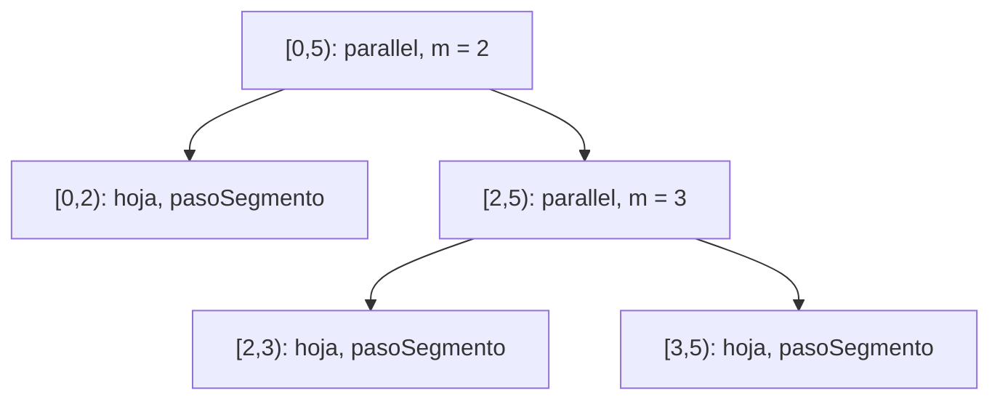

# Informe de paralelización — Taller 4: simulación de partículas

## 1. La estrategia de reparto

```Scala
def pasoParalelo(s: Sistema, dt: Double, umbral: Int): Sistema = {
  def aux(desde: Int, hasta: Int): Sistema =
    if (hasta - desde <= umbral || hasta - desde <= 1)
      pasoSegmento(s, dt, desde, hasta)
    else {
      val m = desde + (hasta - desde) / 2
      val (izq, der) = parallel(aux(desde, m), aux(m, hasta))
      izq ++ der
    }

  aux(0, s.length)
}
```

| Pregunta del enunciado | Respuesta |
|---|---|
| ¿Dónde se reparte? | En la función auxiliar `aux(desde, hasta)` de `pasoParalelo`: cada tramo se parte por la mitad. |
| ¿Con qué abstracción? | `parallel` del paquete `common`: `val (izq, der) = parallel(aux(desde, m), aux(m, hasta))`. |
| ¿Con qué criterio se deja de partir? | Cuando el tramo tiene **a lo sumo `umbral` elementos** o **a lo sumo uno**. Entonces se resuelve en secuencial con `pasoSegmento`. |
| ¿Qué combina los resultados parciales? | La **concatenación** de arreglos, `izq ++ der`, siempre en ese orden. Es asociativa (ver el informe de corrección, sección 3). |

**Por qué este problema se puede repartir.** La partícula movida $q_k$ depende solo de $p_k$ y de $dt$, no de las demás.
Los dos tramos son disjuntos y juntos cubren el tramo original (lema de partición del informe de corrección), y
las dos ramas solo leen `s` y construyen estructuras nuevas, de modo que no hay escrituras compartidas.

**El punto de partición.** `m = desde + (hasta - desde) / 2` deja una mitad de tamaño
$\lfloor len/2 \rfloor$ y otra de $\lceil len/2 \rceil$: las dos mitades difieren en a lo sumo una partícula, así que el
trabajo queda parejo entre las dos ramas.

**El árbol de llamados** para el sistema de cinco partículas del informe de proceso con umbral 2 (ejecutado: 3 hojas y 2 particiones):



Con umbral 1 el mismo sistema dio 5 hojas y 4 particiones. En general, un árbol binario con $L$ hojas tiene $L - 1$
particiones, así que bajar el umbral aumenta el número de hojas y de llamados a `parallel`.

**El caso de control, por construcción.** Si el umbral es mayor o igual que el tamaño del sistema, `aux(0, s.length)` es una hoja
y la función ejecuta exactamente `pasoSegmento(s, dt, 0, s.length)`, que es lo mismo que hace `pasoSecuencial`: no se llama
a `parallel` ni a `++`. Con ese umbral las dos versiones hacen el mismo trabajo de la misma forma, que es lo que el enunciado
pide cuidar para que la aceleración de la fila de control dé 1. Las hojas de los demás umbrales también llaman
a `pasoSegmento`, de modo que la diferencia de tiempos se debe al reparto y no a otra forma de recorrer el arreglo.

## 2. Costos del reparto que se pueden razonar (sin medir)

Esto es **análisis**, no una medición, y lo que dice cada punto debe contrastarse con las mediciones del punto 5:

- Cada partición agrega la creación de dos tareas con `parallel`, y ese costo no depende del tamaño del tramo.
- Cada unión `izq ++ der` **copia** las referencias de las dos mitades a un arreglo nuevo, de modo que
  cada nivel del árbol copia en total hasta $n$ referencias. La versión secuencial no hace esas copias.
- `pasoSegmento` construye una lista intermedia (un nodo por partícula) y luego la pasa a arreglo. Esto vale igual para
  `pasoSecuencial` y para las hojas de `pasoParalelo`, pero genera memoria que recorre el recolector de basura.

Estos tres puntos son **hipótesis candidatas** para explicar, en la sección 4, por qué la aceleración medida
quedaría por debajo de la estimada; no se afirma todavía que expliquen nada.

## 3. Tabla de tiempos con la fila de control

## 3. Tabla de tiempos con la fila de control

**Máquina:** `Runtime.getRuntime.availableProcessors` reportó **12 núcleos**. JVM con `-Xmx4g`.

**Método (`App.scala`).** Para cada tamaño `n` y cada umbral `u` se hacen 5 rondas. En cada ronda se mide `pasoSecuencial` y
justo después `pasoParalelo`, para que el ruido de la máquina afecte a los dos por igual. Cada medición llama antes a
`System.gc()` y usa `medir(1)`, es decir, ScalaMeter con calentamiento. Se reporta la **mediana** de las 5 rondas.
La aceleración es `aceleracion(tSeq, tPar)`; la estimada es `tiempoEstimado(n, 1, u) / tiempoEstimado(n, 12, u)`;
la fracción serial sale de la ley de Amdahl, $f = \dfrac{p/S - 1}{p - 1}$.

### 3.1 Tamaño n = 1.000.000 (mediciones válidas)

| umbral | seq (ms) | par (ms) | aceleración medida | aceleración estimada | fracción serial |
|---:|---:|---:|---:|---:|---:|
| 1000 | 63.47 | 32.47 | 1.95 | 11.87 | 0.467 |
| 10000 | 56.81 | 29.22 | 1.94 | 11.06 | 0.470 |
| 100000 | 58.29 | 41.01 | 1.42 | 7.29 | 0.677 |
| 125000 (n/8) | 55.05 | 63.14 | 0.87 | 5.40 | 1.160 |
| 1000000 (**control**) | 42.75 | 47.01 | **0.91** | 1.85 | — |

La fila de control, donde `pasoParalelo` ejecuta exactamente la misma llamada que `pasoSecuencial`, dio 0.91: las dos
versiones tardan lo mismo salvo ruido de medición.

### 3.2 Tamaño n = 2.000.000 (mediciones descartadas)

| umbral | seq (ms) | par (ms) | aceleración medida | aceleración estimada |
|---:|---:|---:|---:|---:|
| 1000 | 455.50 | 231.74 | 1.97 | 11.94 |
| 10000 | 102.90 | 288.06 | 0.36 | 11.51 |
| 100000 | 883.95 | 323.50 | 2.73 | 9.00 |
| 250000 (n/8) | 789.04 | 333.90 | 2.36 | 5.40 |
| 2000000 (**control**) | 679.22 | 450.57 | **1.51** | 1.85 |

**Estas filas no se usan para concluir nada.** La fila de control dio 1.51 en lugar de 1, y el tiempo de `pasoSecuencial`,
que es el mismo cálculo en todas las filas, varió entre 102 y 884 ms. Eso indica que la máquina estaba bajo presión de
memoria y de recolector de basura durante esta parte de la corrida (cada paso crea una lista de dos millones de nodos y un
arreglo nuevo). Se dejan en el informe para no ocultarlas, y porque muestran que el criterio de la fila de control sirve
para detectar una medición mala.


## 4. Comparación con la estimación del punto 4 y lectura de los resultados

4.1 En qué se parecen y en qué no

- **Se parecen en la forma.** Tanto lo estimado como lo medido bajan al subir el umbral: con 1.000 y 10.000 la aceleración
  es la mayor, y con umbrales grandes se reparte en pocas hojas y la ganancia cae. Con el umbral igual a `n` ambas
  se acercan a «sin ganancia».
- **No se parecen en la magnitud.** Con umbral 1000 el modelo predice 11.87 y se midió 1.95, unas seis veces menos. Con la
  fila de control el modelo predice 1.85 y se midió 0.91.
- **El control muestra un defecto del modelo.** `profundidad(n, n) = n` cuenta el tramo sin partir, y `tiempoEstimado`
  suma además `n/p`, así que ese trabajo se cuenta dos veces y da una ganancia que no existe.

**A qué se atribuye la diferencia.** El modelo supone que el trabajo se reparte sin costo entre 12 procesadores. El programa
real tiene costos que el modelo no incluye. No se midieron por separado, así que son explicaciones probables y no resultados:

1. **Ancho de banda de memoria y recolector de basura.** `pasoSegmento` crea un nodo de lista por partícula y luego un
   arreglo, y cada paso produce millones de objetos. Eso depende de la memoria, no de los núcleos.
2. **Las uniones `izq ++ der`** copian los arreglos en cada nivel del árbol y no se reparten con la misma facilidad.
3. **Costo de crear y planificar tareas** con `parallel`, que crece al bajar el umbral.
4. **Pocas hojas para 12 núcleos.** Con umbral n/8 hay 8 hojas, así que como máximo trabajan 8 núcleos y el resto queda
   ocioso; además la hoja más lenta fija el tiempo. Con umbral 100000 son unas 10 hojas, con el mismo problema.

### 4.2 Qué umbral resultó conveniente

Con n = 1.000.000, los umbrales **1000 y 10000** dieron la mayor aceleración (1.95 y 1.94), prácticamente empatados.
Con 100000 bajó a 1.42, y con n/8 el paralelo fue más lento que el secuencial (0.87): hay muy pocas tareas y el costo de
repartir y de unir supera lo que ahorra. Un umbral muy pequeño crea demasiadas tareas y uno muy grande deja núcleos
sin trabajo. Con 1000 a 10000 se logra un punto intermedio, con cientos o miles de hojas por núcleo, lo que equilibra la
carga sin que el costo de crear tareas domine. Con una sola corrida limpia no se puede decir que uno de los dos sea
mejor que el otro.

### 4.3 Por qué la aceleración deja de crecer y la fracción serial

Según la ley de Amdahl, con una fracción $f$ del cálculo que no se reparte:

$$
S(p) = \frac{1}{f + \dfrac{1-f}{p}}, \qquad S(\infty) = \frac{1}{f}
$$

Con $S = 1.95$ y $p = 12$ se obtiene $f = \dfrac{12/1.95 - 1}{11} \approx 0.47$, y el valor es parecido con umbral 10000
(0.470). Es decir, cerca de la mitad del tiempo no se beneficia de tener más núcleos. Con esa fracción, el máximo que
se alcanzaría con infinitos núcleos es $1/0.47 \approx 2.1$, y con 12 ya se llegó a 1.95. Agregar más núcleos casi no sube
la aceleración, que es por lo que se estanca. Esa parte «serial» incluye todo lo que no escala con los núcleos: la
creación del arreglo inicial y el reparto de la raíz del árbol, las uniones `++` y el acceso a memoria compartida.
No se distingue cuánto aporta cada una porque no se midieron por separado.

Los valores de $f$ de las filas con umbral 100000 y n/8 (0.677 y 1.160) no se interpretan como fracciones reales: en esas
filas el reparto tiene pocas hojas o ruido, y $f > 1$ no tiene sentido físico.