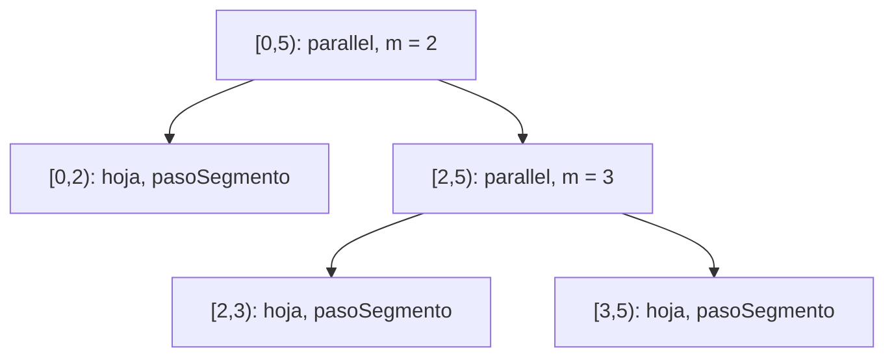

# Informe de paralelización — Taller 4: simulación de partículas

## 1. La estrategia de reparto

```Scala
def pasoParalelo(s: Sistema, dt: Double, umbral: Int): Sistema = {
  def aux(desde: Int, hasta: Int): Sistema =
    if (hasta - desde <= umbral || hasta - desde <= 1)
      pasoSegmento(s, dt, desde, hasta)
    else {
      val m = desde + (hasta - desde) / 2
      val (izq, der) = parallel(aux(desde, m), aux(m, hasta))
      izq ++ der
    }

  aux(0, s.length)
}
```

| Pregunta del enunciado | Respuesta |
|---|---|
| ¿Dónde se reparte? | En la función auxiliar `aux(desde, hasta)` de `pasoParalelo`: cada tramo se parte por la mitad. |
| ¿Con qué abstracción? | `parallel` del paquete `common`: `val (izq, der) = parallel(aux(desde, m), aux(m, hasta))`. |
| ¿Con qué criterio se deja de partir? | Cuando el tramo tiene **a lo sumo `umbral` elementos** o **a lo sumo uno**. Entonces se resuelve en secuencial con `pasoSegmento`. |
| ¿Qué combina los resultados parciales? | La **concatenación** de arreglos, `izq ++ der`, siempre en ese orden. Es asociativa (ver el informe de corrección, sección 3). |

**Por qué este problema se puede repartir.** La partícula movida $q_k$ depende solo de $p_k$ y de $dt$, no de las demás.
Los dos tramos son disjuntos y juntos cubren el tramo original (lema de partición del informe de corrección), y
las dos ramas solo leen `s` y construyen estructuras nuevas, de modo que no hay escrituras compartidas.

**El punto de partición.** `m = desde + (hasta - desde) / 2` deja una mitad de tamaño
$\lfloor len/2 \rfloor$ y otra de $\lceil len/2 \rceil$: las dos mitades difieren en a lo sumo una partícula, así que el
trabajo queda parejo entre las dos ramas.

**El árbol de llamados** para el sistema de cinco partículas del informe de proceso con umbral 2 (ejecutado: 3 hojas y 2 particiones):



Con umbral 1 el mismo sistema dio 5 hojas y 4 particiones. En general, un árbol binario con $L$ hojas tiene $L - 1$
particiones, así que bajar el umbral aumenta el número de hojas y de llamados a `parallel`.

**El caso de control, por construcción.** Si el umbral es mayor o igual que el tamaño del sistema, `aux(0, s.length)` es una hoja
y la función ejecuta exactamente `pasoSegmento(s, dt, 0, s.length)`, que es lo mismo que hace `pasoSecuencial`: no se llama
a `parallel` ni a `++`. Con ese umbral las dos versiones hacen el mismo trabajo de la misma forma, que es lo que el enunciado
pide cuidar para que la aceleración de la fila de control dé 1. Las hojas de los demás umbrales también llaman
a `pasoSegmento`, de modo que la diferencia de tiempos se debe al reparto y no a otra forma de recorrer el arreglo.

## 2. Costos del reparto que se pueden razonar (sin medir)

Esto es **análisis**, no una medición, y lo que dice cada punto debe contrastarse con las mediciones del punto 5:

- Cada partición agrega la creación de dos tareas con `parallel`, y ese costo no depende del tamaño del tramo.
- Cada unión `izq ++ der` **copia** las referencias de las dos mitades a un arreglo nuevo, de modo que
  cada nivel del árbol copia en total hasta $n$ referencias. La versión secuencial no hace esas copias.
- `pasoSegmento` construye una lista intermedia (un nodo por partícula) y luego la pasa a arreglo. Esto vale igual para
  `pasoSecuencial` y para las hojas de `pasoParalelo`, pero genera memoria que recorre el recolector de basura.

Estos tres puntos son **hipótesis candidatas** para explicar, en la sección 4, por qué la aceleración medida
quedaría por debajo de la estimada; no se afirma todavía que expliquen nada.

## 3. Tabla de tiempos con la fila de control

> **Pendiente, a cargo de los demás integrantes del grupo** (punto 5, `App.scala`): el tiempo secuencial, el paralelo y la aceleración,
> para varios tamaños (de al menos un millón de partículas) y varios umbrales, **con la fila de control**
> (umbral igual al tamaño del sistema, aceleración 1) y el **número de núcleos** de la máquina en que se midió.
> El informe debe indicar de qué máquina salen los datos.

## 4. Comparación con la estimación del punto 4 y lectura de los resultados

> **Pendiente, a cargo de los demás integrantes del grupo** (puntos 4 y 5): en qué se parecen y en qué no los números
> estimados con `trabajo`, `profundidad` y `tiempoEstimado` y los medidos, y a qué se atribuye; cuál umbral resultó
> conveniente y por qué; por qué la aceleración deja de crecer aunque se agreguen núcleos, y la
> fracción del cálculo que no se reparte, estimada a partir de la aceleración medida y del número de núcleos.
