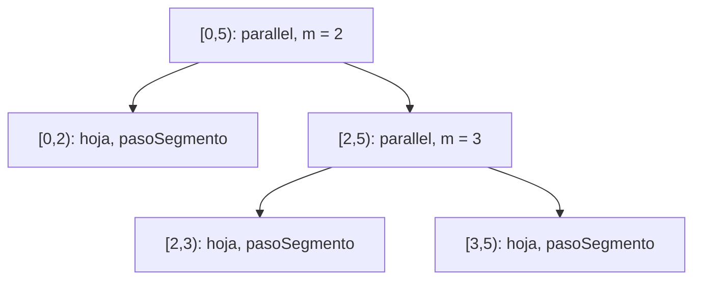

# Informe de paralelización — Taller 4: simulación de partículas

## 1. La estrategia de reparto

```Scala
def pasoParalelo(s: Sistema, dt: Double, umbral: Int): Sistema = {
  def aux(desde: Int, hasta: Int): Sistema =
    if (hasta - desde <= umbral || hasta - desde <= 1)
      pasoSegmento(s, dt, desde, hasta)
    else {
      val m = desde + (hasta - desde) / 2
      val (izq, der) = parallel(aux(desde, m), aux(m, hasta))
      izq ++ der
    }

  aux(0, s.length)
}
```

| Pregunta del enunciado | Respuesta |
|---|---|
| ¿Dónde se reparte? | En la función auxiliar `aux(desde, hasta)` de `pasoParalelo`: cada tramo se parte por la mitad. |
| ¿Con qué abstracción? | `parallel` del paquete `common`: `val (izq, der) = parallel(aux(desde, m), aux(m, hasta))`. |
| ¿Con qué criterio se deja de partir? | Cuando el tramo tiene **a lo sumo `umbral` elementos** o **a lo sumo uno**. Entonces se resuelve en secuencial con `pasoSegmento`. |
| ¿Qué combina los resultados parciales? | La **concatenación** de arreglos, `izq ++ der`, siempre en ese orden. Es asociativa (ver el informe de corrección, sección 3). |

**Por qué este problema se puede repartir.** La partícula movida $q_k$ depende solo de $p_k$ y de $dt$, no de las demás.
Los dos tramos son disjuntos y juntos cubren el tramo original (lema de partición del informe de corrección), y
las dos ramas solo leen `s` y construyen estructuras nuevas, de modo que no hay escrituras compartidas.

**El punto de partición.** `m = desde + (hasta - desde) / 2` deja una mitad de tamaño
$\lfloor len/2 \rfloor$ y otra de $\lceil len/2 \rceil$: las dos mitades difieren en a lo sumo una partícula, así que el
trabajo queda parejo entre las dos ramas.

**El árbol de llamados** para el sistema de cinco partículas del informe de proceso con umbral 2 (ejecutado: 3 hojas y 2 particiones):



Con umbral 1 el mismo sistema dio 5 hojas y 4 particiones. En general, un árbol binario con $L$ hojas tiene $L - 1$
particiones, así que bajar el umbral aumenta el número de hojas y de llamados a `parallel`.

**El caso de control, por construcción.** Si el umbral es mayor o igual que el tamaño del sistema, `aux(0, s.length)` es una hoja
y la función ejecuta exactamente `pasoSegmento(s, dt, 0, s.length)`, que es lo mismo que hace `pasoSecuencial`: no se llama
a `parallel` ni a `++`. Con ese umbral las dos versiones hacen el mismo trabajo de la misma forma, que es lo que el enunciado
pide cuidar para que la aceleración de la fila de control dé 1. Las hojas de los demás umbrales también llaman
a `pasoSegmento`, de modo que la diferencia de tiempos se debe al reparto y no a otra forma de recorrer el arreglo.

## 2. Costos del reparto que se pueden razonar (sin medir)

Esto es **análisis**, no una medición, y lo que dice cada punto debe contrastarse con las mediciones del punto 5:

- Cada partición agrega la creación de dos tareas con `parallel`, y ese costo no depende del tamaño del tramo.
- Cada unión `izq ++ der` **copia** las referencias de las dos mitades a un arreglo nuevo, de modo que
  cada nivel del árbol copia en total hasta $n$ referencias. La versión secuencial no hace esas copias.
- `pasoSegmento` construye una lista intermedia (un nodo por partícula) y luego la pasa a arreglo. Esto vale igual para
  `pasoSecuencial` y para las hojas de `pasoParalelo`, pero genera memoria que recorre el recolector de basura.

Estos tres puntos son **hipótesis candidatas** para explicar, en la sección 4, por qué la aceleración medida
quedaría por debajo de la estimada; no se afirma todavía que expliquen nada.


## 3. Tabla de tiempos con la fila de control

**Máquina:** `Runtime.getRuntime.availableProcessors` reportó **12 núcleos**. No se fijó el tamaño del heap: se usó el de la JVM por defecto.

**Método (`App.scala`).** Para cada tamaño `n` se mide `pasoSecuencial` una vez con `medir(5)`. Después, para cada umbral `u`, se mide
`pasoParalelo(s, dt, u)` con `medir(5)`. `medir` usa ScalaMeter con calentamiento y devuelve la **mediana** de 5 muestras. La aceleración es
`aceleracion(tSec, tPar)`, y el mismo `tSec` se usa en todas las filas de un tamaño. La aceleración estimada es
`tiempoEstimado(n, 1, u) / tiempoEstimado(n, 12, u)`, calculada con una réplica independiente de las definiciones del punto 4, no con la salida del programa.
La fracción serial sale de la ley de Amdahl, $f = \dfrac{p/S - 1}{p - 1}$. Se hicieron **dos corridas** completas de `./gradlew run`, con otros programas cerrados.

### 3.1 Tamaño n = 1.000.000 (mediciones válidas)

| umbral | hojas | seq 1 (ms) | par 1 (ms) | S 1 | seq 2 (ms) | par 2 (ms) | S 2 | S estimada |
|---:|---:|---:|---:|---:|---:|---:|---:|---:|
| 1000 | 1024 | 20.50 | 12.67 | 1.62 | 18.56 | 12.54 | 1.48 | 11.87 |
| 10000 | 128 | 20.50 | 12.85 | 1.60 | 18.56 | 12.38 | 1.50 | 11.06 |
| 100000 | 16 | 20.50 | 16.80 | 1.22 | 18.56 | 16.63 | 1.12 | 7.29 |
| 1000000 (**control**) | 1 | 20.50 | 20.99 | **0.98** | 18.56 | 19.29 | **0.96** | 1.85 |

La fila de control, donde `pasoParalelo` ejecuta exactamente la misma llamada que `pasoSecuencial`, dio 0.98 y 0.96: las dos versiones
tardan lo mismo salvo ruido de medición. Las dos corridas dan resultados coherentes entre sí.

### 3.2 Tamaño n = 2.000.000 (mediciones descartadas)

| umbral | seq 1 (ms) | par 1 (ms) | S 1 | seq 2 (ms) | par 2 (ms) | S 2 |
|---:|---:|---:|---:|---:|---:|---:|
| 1000 | 42.72 | 34.11 | 1.25 | 41.27 | 151.00 | 0.27 |
| 10000 | 42.72 | 38.67 | 1.10 | 41.27 | 40.34 | 1.02 |
| 100000 | 42.72 | 134.65 | 0.32 | 41.27 | 35.41 | 1.17 |
| 2000000 (**control**) | 42.72 | 39.20 | 1.09 | 41.27 | 73.94 | **0.56** |

**Estas filas no se usan para concluir nada.** El control de la corrida 2 dio 0.56 en lugar de 1. Un mismo umbral da 0.32 en una corrida y 1.17 en la otra, y
el tiempo de 130 a 150 ms aparece en una fila distinta en cada corrida. Ese comportamiento no corresponde a un efecto del umbral, sino a ruido de la máquina; la causa más
probable son las pausas del recolector de basura, porque cada paso crea una lista de dos millones de nodos y un arreglo nuevo, pero no se midió. Se dejan
en el informe para no ocultarlas, y porque muestran que el criterio de la fila de control sirve para detectar una medición mala.

## 4. Comparación con la estimación del punto 4 y lectura de los resultados

### 4.1 En qué se parecen y en qué no

- **Se parecen en la forma.** Tanto lo estimado como lo medido bajan al subir el umbral: con 1000 y 10000 la aceleración
  es la mayor, y con 100000 y menos hojas la ganancia cae. Con el umbral igual a `n` ambas se acercan a «sin ganancia».
- **No se parecen en la magnitud.** Con umbral 1000 el modelo predice 11.87 y se midió 1.62 y 1.48, entre siete y ocho veces menos. En la
  fila de control el modelo predice 1.85 y se midió 0.98 y 0.96.
- **El control muestra un defecto del modelo.** `profundidad(n, n) = n` cuenta el tramo sin partir, y `tiempoEstimado`
  suma además `n/p`, así que ese trabajo se cuenta dos veces y da una ganancia que no existe.

**A qué se atribuye la diferencia.** El modelo supone que el trabajo se reparte sin costo entre 12 procesadores. El programa
real tiene costos que el modelo no incluye. No se midieron por separado, así que son explicaciones probables y no resultados:

1. **Ancho de banda de memoria y recolector de basura.** `pasoSegmento` crea un nodo de lista por partícula y luego un
   arreglo, y cada paso produce millones de objetos. Eso depende de la memoria, no de los núcleos.
2. **Las uniones `izq ++ der`** copian los arreglos en cada nivel del árbol y no se reparten con la misma facilidad.
3. **Costo de crear y planificar tareas** con `parallel`, que crece al bajar el umbral.
4. **Pocas hojas para 12 núcleos.** Con umbral 100000 hay 16 hojas, así que la última tanda deja núcleos ociosos y la hoja más lenta
   fija el tiempo.

### 4.2 Qué umbral resultó conveniente

Con $n = 1.000.000$, los umbrales **1000 y 10000** dieron la mayor aceleración (1.62 y 1.60 en la corrida 1, 1.48 y 1.50 en la 2), prácticamente empatados:
el orden entre los dos se invierte de una corrida a otra, así que no se puede decir que uno sea mejor que el otro. Con 100000 la aceleración baja a 1.22 y 1.12 en las dos corridas.
Un umbral muy pequeño crea demasiadas tareas y uno muy grande deja núcleos sin trabajo. Con 1000 y 10000 hay 1024 y 128 hojas, es decir, muchas
más tareas que núcleos, lo que equilibra la carga sin que el costo de crear tareas domine; con 100000 hay solo 16.

### 4.3 Por qué la aceleración deja de crecer y la fracción serial

Según la ley de Amdahl, con una fracción $f$ del cálculo que no se reparte:

$$
S(p) = \frac{1}{f + \dfrac{1-f}{p}}, \qquad S(\infty) = \frac{1}{f}
$$

| umbral | $f$ corrida 1 | $f$ corrida 2 |
|---:|---:|---:|
| 1000 | 0.582 | 0.646 |
| 10000 | 0.591 | 0.636 |
| 100000 | 0.803 | 0.883 |

Con $S = 1.62$ y $p = 12$ se obtiene $f = \dfrac{12/1.62 - 1}{11} \approx 0.58$. Para los umbrales 1000 y 10000, $f$ queda entre 0.58 y 0.65 en las dos corridas:
más de la mitad del tiempo no se beneficia de tener más núcleos. El máximo con infinitos núcleos, $1/f$, sería entre aproximadamente
1.55 y 1.72, y con 12 núcleos ya se midió entre 1.48 y 1.62. Agregar más núcleos casi no sube la aceleración, que es por lo que se estanca.
Esa parte «serial» incluye todo lo que no escala con los núcleos: la creación del arreglo inicial y el reparto de la raíz del árbol, las uniones `++` y el acceso a memoria
compartida. No se distingue cuánto aporta cada una porque no se midieron por separado.

Los valores de $f$ con umbral 100000 (0.803 y 0.883) no se interpretan como fracciones reales: con 16 hojas para 12 núcleos la carga queda desbalanceada y eso
contamina la estimación. En el control $f$ saldría mayor que 1 (1.02 y 1.05) porque la aceleración es menor que 1, lo que no tiene sentido físico y confirma que ahí solo hay ruido.
