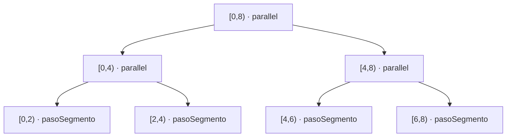

# Informe de paralelización: Simulación de partículas 

# 1. Introducción

Este informe presenta la estrategia de paralelización de la simulación de partículas y analiza sus resultados. 
Se explica cómo se divide el trabajo para calcular el movimiento, la energía cinética y el centro de masa. 
También se describen las versiones secuenciales usadas como referencia, el modelo teórico de costo y las mediciones 
realizadas con distintos tamaños de sistemas y umbrales

## Indice

| Punto                             | Funciones del proyecto                                     | Papel en este informe                                                               |
|-----------------------------------|------------------------------------------------------------|-------------------------------------------------------------------------------------|
| 1. Movimiento                     | `mover`, `pasoSegmento`, `pasoSecuencial`, `pasoParalelo`  | Describe el cálculo, la división y la concatenación de resultados.                  |
| 2. Magnitudes secuenciales        | `energiaSecuencial`, `masaTotal`, `centroDeMasaSecuencial` | Establece los valores de referencia para comparar resultados y tiempos.             |
| 3. Magnitudes paralelas           | `energiaParalela`, `centroDeMasaParalelo`                  | Explica el reparto y las operaciones de combinación.                                |
| 4. Modelo de costo                | `trabajo`, `profundidad`, `tiempoEstimado`                 | Presenta la estimación teórica y la contrasta con las mediciones.                   |
| 5. Medición y elección del umbral | `medir`, `aceleracion`, `umbralConveniente` y `App.scala`  | Describe cómo se obtienen y analizan los tiempos, las aceleraciones y los umbrales. |


# 2. Estrategia de paralelización

## 2.1 División de los segmentos y criterio de corte

El sistema se representa mediante el arreglo `Sistema = Array[Particula]`. Cada llamada recursiva procesa un 
intervalo [desde, hasta), de tamaño `hasta - desde`. Se usa `tope = math.max(umbral, 1)` para garantizar que el umbral 
sea al menos uno

### Caso base

Si el segmento tiene `hasta - desde <= tope`, se calcula de manera secuencial

### Caso recursivo

Si el segmento supera el umbral, se divide en dos mitades en $m = desde + (hasta - desde) / 2$, y se evalúan con 
`parallel(aux(desde, m), aux(m, hasta))`

### Combinación

Al terminar las dos mitades se unen los resultados con la operación apropiada para cada magnitud

`Ejemplo:`

Para ocho partículas con umbral dos, el árbol de reparto es el siguiente:



Los segmentos no se repiten ni dejan partículas sin procesar. Un umbral muy grande aprovecha poco el paralelismo, 
mientras que uno muy pequeño genera demasiadas tareas

## 2.2 Paralelización del movimiento de partículas 

Para una partícula $i$, la operación es: $\mathbf{r}'_i = \mathbf{r}_i + \mathbf{v}_i\,dt$

- $\mathbf{r}_i$: Es la posición inicial
- $\mathbf{v}_i$: Es la velocidad 
- $\mathbf{r}'_i$: Es la nueva posición

La masa y la velocidad permanecen constantes. En el punto 1, `mover` construye una nueva `Particula` con la posición 
actualizada; `pasoSegmento` aplica ese cálculo a un intervalo del arreglo mediante `Array.tabulate`; 
`pasoSecuencial` procesa todo el sistema con `pasoSegmento(s, dt, 0, s.length)`. Estas funciones proporcionan la 
referencia secuencial, sin modificar las partículas originales.

```scala
def mover(p: Particula, dt: Double): Particula =
  Particula(p.pos + p.vel * dt, p.vel, p.masa)

def pasoSecuencial(s: Sistema, dt: Double): Sistema =
  pasoSegmento(s, dt, 0, s.length)

def pasoSegmento(s: Sistema, dt: Double, desde: Int, hasta: Int): Sistema =
  Array.tabulate(hasta - desde)(i => mover(s(desde + i), dt))
```

La versión paralela procesa los segmentos finales con la misma función `pasoSegmento`, pero distribuye los intervalos 
mediante `parallel`:

```scala
def pasoParalelo(s: Sistema, dt: Double, umbral: Int): Sistema = {
  val tope = math.max(umbral, 1)

  def aux(desde: Int, hasta: Int): Sistema =
    if (hasta - desde <= tope) {
      pasoSegmento(s, dt, desde, hasta)
    } else {
      val m = desde + (hasta - desde) / 2
      val (izq, der) = parallel(aux(desde, m), aux(m, hasta))
      izq ++ der
    }

  aux(0, s.length)
}
```

La combinación `izq ++ der` conserva el orden de las partículas, pero crea y copia arreglos en los nodos internos 
del árbol. Por eso, la aceleración del movimiento también depende del costo de combinar los resultados

## 2.3 Punto 2: magnitudes globales secuenciales de referencia

Las funciones del punto 2 sirven como referencia para verificar las magnitudes paralelas y comparar sus tiempos:

- `energiaSecuencial(s)`: Recorre el arreglo mediante una función auxiliar con recursión de cola y acumula la energía
   cinética $E(s) = \sum_{i=0}^{n-1}\frac{1}{2}m_i\lVert\mathbf{v}_i\rVert^2$ de cada partícula. El acumulador comienza
   en `0.0`; para un sistema vacío devuelve `0.0`
- `masaTotal(s)`: Suma las masas de todas las partículas, también mediante recursión de cola. Define la magnitud de 
   masa total que interviene en el centro de la masa, aunque `centroDeMasaSecuencial` realiza su propia acumulación y 
   no llama directamente a `masaTotal` 
- `centroDeMasaSecuencial`: Acumula en una misma pasada la suma ponderada de posiciones y la masa total, al finalizar 
   divide una entre otra. Si la masa total es cero devuelve `Vector2(0.0, 0.0)`.

Las especificaciones usadas son:

- La energía cinética total se calcula como: $E(s) = \sum_{i = 0}^{n - 1}\frac{1}{2}m_i\lVert\mathbf{v}_i\rVert^2$
- La masa total del sistema es: $M(s) = \sum_{i = 0}^{n - 1}m_i$
- El centro de masa se calcula mediante:

$
\mathbf{C}(s) =
\begin{cases}
\displaystyle\frac{\sum_{i = 0}^{n-1}m_i\mathbf{r}_i}{M(s)}, & M(s)\ne 0,\\[4pt]
(0,0), & M(s) = 0.
\end{cases}
$

Estos resultados forman la línea base de corrección de las magnitudes globales. Para la medición de rendimiento,  
se compara el tiempo de `energiaSecuencial` con el de `energiaParalela` , y el de `centroDeMasaSecuencial` con el de 
`centroDeMasaParalelo`. 

`masaTotal` no tiene una versión paralela ni una tabla de aceleración específica; sin embargo, esta se tiene en cuenta 
por su función dentro del cálculo de centro de masa. Con números del tipo `Double` se admite una pequeña tolerancia en 
las pruebas de equivalencia

## 2.4 Punto 3: Paralelización de la energía cinética

`energiaParalela` calcula la misma magnitud $E(s)$ especificada en la sección `2.3`, pero divide el sistema con el 
criterio de corte común. La función recursiva de cola suma las energías del segmento, en los nodos internos, las dos
sumas parciales se combinan mediante `izq + der`.

Matemáticamente, esta suma es asociativa. Con `Double`, el cambio en el orden de operación puede producir pequeñas 
diferencias de redondeo, por lo que la equivalencia numérica debe evaluarse mediante tolerancias. A diferencia del 
movimiento, la combinación no concatena arreglos de partículas.

## 2.5 Punto 3: Paralelización del centro de masa

`centroDeMasaParalelo` calcula la magnitud $\mathbf C(s)$ de la sección 2.3. Para ello, cada segmento produce una 
pareja `(Vector2, Double)` que representa, respectivamente, la suma ponderada de posición y la suma de masa. La operación de 
combinación es:

$(\mathbf R_1, M_1)\oplus(\mathbf R_2, M_2) = (\mathbf R_1 + \mathbf R_2, \, M_1 + M_2)$

```scala
def combinar(
  a: (Vector2, Double),
  b: (Vector2, Double)
): (Vector2, Double) =
  (a._1 + b._1, a._2 + b._2)
```

La suma ponderada se divide entre la masa total y se hace una sola vez al final. No se promedian los centros de 
masa parciales, porque los segmentos pueden tener masas diferentes. Los resultados parciales no requieren concatenar 
arreglos completos.

En síntesis, los tres algoritmos comparten el árbol de partición, pero difieren en el costo de combinación:

| Cálculo          | Resultado de cada segmento         | Combinación              | Costo relevante            |
|------------------|------------------------------------|--------------------------|----------------------------|
| Movimiento       | Arreglo de partículas actualizadas | `izq ++ der`             | Crear y copiar arreglos    |
| Energía cinética | Un valor `Double`                  | `izq + der`              | Suma de valores            |
| Centro de masa   | `(Vector2, Double)`                | Suma de vectores y masas | Suma de vectores y valores |

# 3. Metodología experimental 

## 3.1 Datos equipo y procedimiento

Las mediciones principales proceden de tres ejecuciones completas realizadas en un MacBook Air M5. Para cada caso se 
tomaron 10 mediciones y se usó su mediana, después se obtuvo la mediana de los resultados de las tres ejecuciones

| Parámetro                             | Configuración                                        |
|---------------------------------------|------------------------------------------------------|
| Equipo                                | MacBook Air M5, 16 GB de memoria                     |
| Procesadores disponibles según la JVM | 10                                                   |
| Java y memoria de la JVM              | Java 17; `-Xms8g -Xmx8g`                             |
| Otras opciones de JVM                 | `-XX:+AlwaysPreTouch -XX:+UseParallelGC`             |
| Partículas por sistema (`n`)          | 1.000.000; 2.000.000; 4.000.000                      |
| Umbrales                              | `n`, `n/2`, `n/8`, `n/64`, `n/512` (división entera) |
| Intervalo de movimiento               | `dt = 0.01`                                          |
| Muestras por caso                     | 10 (se utiliza la mediana)                           |
| Corridas completas                    | 3                                                    |
| Unidad de tiempo                      | Milisegundos                                         |

El programa usa ScalaMeter y realiza un calentamiento previo que no se incluye en la medición. El tiempo secuencial 
se mide antes de cada umbral, de modo que no es necesariamente idéntico en todas las filas del mismo tamaño

Para reproducir estas mediciones se documentó el siguiente comando:

```bash
./gradlew installDist
JAVA_OPTS="-Xms8g -Xmx8g -XX:+AlwaysPreTouch -XX:+UseParallelGC" app/build/install/app/bin/app 10
```

Las mediciones compararon las versiones secuenciales y paralelas de movimiento, energía cinética y centro de masa con los 
tamaños y umbrales indicados. Los resultados de las tres ejecuciones se presentan en la sección 4 y en la sección 5 se
analiza el límite de aceleración mediante la ley de Amdahl

Aunque `umbralConveniente` está implementada, `App.scala` no la ejecuta directamente. Por eso, los mejores umbrales se 
identificaron comparando los resultados de las tablas

El caso `umbral = n` funciona como control, no se divide el sistema ni se ejecutan ramas paralelas. En condiciones 
estables, su tiempo debe ser aproximadamente igual al de la versión secuencial

## 3.2 Indicadores usados

La aceleración medida compara el tiempo secuencial con el paralelo:

$S_{\mathrm{medida}} = \frac{T_{\mathrm{secuencial}}}{T_{\mathrm{paralelo}}}$

Un valor mayor que uno indica que el cálculo paralelo fue más rápido; uno menor que uno indica que tardó más

El punto 4 reúne tres funciones que calculan un costo teórico sin cronometrar la simulación, `trabajo(n)` devuelve 
`n`, `profundidad(n, umbral)` calcula la longitud del camino crítico del árbol (número de divisiones más el tamaño 
de la hoja final) y `tiempoEstimado(n, p, umbral)` suma la profundidad y el trabajo dividido entre `p` procesadores. 
El modelo es:

- El trabajo total es: $W(n) = n $
- La profundidad del cálculo es: $D(n, u) = \operatorname{profundidad}(n, u)$
- El tiempo estimado se calcula así: $T_{\mathrm{estimado}}(n, p, u) = D(n, u) + \frac{W(n)}{p}$
- La aceleración estimada es: $S_{\mathrm{estimada}} = \frac{W(n)}{T_{\mathrm{estimado}}(n, p, u)}$

Aquí `n` es la cantidad de partículas, `u` es el umbral y `p` es la cantidad de procesadores. El tiempo estimado se 
expresa en unidades teóricas de trabajo, no en milisegundos, por eso se comparan las aceleraciones estimadas y medida, 
no los tiempos directamente

#### Comprobación del modelo de costo

Para verificar los cálculos:

| Función                   | Resultado |
|---------------------------|-----------|
| `trabajo(1024)`           | 1024      |
| `profundidad(1024, 1024)` | 1024      |
| `profundidad(1024, 512)`  | 513       |
| `profundidad(1024, 1)`    | 11        |

`Ejemplo:`

`tiempoEstimado(1024, 4, 1) = 11 + 1024 / 4 = 267`

El resultado 267 representa unidades teóricas de trabajo no milisegundos. Estos cálculos permiten estimar 
la aceleración y compararla con la aceleración medida en la sección `5.2`

## 3.3 Punto 5: Mediciones aceleración y selección del umbral

En esta sección se describen tres funciones y el programa de arranque `App.scala`:

- `medir(repeticiones)(cuerpo)`: Usa ScalaMeter, ejecuta `cuerpo` el número indicado de veces y devuelve la 
   mediana de la muestra
- `aceleracion(tSecuencial, tParalelo)`: Devuelve el cociente `tSecuencial / tParalelo`. Por ejemplo, si una tarea 
   tarda 100 ms en secuencial y 25 ms en paralelo, su aceleración es 4.0
- `umbralConveniente(s, dt, umbrales)`: Mide `pasoParalelo` para cada candidato mediante `medir(5)` y devuelve el 
   umbral asociado al menor tiempo observado en esas llamadas. Si la lista está vacía, devuelve `s.length` que equivale 
   a no subdividir

Para seleccionar el umbral más conveniente, se comparan los tiempos de ejecución de cada opción mediante una función 
con recursión de cola:

```scala
def umbralConveniente(s: Sistema, dt: Double, umbrales: List[Int]): Int = {
  @tailrec
  def aux(restantes: List[Int], mejorUmbral: Int, mejorTiempo: Double): Int =
    restantes match {
      case Nil => mejorUmbral
      case cabeza :: cola =>
        val tiempo = medir(5)(pasoParalelo(s, dt, cabeza))
        if (tiempo < mejorTiempo) aux(cola, cabeza, tiempo)
        else aux(cola, mejorUmbral, mejorTiempo)
    }

  umbrales match {
    case Nil => s.length
    case cabeza :: cola =>
      aux(cola, cabeza, medir(5)(pasoParalelo(s, dt, cabeza)))
  }
}
```

En `App.scala` se comparan los tiempos secuencial y paralelo del movimiento, la energía cinética y el centro de masa, con los tamaños, umbrales y repeticiones de la sección 3.1.

Los resultados incluyen los tiempos, las aceleraciones y, para el movimiento, la estimación teórica.

### Qué umbral habría elegido `umbralConveniente`

`umbralConveniente` mide cada candidato una sola vez, uno tras otro y no en paralelo, a propósito: si se midieran a la vez, cada medición le quitaría núcleos a las demás y los tiempos dejarían de ser comparables. Con los tiempos de la sección 4.1, el umbral de menor tiempo paralelo en cada tamaño es:

| Partículas | Umbral de menor tiempo | Paralelo (ms) | Secuencial (ms) | Aceleración |
|---------|--------|--------|-------|--------|
| 1.000.000 | 125.000 | 2,43 |  6,83 | 2,83 |
| 2.000.000 | 31.250 | 5,99 | 16,85 | 2,75 |
| 4.000.000 | 500.000 | 9,96 | 30,45 | 3,06 |

Con 1.000.000 y 4.000.000 de partículas el umbral elegido es `n/8`; con 2.000.000 es `n/64`, y su tiempo (5,99 ms) casi empata con el de `n/8` (6,03 ms). En ningún tamaño gana el umbral más pequeño (`n/512`) ni el igual a `n`. 

`umbralConveniente` compara los tiempos de `pasoParalelo` entre sí, no la aceleración. Por eso con 2.000.000 de partículas elige `n/64`, aunque la mayor aceleración de la tabla está en `n/8` (2,79): el secuencial se mide aparte en cada fila y esas diferencias caen dentro de la variación entre corridas. Además, la elección puede cambiar de una ejecución a otra, porque mide cada candidato una sola vez.

# 4 Resultados experimentales

Los resultados presentados en las siguientes tablas corresponden a tres ejecuciones completas del experimento. 
Para cada configuración se reporta la mediana de los tiempos secuenciales, los tiempos paralelos y las aceleraciones 
obtenidas. Además, se incluye el rango de aceleración, que representa el valor mínimo y máximo registrado entre las 
tres ejecuciones.

Debido a que las medianas se calculan de manera independiente para cada columna, la aceleración presentada puede 
diferir ligeramente del cociente entre los tiempos secuenciales y paralelos mostrados en una misma fila

## 4.1 Movimiento de partículas (punto 1)

| Partículas | Umbral    | Secuencial (ms) | Paralelo (ms) | Aceleración | Rango (3 corridas) | Estimada |
|------------|-----------|-----------------|---------------|-------------|--------------------|----------|
| 1.000.000  | 1.000.000 | 6,76            | 6,77          | 1,00        | 1,00 a 1,01        | 0,91     |
| 1.000.000  | 500.000   | 6,86            | 3,86          | 1,78        | 1,74 a 1,80        | 1,67     |
| 1.000.000  | 125.000   | 6,83            | 2,43          | **2,83**    | 2,79 a 2,83        | 4,44     |
| 1.000.000  | 15.625    | 6,86            | 2,56          | 2,66        | 2,56 a 2,73        | 8,65     |
| 1.000.000  | 1.953     | 6,86            | 2,72          | 2,55        | 2,46 a 2,58        | 9,81     |
| 2.000.000  | 2.000.000 | 16,86           | 17,01         | 0,99        | 0,98 a 1,00        | 0,91     |
| 2.000.000  | 1.000.000 | 16,81           | 10,15         | 1,70        | 1,66 a 1,78        | 1,67     |
| 2.000.000  | 250.000   | 16,80           | 6,03          | **2,79**    | 2,75 a 2,79        | 4,44     |
| 2.000.000  | 31.250    | 16,85           | 5,99          | 2,75        | 2,71 a 2,81        | 8,65     |
| 2.000.000  | 3.906     | 16,89           | 6,31          | 2,65        | 2,63 a 2,68        | 9,81     |
| 4.000.000  | 4.000.000 | 30,53           | 30,60         | 1,00        | 0,99 a 1,03        | 0,91     |
| 4.000.000  | 2.000.000 | 31,21           | 18,12         | 1,74        | 1,71 a 1,76        | 1,67     |
| 4.000.000  | 500.000   | 30,45           | 9,96          | **3,06**    | 3,00 a 3,12        | 4,44     |
| 4.000.000  | 62.500    | 30,42           | 10,48         | 2,90        | 1,85 a 2,99        | 8,65     |
| 4.000.000  | 7.812     | 30,52           | 12,01         | 2,62        | 1,47 a 2,71        | 9,81     |

El umbral `n/8` obtuvo la mayor aceleración mediana del movimiento en los tres tamaños evaluados. Se alcanzó 
una aceleración de 2,83 con un millón de partículas, 2,79 con dos millones y 3,06 con cuatro millones. La ejecución
paralela fue aproximadamente entre 2,8 y 3,1 veces más rápida que la secuencial 

Sin embargo, al usar umbrales más pequeños, como `n/64` y `n/512`, la aceleración disminuyó. Esto ocurre porque se 
generan más tareas y aumentan el trabajo necesario para dividir y combinar los resultados. Por lo tanto, un umbral más 
pequeño no siempre significa un mejor rendimiento 

## 4.2 Energía cinética (punto 3)

| Partículas | Umbral    | Secuencial (ms) | Paralelo (ms) | Aceleración | Rango (3 corridas) |
|------------|-----------|-----------------|---------------|-------------|--------------------|
| 1.000.000  | 1.000.000 | 1,26            | 1,26          | 0,99        | 0,98 a 1,00        |
| 1.000.000  | 500.000   | 2,56            | 1,99          | 1,29        | 1,27 a 1,30        |
| 1.000.000  | 125.000   | 2,57            | 1,19          | 2,16        | 2,07 a 2,22        |
| 1.000.000  | 15.625    | 2,56            | 1,14          | **2,24**    | 2,23 a 2,28        |
| 1.000.000  | 1.953     | 2,54            | 1,16          | 2,21        | 2,14 a 2,23        |
| 2.000.000  | 2.000.000 | 2,61            | 2,60          | 1,00        | 1,00 a 1,00        |
| 2.000.000  | 1.000.000 | 3,60            | 2,55          | 1,41        | 1,40 a 1,47        |
| 2.000.000  | 250.000   | 4,74            | 2,14          | 2,21        | 2,03 a 2,51        |
| 2.000.000  | 31.250    | 4,73            | 1,92          | **2,47**    | 2,15 a 2,75        |
| 2.000.000  | 3.906     | 4,74            | 1,93          | 2,45        | 2,20 a 2,76        |
| 4.000.000  | 4.000.000 | 4,97            | 4,91          | 1,01        | 1,00 a 1,03        |
| 4.000.000  | 2.000.000 | 8,62            | 5,47          | 1,56        | 1,55 a 1,59        |
| 4.000.000  | 500.000   | 8,68            | 3,45          | 2,51        | 2,44 a 2,56        |
| 4.000.000  | 62.500    | 8,68            | 3,15          | 2,76        | 2,69 a 2,81        |
| 4.000.000  | 7.812     | 8,71            | 3,14          | **2,79**    | 2,69 a 2,81        |

Los resultados muestran que la paralelización de la energía cinética mejora el tiempo de ejecución. Para un millón de
partículas se alcanzó una aceleración de 2,24 con el umbral `n/64`; para dos millones 2,47 con el mismo umbral y 
para cuatro millones 2,79 con `n/512`

A diferencia del movimiento de partículas, la energía cinética solo necesita sumar los valores parciales de tipo 
`Double` sin crear ni concatenar arreglos. Esto hace que la combinación sea más sencilla y tenga un menor costo. Además,
se observa que los umbrales pequeños obtuvieron mejores resultados, aunque reducirlo demasiado no garantiza una mejora 
significativa


## 4.3 Centro de masa (punto 3)

| Partículas | Umbral    | Secuencial (ms) | Paralelo (ms) | Aceleración | Rango (3 corridas) |
|------------|-----------|-----------------|---------------|-------------|--------------------|
| 1.000.000  | 1.000.000 | 5,10            | 5,04          | 1,00        | 0,68 a 1,03        |
| 1.000.000  | 500.000   | 5,07            | 2,99          | 1,68        | 1,68 a 1,76        |
| 1.000.000  | 125.000   | 5,09            | 1,71          | 2,98        | 2,92 a 3,19        |
| 1.000.000  | 15.625    | 5,02            | 1,63          | **3,13**    | 3,05 a 3,15        |
| 1.000.000  | 1.953     | 5,08            | 1,63          | 3,12        | 3,11 a 3,30        |
| 2.000.000  | 2.000.000 | 7,53            | 7,34          | 1,03        | 0,82 a 1,03        |
| 2.000.000  | 1.000.000 | 9,66            | 5,54          | 1,74        | 1,63 a 1,86        |
| 2.000.000  | 250.000   | 9,61            | 3,12          | 3,08        | 2,70 a 3,31        |
| 2.000.000  | 31.250    | 9,75            | 2,87          | **3,40**    | 2,88 a 3,56        |
| 2.000.000  | 3.906     | 9,75            | 2,87          | **3,40**    | 2,95 a 3,59        |
| 4.000.000  | 4.000.000 | 17,63           | 16,95         | 1,04        | 1,04 a 1,05        |
| 4.000.000  | 2.000.000 | 18,13           | 9,76          | 1,87        | 1,86 a 1,92        |
| 4.000.000  | 500.000   | 18,08           | 5,51          | 3,28        | 3,18 a 3,34        |
| 4.000.000  | 62.500    | 18,47           | 5,17          | **3,54**    | 3,51 a 3,65        |
| 4.000.000  | 7.812     | 18,16           | 5,41          | 3,44        | 3,36 a 3,57        |

Los resultados muestran que la paralelización del centro de masa redujo los tiempos de ejecución. Se alcanzaron 
aceleraciones de 3,13 con un millón de partículas, 3,40 con dos millones y 3,54 con cuatro millones 

El umbral `n/64` obtuvo buenos resultados, aunque reducir el umbral a `n/512` no produjo mejoras adicionales en 
todos los casos

## 4.4 Prueba adicional: Número de procesadores

Además de las tres corridas principales, se realizó una sola ejecución por configuración con dos millones de partículas
y umbral `n/8`, variando el número de procesadores que la JVM reconoce como disponibles mediante 
`-XX:ActiveProcessorCount=N`

| Procesadores (JVM) | Secuencial (ms) | Paralelo (ms) | Aceleración | Estimada |
|--------------------|-----------------|---------------|-------------|----------|
| 1                  | 11,77           | 10,97         | 1,07        | 0,89     |
| 2                  | 11,76           | 6,66          | 1,77        | 1,60     |
| 4                  | 13,51           | 5,61          | 2,41        | 2,67     |
| 8                  | 13,95           | 4,62          | 3,02        | 4,00     |
| 10                 | 14,36           | 4,64          | 3,09        | 4,44     |

El tiempo paralelo disminuyó de 10,97 ms a 4,62 ms al pasar de 1 a 8 procesadores, pero no mejoró al aumentar a 10.
La aceleración medida fue inferior a la estimada con 4, 8 y 10 procesadores. Esta prueba muestra cómo cambia el
rendimiento, aunque se basa en una sola ejecución por configuración

# 5 Análisis y discusión

## 5.1 Efecto del umbral

El umbral establece cuántas partículas se procesan por segmento. Con `umbral = n` no se divide el trabajo y las 
aceleraciones del movimiento se mantienen aproximadamente en 1, como se espera para el caso de control. Al disminuir 
el umbral, se aprovechan varias tareas simultáneas, pero también aumentan sus costos de creación y combinación

En movimiento, `n/8` obtuvo la mayor aceleración mediana para los tres tamaños. En energía y centro de masa, los
umbrales más pequeños ofrecieron mejores resultados. Esto se relaciona con el costo de combinar los resultados, por lo
tanto, no existe un umbral que sea el mejor para todos los cálculos

## 5.2 Comparación entre la estimación y las mediciones

El modelo del punto 4 aproxima el costo a partir del trabajo, la profundidad y los procesadores. Sin embargo, no 
incorpora todos los costos reales de la JVM, la creación de tareas, las asignaciones de memoria y la combinación de 
arreglos

Por ejemplo, con un millón de partículas y umbral 125.000, el movimiento consiguió una aceleración medida de 2,83  
frente a una estimada de 4,44. Para cuatro millones con umbral 500.000, se midió una aceleración de 3,06 frente 
a 4,44 estimados. Por eso, el modelo permite comparar tendencias, pero no debe interpretarse como una predicción exacta 
del tiempo real  

## 5.3 Variación de los tiempos y límites del experimento

Las tres ejecuciones permitieron observar resultados consistentes en varias filas, pero también algunas diferencias.
En movimiento con cuatro millones de partículas y umbral 62.500, las aceleraciones variaron entre 1,85 y 2,99, con 
un umbral `7.812`, entre 1,47 y 2,71. Estas variaciones aconsejan interpretar las medianas junto con sus rangos.

Además, en las mediciones de energía, el tiempo secuencial de la fila de control fue menor que el de algunos casos en 
los que se dividió el trabajo. Por ejemplo, para un millón de partículas, el control registró 1,26 ms y la fila con 
umbral 500.000 registró 2,56 ms. Aunque cada aceleración se calcula con su propia medición secuencial, la diferencia
exige cautela al comparar tiempos de filas distintas.

Las pruebas se realizaron en un equipo y una configuración de JVM concreto. Por lo tanto, los resultados muestran el 
comportamiento observado en ese entorno y no garantizan la misma aceleración en otros computadores

## 5.4 Techo de aceleración: Estimación con Amdahl

La ley de Amdahl permite estimar el límite de aceleración de un programa cuando una parte de su trabajo no se puede 
ejecutar en paralelo. Aunque se usen más procesadores, esta parte limita la mejora del rendimiento

La aceleración se expresa mediante: $S(p) = \frac{1}{f + \frac{1 - f}{p}}$

Donde:

- `S(p)`: Es la aceleración
- `f`: Es la fracción no paralelizable
- `p`: Es el número de procesadores

A partir de la aceleración medida, se puede estimar la fracción no paralelizable: 
$f = \frac{\frac{1}{S} - \frac{1}{p}}{1 - \frac{1}{p}}$

Para los experimentos se considera `p = 10`, correspondiente al número de procesadores disponibles reportados por 
la JVM

`Ejemplo`

Con un movimiento de 4.000.000 y el umbral `n/8` se obtuvo una aceleración de 3,06

$f = \frac{\frac{1}{3.06} - \frac{1}{10}}{1 - \frac{1}{10}}$

$f \approx 0.252 = 25.2\%$

Según esta estimación, la fracción no paralelizable equivalente es aproximadamente del 25,2%

Si se mantiene esa fracción, el techo teórico de aceleración al aumentar indefinidamente el número de procesadores es:

$S_{\max} = \frac{1}{f}$

$S_{\max} = \frac{1}{0.252} \approx 3.97$

`Estimación para los tres cálculos`

| Cálculo          | Aceleración medida | Fracción no paralelizable estimada | Techo estimado |
|------------------|--------------------|------------------------------------|----------------|
| Movimiento       | 3,06               | 25,2 %                             | 3,97           |
| Energía cinética | 2,79               | 28,7 %                             | 3,48           |
| Centro de masa   | 3,54               | 20,3 %                             | 4,93           |

Los resultados muestran que aumentar los procesadores no garantiza una aceleración proporcional, debido a los 
costos de creación de tareas, combinación de resultados y uso de la memoria. Las estimaciones basadas en la ley de 
Amdahl son aproximadas y no representan límites definitivos del programa

# 6 Conclusión 

La simulación se paralelizó dividiendo las partículas en segmentos independientes y conservando los cálculos de 
movimiento, energía cinética y centro de masa

Las tres ejecuciones en el MacBook Air M5 mostraron aceleraciones máximas medianas de 3,06 en movimiento, 2,79 en 
energía y 3,54 en centro de masa. Los resultados demostraron que el umbral influye en el rendimiento y que dividir 
más el trabajo no siempre mejora la velocidad

Finalmente, las aceleraciones medidas fueron generalmente inferiores a las estimadas, debido a los costos adicionales 
de la ejecución paralela y las condiciones del equipo