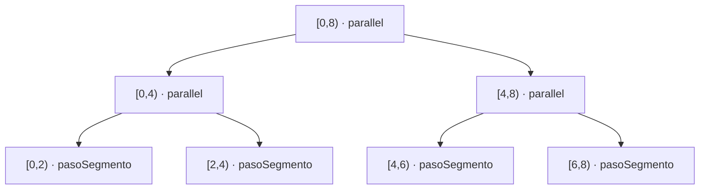
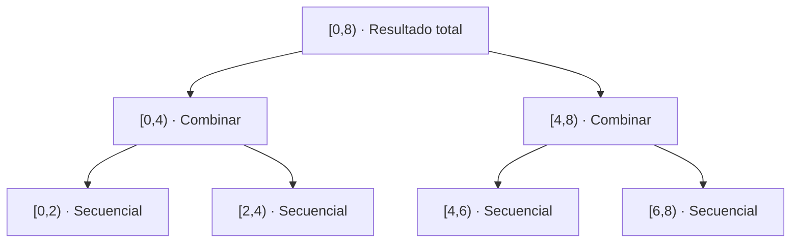

# Informe de paralelización: Simulación de partículas 

Este informe analiza cómo las funciones distribuyen el procesamiento de las partículas mediante `parallel` 
para calcular su movimiento, energía cinética y centro de masa.

Además, se comparan los tiempos de ejecución secuencial y paralela mediante ScalaMeter, evaluando la aceleración 
obtenida con diferentes tamaños de sistemas y umbrales de partición, así como su relación con las estimaciones 
teóricas de rendimiento

# Punto 1: Un paso de la simulación

## 1.1 El cálculo del movimiento

El punto 1 actualiza la posición de cada partícula durante un intervalo de tiempo `dt`, sin modificar su velocidad 
ni su masa, Para una partícula $i$, la operación es:
$\mathbf{r}'_i = \mathbf{r}_i + \mathbf{v}_i\,dt$

- $\mathbf{r}_i$: Es la posición inicial
- $\mathbf{v}_i$: Es la velocidad 
- $\mathbf{r}'_i$: Es la nueva posición

La implementación usa las funciones `mover`, `pasoSegmento`, `pasoSecuencial` y `pasoParalelo`

```scala
def mover(p: Particula, dt: Double): Particula =
  Particula(p.pos + p.vel * dt, p.vel, p.masa)

def pasoSecuencial(s: Sistema, dt: Double): Sistema =
  pasoSegmento(s, dt, 0, s.length)

def pasoSegmento(s: Sistema, dt: Double, desde: Int, hasta: Int): Sistema =
  Array.tabulate(hasta - desde)(i => mover(s(desde + i), dt))
```

La versión secuencial procesa el arreglo completo. La versión paralela usa el mismo cálculo `pasoSegmento` 
en sus segmentos finales; por ello, se comparan dos formas de organizar el procesamiento de las partículas y no 
dos fórmulas de movimiento diferentes.

## 1.2 La estrategia de reparto

`pasoParalelo` recibe un umbral que determina cuándo dejar de dividir el problema. El umbral efectivo es 
`math.max(umbral,1)`, de modo que un valor no positivo se trata como uno.

### Caso base

Si el segmento tiene como máximo `tope` partículas, se procesa con `pasoSegmento`

### Caso recursivo

Si es más grande, se divide en dos partes y ambas se entregan a `parallel`

### Combinación

Se unen los arreglos parciales mediante `izq ++ der`, conservando el orden

```scala
def pasoParalelo(s: Sistema, dt: Double, umbral: Int): Sistema = {
  val tope = math.max(umbral, 1)

  def aux(desde: Int, hasta: Int): Sistema =
    if (hasta - desde <= tope) {
      pasoSegmento(s, dt, desde, hasta)
    } else {
      val m = desde + (hasta - desde) / 2
      val (izq, der) = parallel(aux(desde, m), aux(m, hasta))
      izq ++ der
    }

  aux(0, s.length)
}
```

Para un segmento $[d, h)$ el punto medio es: 

$m = d + \left\lfloor\frac{h - d}{2}\right\rfloor$

La división produce los intervalos $[d, m)$ y $[m, h)$. No se solapan, y su unión es exactamente $[d, h)$; por 
lo tanto, no se pierde ni se procesa dos veces ninguna posición del arreglo.

La concatenación de secuencias es asociativa: 


```scala
(A ++ B) ++ C == A ++ (B ++ C)
```

El operador `++` concatena los arreglos. Aunque los segmentos terminen en momentos distintos, sus resultados se combinan respetando
el orden de las partículas

## 1.3 Árbol de particiones

Para ocho partículas con umbral dos, se forman cuatro hojas secuenciales:


Esta división permite procesar varios segmentos de forma concurrente 

## 1.4 Cómo se tomaron los tiempos

Los tiempos se midieron con ScalaMeter mediante la función `medir`, que obtiene cinco mediciones por caso y devuelve 
su mediana. Cada medición usa `withWarmer(new Warmer.Default) measure { ... }` para reducir la influencia del 
calentamiento de la JVM (máquina virtual de java).

| Parámetro                                      | Valor                                                          |
|------------------------------------------------|----------------------------------------------------------------|
| Procesadores disponibles reportados por la JVM | 8                                                              |
| Tamaños del sistema                            | 500 000; 1 000 000; 2 000 000 partículas                       |
| Umbrales por tamaño \(n\)                      | \(n\), \(n/2\), \(n/8\), \(n/64\), \(n/512\) (división entera) |
| Intervalo de tiempo                            | `dt = 0.01`                                                    |
| Repeticiones por medición                      | 5                                                              |
| Unidad                                         | Milisegundos                                                   |
| Ejecuciones completas disponibles              | 2                                                              |

Se genera los sistemas mediante `Array.tabulate`, con posiciones, velocidades y masas deterministas, y usa un mismo 
sistema para medir las dos versiones de cada tamaño.

El `caso de control` corresponde a `umbral = n`: no se llama a `parallel` porque no se subdivide el arreglo; la 
versión `pasoParalelo` ejecuta un único `pasoSegmento`, igual que en `pasoSecuencial`. Por tanto, su aceleración 
debería ser cercana a uno en una medición estable.

La aceleración real se calcula con: $S_{\mathrm{medida}} = \frac{T_{\mathrm{sec}}}{T_{\mathrm{par}}}$

Para comparar con el punto 4, se utiliza:
$
T_{\mathrm{estimado}}(n,p,u) = D(n,u) + \frac{W(n)}{p},
\qquad
S_{\mathrm{estimada}} = \frac{W(n)}{T_{\mathrm{estimado}}(n,p,u)} 
$

Donde $W(n)$ representa el trabajo, $D(n, u)$ la profundidad estimada, $p$ los procesadores disponibles y $u$ el 
umbral

## 1.5 Las mediciones del movimiento

Los siguientes valores son los reportados por la segunda ejecución completa. Las aceleraciones se calcularon a 
partir de los tiempos originales, antes de redondearlos a dos decimales, por lo que algunas divisiones hechas con
los números mostrados pueden variar levemente en el último decimal.

| Partículas | Umbral    | Secuencial (ms) | Paralelo (ms) | Aceleración | Estimada |
|------------|-----------|-----------------|---------------|-------------|----------|
| 500.000    | 500.000   | 14,62           | 13,45         | 1,09        | 0,89     |
| 500.000    | 250.000   | 14,62           | 10,19         | 1,43        | 1,60     |
| 500.000    | 62.500    | 14,62           | 9,43          | 1,55        | 4,00     |
| 500.000    | 7.812     | 14,62           | 9,01          | **1,62**    | 7,11     |
| 500.000    | 976       | 14,62           | 9,75          | 1,50        | 7,88     |
| 1.000.000  | 1.000.000 | 29,78           | 32,46         | 0,92        | 0,89     |
| 1.000.000  | 500.000   | 29,78           | 175,52        | 0,17        | 1,60     |
| 1.000.000  | 125.000   | 29,78           | 19,78         | **1,51**    | 4,00     |
| 1.000.000  | 15.625    | 29,78           | 238,27        | 0,12        | 7,11     |
| 1.000.000  | 1.953     | 29,78           | 19,84         | 1,50        | 7,88     |
| 2.000.000  | 2.000.000 | 76,37           | 153,91        | 0,50        | 0,89     |
| 2.000.000  | 1.000.000 | 76,37           | 137,95        | **0,55**    | 1,60     |
| 2.000.000  | 250.000   | 76,37           | 213,58        | 0,36        | 4,00     |
| 2.000.000  | 31.250    | 76,37           | 144,19        | 0,53        | 7,11     |
| 2.000.000  | 3.906     | 76,37           | 156,39        | 0,49        | 7,88     |

## 1.6 Comparación con la primera ejecución

La mejor aceleración observada entre los umbrales de cada tamaño fue:

| Partículas | Primera ejecución | Segunda ejecución |
|------------|-------------------|-------------------|
| 500.000    | 2,20              | 1,62              |
| 1.000.000  | 1,66              | 1,51              |
| 2.000.000  | 0,57              | 0,55              |

Los umbrales correspondientes al máximo pueden variar entre ejecuciones; esta tabla no implica que se haya utilizado 
un úmbral para ambas


## 1.7 Lo que dicen los números

Para 500.000 partículas, la mejor aceleración de la segunda ejecución fue 1,62, con umbral 7.812: el tiempo bajó 
de 14,62 ms a 9,01 ms. Para 1.000.000, la mejor aceleración fue 1,51, con umbral 125.000. En cambio, para 2.000.000, 
todos los umbrales medidos dieron una aceleración menor que uno: la versión secuencial fue más rápida en esa ejecución.

El umbral más pequeño no siempre produjo el mejor resultado. Dividir más veces puede generar más tareas y más 
concatenaciones, que implican asignaciones y copias adicionales de arreglos. Por eso, un sistema más
grande no garantiza una aceleración mayor

## 1.8 Comprobación del control

Al fijar `umbral = n`, se obtuvieron las siguientes aceleraciones:

| Partículas | Primera ejecución | Segunda ejecución |
|------------|-------------------|-------------------|
| 500.000    | 1,99              | 1,09              |
| 1.000.000  | 0,50              | 0,92              |
| 2.000.000  | 0,46              | 0,50              |

El caso de control no fue estable especialmente con dos millones de partículas, la aceleración se mantuvo lejos 
de uno. Puesto que en este caso ambas versiones utilizan `pasoSegmento` sobre el arreglo completo, los resultados 
no permiten atribuir toda la diferencia únicamente al reparto. Es necesario considerar la variación experimental, 
el uso de memoria, la recolección de basura, la optimización de la JVM y otras cargas del equipo. No se modificaron 
las cifras para hacerlas parecer cercanas a uno

## 1.9 Comparación con la estimación del punto 4

El modelo de trabajo y profundidad estima una aceleración mayor que la que se observó en distintos casos:

| Partículas | Umbral  | Aceleración medida | Aceleración estimada |
|------------|---------|--------------------|----------------------|
| 500.000    | 7.812   | 1,62               | 7,11                 |
| 1.000.000  | 125.000 | 1,51               | 4,00                 |
| 2.000.000  | 250.000 | 0,36               | 4,00                 |

El modelo asigna un costo básico por partícula y considera la profundidad de las divisiones, pero no se 
reproduce con exactitud la creación y coordinación de tareas, la concatenación de arreglos, las asignaciones 
de memoria ni las condiciones reales de la máquina. Por ello sirve como estimación teórica, no como pronóstico
exacto del cronómetro

## 1.10 Límite de aceleración: ley Amdahl

Para ilustrar el límite con una aceleración medida positiva, se toma $S = 1.62$ sobre $p = 8$ procesadores 
disponibles:

$S(p) = \frac{1}{f + \frac{1 - f}{p}}$

$f_{\mathrm{efectiva}} = \frac{1/S - 1/p}{1 - 1/p}$

$f_{\mathrm{efectiva}} = \frac{1/1.62-1/8}{1-1/8} \approx 0.563$

$S_{\mathrm{limite}}\approx\frac{1}{0.563}\approx 1.78$

En el modelo Amdahl, se obtuvo una fracción serial efectiva del 56,3% y una aceleración límite aproximada de 1,78. 
Estos valores son estimaciones, no medidas exactas del código secuencial, debido a los sobrecostos y la variabilidad 
de ejecución. Por ello, cuando la aceleración es menor que uno, el modelo puede producir una fracción serial superior 
a uno, sin interpretación física válida  

## 1.11 Conclusión punto 1

La división recursiva con `parallel` conserva las partículas y su orden. Las mediciones mostraron mejoras con 
500.000 y 1.000.000 de partículas, pero no con 2.000.000. La concatenación de arreglos y los costos de ejecución 
limitan la aceleración, por lo que no se puede establecer un umbral óptimo para todos los casos 

## 1.12 Mediciones en el MacBook Air M5 (pendiente de interpretar)

Estas tablas se midieron en un equipo distinto al de las secciones 1.4 a 1.11 y todavía no tienen lectura: esas secciones se actualizan a partir de ellas.

- **Máquina:** MacBook Air con chip M5 y 16 GB de memoria. La JVM ve 10 núcleos (`availableProcessors`): 4 de rendimiento y 6 de eficiencia.
- **JVM:** Java 17 con `-Xms8g -Xmx8g -XX:+AlwaysPreTouch -XX:+UseParallelGC`.
- **Medición:** `App.scala` con ScalaMeter, 10 repeticiones por caso (mediana) y 3 corridas completas; cada cifra es la mediana de las tres. `dt = 0.01`; umbrales `n`, `n/2`, `n/8`, `n/64` y `n/512` (división entera); tiempos en milisegundos. El secuencial se mide justo antes de cada umbral, después de un calentamiento que se descarta.

Para reproducirlas:

```bash
./gradlew installDist
JAVA_OPTS="-Xms8g -Xmx8g -XX:+AlwaysPreTouch -XX:+UseParallelGC" app/build/install/app/bin/app 10
```

La primera fila de cada tamaño (umbral = n) es la fila de control: no reparte nada. La aceleración es la mediana de las aceleraciones de las tres corridas, el rango es la menor y la mayor, y la estimada es `trabajo(n) / tiempoEstimado(n, 10, umbral)` del punto 4. En negrita está la mayor aceleración de cada tamaño.

### Movimiento (`pasoSecuencial` y `pasoParalelo`)

| Partículas | Umbral | Secuencial (ms) | Paralelo (ms) | Aceleración | Rango (3 corridas) | Estimada |
|-----------:|-------:|----------------:|--------------:|------------:|-------------------:|---------:|
| 1.000.000 | 1.000.000 | 6,76 | 6,77 | 1,00 | 1,00 a 1,01 | 0,91 |
| 1.000.000 | 500.000 | 6,86 | 3,86 | 1,78 | 1,74 a 1,80 | 1,67 |
| 1.000.000 | 125.000 | 6,83 | 2,43 | **2,83** | 2,79 a 2,83 | 4,44 |
| 1.000.000 | 15.625 | 6,86 | 2,56 | 2,66 | 2,56 a 2,73 | 8,65 |
| 1.000.000 | 1.953 | 6,86 | 2,72 | 2,55 | 2,46 a 2,58 | 9,81 |
| 2.000.000 | 2.000.000 | 16,86 | 17,01 | 0,99 | 0,98 a 1,00 | 0,91 |
| 2.000.000 | 1.000.000 | 16,81 | 10,15 | 1,70 | 1,66 a 1,78 | 1,67 |
| 2.000.000 | 250.000 | 16,80 | 6,03 | **2,79** | 2,75 a 2,79 | 4,44 |
| 2.000.000 | 31.250 | 16,85 | 5,99 | 2,75 | 2,71 a 2,81 | 8,65 |
| 2.000.000 | 3.906 | 16,89 | 6,31 | 2,65 | 2,63 a 2,68 | 9,81 |
| 4.000.000 | 4.000.000 | 30,53 | 30,60 | 1,00 | 0,99 a 1,03 | 0,91 |
| 4.000.000 | 2.000.000 | 31,21 | 18,12 | 1,74 | 1,71 a 1,76 | 1,67 |
| 4.000.000 | 500.000 | 30,45 | 9,96 | **3,06** | 3,00 a 3,12 | 4,44 |
| 4.000.000 | 62.500 | 30,42 | 10,48 | 2,90 | 1,85 a 2,99 | 8,65 |
| 4.000.000 | 7.812 | 30,52 | 12,01 | 2,62 | 1,47 a 2,71 | 9,81 |

### Variación con el número de procesadores

Se repitió la medición con 2.000.000 de partículas y umbral 250.000 (`n/8`), en una sola corrida, limitando con `-XX:ActiveProcessorCount=N` los procesadores que ve la JVM. Eso dimensiona el pool de `parallel` en N hilos; no fija los hilos a núcleos físicos.

| N (pool de la JVM) | Secuencial (ms) | Paralelo (ms) | Aceleración | Estimada |
|-------------------:|----------------:|--------------:|------------:|---------:|
| 1 | 11,77 | 10,97 | 1,07 | 0,89 |
| 2 | 11,76 | 6,66 | 1,77 | 1,60 |
| 4 | 13,51 | 5,61 | 2,41 | 2,67 |
| 8 | 13,95 | 4,62 | 3,02 | 4,00 |
| 10 | 14,36 | 4,64 | 3,09 | 4,44 |

# Punto 3: Magnitudes globales en paralelo

## 3.1 El cálculo de la energía cinética

La energía cinética total del sistema es la suma de la energía de cada partícula: 

$E(s) = \sum_{i = 0}^{n-1}\frac{1}{2}m_i\lVert\mathbf{v}_i\rVert^{2} $

Donde $m_i$ es la masa y $\mathbf{v}_i$ es la velocidad de la partícula $i$. La función `energiaSecuencial`
realiza esta suma sobre todas las partículas; `energiaParalela` la distribuye entre segmentos.

El cálculo local de un segmento utiliza recursión de cola y un acumulador:

```scala
@tailrec
def segmento(i: Int, hasta: Int, acc: Double): Double =
  if (i >= hasta) acc
  else {
    val v = s(i).vel.norma
    segmento(i + 1, hasta, acc + 0.5 * s(i).masa * v * v)
  }
```
## 3.2 La estrategia de reparto de la energía

Se aplica la misma regla del punto 1, cuando `hasta - desde <= math.max(umbral, 1)`, el tramo se calcula 
secuencialmente; de lo contrario, se divide en dos y se procesan ambas mitades con `parallel` 

```scala
def aux(desde: Int, hasta: Int): Double =
  if (hasta - desde <= tope) {
    segmento(desde, hasta, 0.0)
  } else {
    val m = desde + (hasta - desde) / 2
    val (izq, der) = parallel(aux(desde, m), aux(m, hasta))
    izq + der
  }
```

Las energías parciales se suman:

$\sum_{i = d}^{m - 1} E_i + \sum_{i = m}^{h - 1} E_i = \sum_{i = d}^{h - 1} E_i $

La suma es asociativa en aritmética exacta, lo que permite agrupar el cálculo por segmento. Con valores `Double`,
el cambio de orden de las sumas pueden ocasionar pequeñas diferencias de redondeo; por ello, las pruebas deben 
utilizar tolerancias numéricas.

## 3.3 El cálculo del centro de masa

El centro de masa se calcula teniendo en cuenta la posición y la masa de cada partícula, de modo que las partículas 
con mayor masa tienen más influencia en el resultado

$
\mathbf{C}(s)=
\begin{cases}
\displaystyle\frac{\sum_{i=0}^{n-1}m_i\mathbf{r}_i}
{\sum_{i=0}^{n-1}m_i},
& \text{si }\sum_i m_i\ne0,\\[6pt]
(0,0),
& \text{si }\sum_i m_i=0.
\end{cases}
$

La función `centroDeMasaParalelo` calcula en cada segmento una pareja $(\mathbf{R},M)$ donde:

$\mathbf{R} = \sum_i m_i\mathbf{r}_i, \qquad M = \sum_i m_i$

El segmento devuelve ambas cantidades sin calcular todavía el promedio. Solo después de juntar todas las 
parejas se divide la suma ponderada por la masa total

## 3.4 La estrategia de reparto y combinación del centro de masa

Se divide el arreglo en intervalos independientes mediante `parallel`. Los resultados parciales se combinan 
como parejas:

```scala
def combinar(
  a: (Vector2, Double),
  b: (Vector2, Double)
): (Vector2, Double) =
  (a._1 + b._1, a._2 + b._2)

// En el caso recursivo:
val (izq, der) = parallel(aux(desde, m), aux(m, hasta))
combinar(izq, der)
```

Matemáticamente, la combinación es:
$(\mathbf{R}_1, M_1)\oplus(\mathbf{R}_2, M_2) = (\mathbf{R}_1 + \mathbf{R}_2, M_1 + M_2)$

La operación es asociativa porque las posiciones ponderadas por sus masas y las masas totales se suman 
por separado. Por ello, el resultado matemático es el mismo sin importar cómo se agrupen los segmentos.

No se promedian los centros de masa de cada segmento, porque pueden tener masas diferentes. Primero se suman 
los resultados parciales y después se calcula el centro de masa total. Si la masa total es cero, se 
devuelve `Vector2(0.0, 0.0)`

## 3.5 Árbol de combinación



En energía, cada nodo interno suma dos valores numéricos. En centro de masa, cada nodo interno combina una pareja
`(Vector2, Double)`. En ninguno de esos casos se concatenan arreglos completos de partículas.

## 3.6 Como se tomaron los tiempos

Se utilizó la misma configuración experimental descrita en la sección 1.4: ScalaMeter, cinco mediciones por caso, 
tres tamaños de sistema, cinco umbrales por tamaño y ocho procesadores disponibles según la JVM.

En la ejecución local también se midieron las funciones secuenciales de referencia del punto 2 y las funciones 
paralelas del punto 3 sobre el mismo sistema de cada tamaño

```scala 
val tES = medir(repeticiones)(energiaSecuencial(s))
val tCS = medir(repeticiones)(centroDeMasaSecuencial(s))

umbrales.foreach { u =>
  val tEP = medir(repeticiones)(energiaParalela(s, u))
  val tCP = medir(repeticiones)(centroDeMasaParalelo(s, u))
  // Se reportan los tiempos y sus cocientes de aceleración.
}
```

El caso `umbral = n` como caso de control, ya que las funciones paralelas procesan el sistema sin dividirlo. 
Los tiempos se expresan en milisegundos y corresponde a la mediana de cinco mediciones. La aceleración se calcula 
dividiendo el tiempo secuencial entre paralelo 

## 3.7 Las mediciones de energía cinética

La siguiente tabla recoge la segunda ejecución completa:

| Partículas | Umbral    | Secuencial (ms) | Paralelo (ms) | Aceleración |
|------------|-----------|-----------------|---------------|-------------|
| 500.000    | 500.000   | 4,79            | 2,89          | 1,66        |
| 500.000    | 250.000   | 4,79            | 2,09          | 2,28        |
| 500.000    | 62.500    | 4,79            | 2,25          | 2,13        |
| 500.000    | 7.812     | 4,79            | 1,95          | **2,46**    |
| 500.000    | 976       | 4,79            | 2,24          | 2,13        |
| 1.000.000  | 1.000.000 | 6,38            | 9,10          | 0,70        |
| 1.000.000  | 500.000   | 6,38            | 5,84          | **1,09**    |
| 1.000.000  | 125.000   | 6,38            | 6,29          | 1,02        |
| 1.000.000  | 15.625    | 6,38            | 6,09          | 1,05        |
| 1.000.000  | 1.953     | 6,38            | 6,33          | 1,01        |
| 2.000.000  | 2.000.000 | 15,12           | 13,51         | 1,12        |
| 2.000.000  | 1.000.000 | 15,12           | 8,84          | 1,71        |
| 2.000.000  | 250.000   | 15,12           | 8,65          | 1,75        |
| 2.000.000  | 31.250    | 15,12           | 8,92          | 1,70        |
| 2.000.000  | 3.906     | 15,12           | 8,58          | **1,76**    |

La mayor aceleración de esta segunda ejecución fue 2,46 con 500.000 partículas y umbral 7.812. Para un millón 
de partículas la aceleración más alta fue de 1,09; para dos millones, 1,76

## 3.8 Las mediciones del centro de masa

Resultado de la segunda ejecución completa:

| Partículas | Umbral    | Secuencial (ms) | Paralelo (ms) | Aceleración |
|------------|-----------|-----------------|---------------|-------------|
| 500.000    | 500.000   | 5,22            | 4,28          | 1,22        |
| 500.000    | 250.000   | 5,22            | 4,07          | 1,28        |
| 500.000    | 62.500    | 5,22            | 3,91          | 1,33        |
| 500.000    | 7.812     | 5,22            | 3,45          | **1,51**    |
| 500.000    | 976       | 5,22            | 3,75          | 1,39        |
| 1.000.000  | 1.000.000 | 14,33           | 12,29         | 1,17        |
| 1.000.000  | 500.000   | 14,33           | 10,03         | 1,43        |
| 1.000.000  | 125.000   | 14,33           | 10,48         | 1,37        |
| 1.000.000  | 15.625    | 14,33           | 9,80          | 1,46        |
| 1.000.000  | 1.953     | 14,33           | 9,39          | **1,53**    |
| 2.000.000  | 2.000.000 | 21,83           | 19,58         | 1,11        |
| 2.000.000  | 1.000.000 | 21,83           | 14,39         | **1,52**    |
| 2.000.000  | 250.000   | 21,83           | 14,92         | 1,46        |
| 2.000.000  | 31.250    | 21,83           | 15,32         | 1,43        |
| 2.000.000  | 3.906     | 21,83           | 14,87         | 1,47        |

La aceleración máxima observada en la segunda ejecución fue 1,53 con un millón de partículas y umbral 1.953. 
En todos los umbrales de esta ejecución, el cálculo paralelo del centro de masa fue más rápido que el secuencial

## 3.9 Lo que dicen los números

La paralelización mejoró los tiempos de ejecución de la energía cinética y del centro de masa en varias 
configuraciones. Ambas funciones combinan sus resultados mediante sumas, sin necesidad de concatenar arreglos. 

Para comprobar como variaron los resultados, se compararon las mayores aceleraciones obtenidas en las dos ejecuciones.

| Función        | Partículas | Primera ejecución | Segunda ejecución |
|----------------|------------|-------------------|-------------------|
| Energía        | 500.000    | 2,80              | 2,46              |
| Energía        | 1.000.000  | 2,26              | 1,09              |
| Energía        | 2.000.000  | 1,97              | 1,76              |
| Centro de masa | 500.000    | 2,34              | 1,51              |
| Centro de masa | 1.000.000  | 2,50              | 1,53              |
| Centro de masa | 2.000.000  | 3,36              | 1,52              |

La variación entre corridas es relevante; estos máximos no implican que un umbral sea óptimo bajo todas las condiciones.

## 3.10 Lectura del caso de control

Al fijar `umbral = n` en la segunda ejecución, se obtuvieron aceleraciones de 1,66; 0,70; 1,12 para energía y 
de 1,22; 1,17; 1,11 para centro de masa, respectivamente en 500.000, 1.000.000 y 2.000.000 partículas. Los 
resultados no fueron exactamente uno, aunque las funciones paralelas procesaron cada sistema sin subdividirlo. 
Esto advierte que también intervienen costos de ejecución y variabilidad de medición, por lo que no deben 
interpretarse diferencias pequeñas como ganancias garantizadas

## 3.11 Relación con la estimación del punto 4

El modelo del punto 4 estima el rendimiento según el trabajo total, la profundidad y los procesadores disponibles, 
pero no considera todos los costos reales de ejecución.

Como las funciones de energía y centro de masa realizan cálculos diferentes al movimiento de partículas, las 
estimaciones teóricas sirven como referencia, pero no representan sus tiempos exactos de ejecución

## 3.12 Techo de aceleración: estimación con Amdahl

Con ocho procesadores disponibles, se puede estimar una fracción serial efectiva a partir de una aceleración 
positiva. Para la energía, tomando el mejor caso de la segunda ejecución $S = 2.46$

$f_{\mathrm{efectiva}} = \frac{1/2.46 - 1/8}{1 - 1/8} \approx 0.322$

$S_{\mathrm{limite}}\approx \frac{1}{0.322}\approx 3.11$

Para centro de masa, con $S = 1.53$

$f_{\mathrm{efectiva}} = \frac{1/1.53 - 1/8}{1 - 1/8} \approx 0.604$

$S_{\mathrm{limite}}\approx \frac{1}{0.604}\approx 1.66$

Los límites calculados con la ley de Amdahl son aproximaciones, no valores definitivos, ya que el rendimiento 
también depende de los costos de ejecución, la memoria y las condiciones de la máquina


## 3.13 Conclusión del punto 3

Las funciones de energía cinética y centro de masa utilizan `parallel` para procesar segmentos independientes y 
combinar sus resultados correctamente. Las mediciones mostraron mejoras de rendimiento, aunque estas varían según 
el tamaño del sistema, el umbral y las condiciones de ejecución

## 3.14 Mediciones en el MacBook Air M5 (pendiente de interpretar)

Misma máquina, JVM y método de la sección 1.12 (10 repeticiones, 3 corridas, mediana de las tres). Para cada umbral se midieron, una detrás de otra, `energiaSecuencial`, `energiaParalela`, `centroDeMasaSecuencial` y `centroDeMasaParalelo` sobre el mismo sistema. La primera fila de cada tamaño (umbral = n) es la fila de control. En negrita está la mayor aceleración de cada tamaño.

### Energía cinética

| Partículas | Umbral | Secuencial (ms) | Paralelo (ms) | Aceleración | Rango (3 corridas) |
|-----------:|-------:|----------------:|--------------:|------------:|-------------------:|
| 1.000.000 | 1.000.000 | 1,26 | 1,26 | 0,99 | 0,98 a 1,00 |
| 1.000.000 | 500.000 | 2,56 | 1,99 | 1,29 | 1,27 a 1,30 |
| 1.000.000 | 125.000 | 2,57 | 1,19 | 2,16 | 2,07 a 2,22 |
| 1.000.000 | 15.625 | 2,56 | 1,14 | **2,24** | 2,23 a 2,28 |
| 1.000.000 | 1.953 | 2,54 | 1,16 | 2,21 | 2,14 a 2,23 |
| 2.000.000 | 2.000.000 | 2,61 | 2,60 | 1,00 | 1,00 a 1,00 |
| 2.000.000 | 1.000.000 | 3,60 | 2,55 | 1,41 | 1,40 a 1,47 |
| 2.000.000 | 250.000 | 4,74 | 2,14 | 2,21 | 2,03 a 2,51 |
| 2.000.000 | 31.250 | 4,73 | 1,92 | **2,47** | 2,15 a 2,75 |
| 2.000.000 | 3.906 | 4,74 | 1,93 | 2,45 | 2,20 a 2,76 |
| 4.000.000 | 4.000.000 | 4,97 | 4,91 | 1,01 | 1,00 a 1,03 |
| 4.000.000 | 2.000.000 | 8,62 | 5,47 | 1,56 | 1,55 a 1,59 |
| 4.000.000 | 500.000 | 8,68 | 3,45 | 2,51 | 2,44 a 2,56 |
| 4.000.000 | 62.500 | 8,68 | 3,15 | 2,76 | 2,69 a 2,81 |
| 4.000.000 | 7.812 | 8,71 | 3,14 | **2,79** | 2,69 a 2,81 |

### Centro de masa

| Partículas | Umbral | Secuencial (ms) | Paralelo (ms) | Aceleración | Rango (3 corridas) |
|-----------:|-------:|----------------:|--------------:|------------:|-------------------:|
| 1.000.000 | 1.000.000 | 5,10 | 5,04 | 1,00 | 0,68 a 1,03 |
| 1.000.000 | 500.000 | 5,07 | 2,99 | 1,68 | 1,68 a 1,76 |
| 1.000.000 | 125.000 | 5,09 | 1,71 | 2,98 | 2,92 a 3,19 |
| 1.000.000 | 15.625 | 5,02 | 1,63 | **3,13** | 3,05 a 3,15 |
| 1.000.000 | 1.953 | 5,08 | 1,63 | 3,12 | 3,11 a 3,30 |
| 2.000.000 | 2.000.000 | 7,53 | 7,34 | 1,03 | 0,82 a 1,03 |
| 2.000.000 | 1.000.000 | 9,66 | 5,54 | 1,74 | 1,63 a 1,86 |
| 2.000.000 | 250.000 | 9,61 | 3,12 | 3,08 | 2,70 a 3,31 |
| 2.000.000 | 31.250 | 9,75 | 2,87 | **3,40** | 2,88 a 3,56 |
| 2.000.000 | 3.906 | 9,75 | 2,87 | **3,40** | 2,95 a 3,59 |
| 4.000.000 | 4.000.000 | 17,63 | 16,95 | 1,04 | 1,04 a 1,05 |
| 4.000.000 | 2.000.000 | 18,13 | 9,76 | 1,87 | 1,86 a 1,92 |
| 4.000.000 | 500.000 | 18,08 | 5,51 | 3,28 | 3,18 a 3,34 |
| 4.000.000 | 62.500 | 18,47 | 5,17 | **3,54** | 3,51 a 3,65 |
| 4.000.000 | 7.812 | 18,16 | 5,41 | 3,44 | 3,36 a 3,57 |
