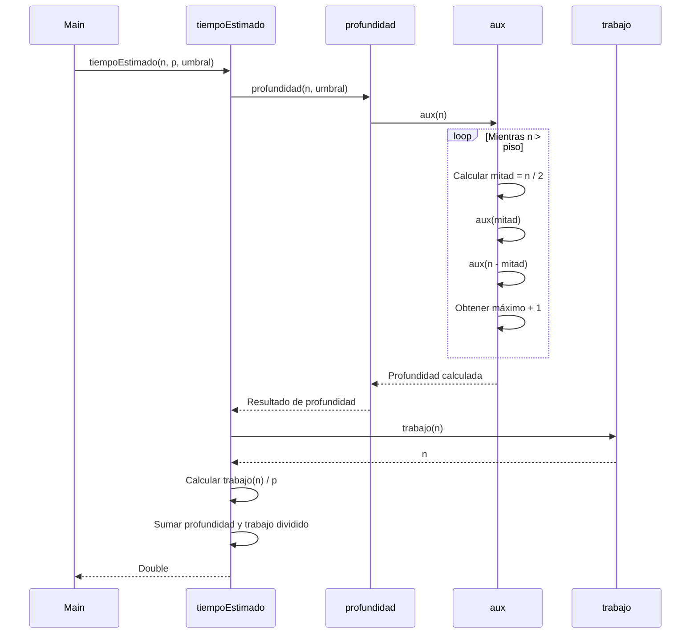

## Punto 4: Trabajo y profundidad

### Definición del algoritmo - `trabajo`

```scala
def trabajo(n: Int): Int = n
```

La función `trabajo` recibe un entero `n` y devuelve el mismo valor. Representa el número total de operaciones, considerando una operación por partícula.

Recibe un parámetro:

- n: Número de partículas u operaciones.

### Definición del algoritmo - `profundidad`

```scala
def profundidad(n: Int, umbral: Int): Int = {
  require(n >= 0, "El # de operaciones no puede ser negativo.")
  require(umbral > 0, "El umbral debe ser minimo 1.")

  val piso = math.max(umbral, 1)

  def aux(n: Int): Int = {
    if (n <= piso) n
    else {
      val mitad = n / 2
      math.max(aux(mitad), aux(n - mitad)) + 1
    }
  }

  aux(n)
}
```

La función `profundidad` recibe el número de operaciones `n` y un `umbral`. Divide el problema en dos partes hasta que cada parte tenga un tamaño menor o igual al umbral. Devuelve la profundidad máxima de las divisiones, incluyendo el tramo final que queda sin dividir.

Recibe dos parámetros:

- n: Número de operaciones que se deben procesar.

- umbral: Tamaño máximo permitido para dejar de dividir.

### Definición del algoritmo - `tiempoEstimado`

```scala
def tiempoEstimado(n: Int, p: Int, umbral: Int): Double = {
  require(p > 0, "El # de procesadores debe ser mayor a 0.")
  profundidad(n, umbral) + (trabajo(n)/p)
}
```

La función tiempoEstimado recibe el número de operaciones `n`, la cantidad de procesadores `p` y un `umbral`. Devuelve una estimación del tiempo mediante la suma de la profundidad y el trabajo dividido entre los procesadores.

Recibe tres parámetros:

- `n`: Número de operaciones.

- `p`: Cantidad de procesadores disponibles.

- `umbral`: Tamaño máximo de cada tramo antes de dejar de dividir.

### Explicación paso a paso

#### `profundidad( )`

- Se comprueba que n sea mayor o igual a cero y que umbral sea mayor que cero mediante require.

- Se calcula piso con math.max(umbral, 1). Como el umbral ya debe ser positivo, piso tendrá el mismo valor que umbral.

- Se llama a aux(n) para iniciar el cálculo.

- Si n <= piso, se devuelve n, porque el tramo ya no necesita dividirse.

- Si n > piso, se calcula mitad = n / 2.

- Se realizan dos llamadas recursivas:

  - aux(mitad): procesa la primera mitad.

  - aux(n - mitad): procesa la segunda mitad.

- Se toma el mayor resultado de ambas llamadas y se suma uno para contar la división actual.

#### `tiempoEstimado( )`
- Se comprueba que `p` sea mayor que cero mediante require.

- Se llama a `profundidad(n, umbral)` para calcular la profundidad del proceso.

- Se llama a `trabajo(n)` para obtener el número total de operaciones.

- Se divide el `trabajo` entre `p`.

- Se suman ambos resultados y se devuelve el valor como Double.

Importante: Como `trabajo(n)` y `p` son de tipo Int, la división `trabajo(n)/p` es una división entera. Por lo tanto, se descarta la parte decimal antes de sumarla a la profundidad.

### Diagrama de llamados

