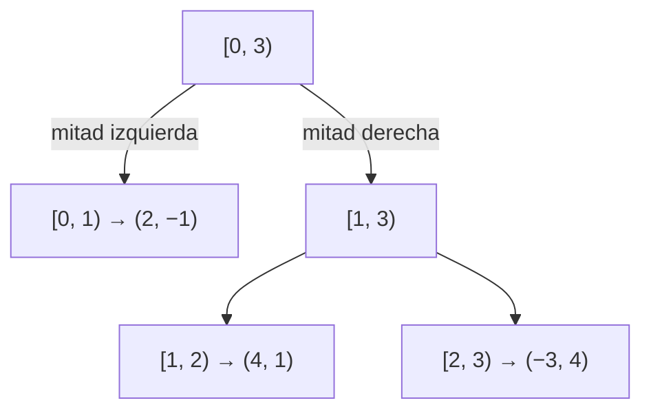

# Informe de proceso

Usamos tres partículas con índices $0,1,2$ y un paso $dt=0.5$.

| Índice | Posición | Velocidad | Masa |
| ---: | --- | --- | ---: |
| 0 | $(1,-1)$ | $(2,0)$ | 1 |
| 1 | $(4,2)$ | $(0,-2)$ | 2 |
| 2 | $(-2,3)$ | $(-2,2)$ | 3 |

## Punto 1. Avance

`mover` multiplica la velocidad por $dt$, suma el desplazamiento a la posición y copia la partícula con la posición nueva. Para la primera obtiene $(1,-1)+(1,0)=(2,-1)$.

`pasoSegmento(s, 0.5, 1, 3)` crea dos celdas. Las celdas $0$ y $1$ de la salida leen los índices $1$ y $2$ de la entrada y guardan las partículas movidas a $(4,1)$ y $(-3,4)$. `pasoSecuencial` llama al mismo cálculo para $[0,3)$ y obtiene las tres posiciones en ese orden.

`pasoParalelo(s, 0.5, 1)` divide en el índice $1$ y luego divide el tramo derecho en el índice $2$. Cada hoja llama a `pasoSegmento`. Cada llamada a `parallel` devuelve el par de resultados y la concatenación coloca el tramo izquierdo primero. Con umbral $3$ se ejecuta directamente `pasoSecuencial`.

La combinación empieza por el nodo derecho. Este devuelve las posiciones
$[(4,1),(-3,4)]$. La raíz antepone la salida del nodo izquierdo y devuelve
$[(2,-1),(4,1),(-3,4)]$, con las velocidades y masas de entrada.

## Punto 2. Magnitudes secuenciales

`energiaSecuencial` y `centroDeMasaSecuencial` fijan el umbral en $n$ y
resuelven el tramo entero en una hoja. `masaTotal` usa `foldLeft`. Los tres
recorridos acumulan de izquierda a derecha sobre las partículas de entrada.

| Índice procesado | Energía acumulada | Masa acumulada | Suma de posiciones ponderadas |
| ---: | ---: | ---: | --- |
| Inicio | 0 | 0 | $(0,0)$ |
| 0 | 2 | 1 | $(1,-1)$ |
| 1 | 6 | 3 | $(9,3)$ |
| 2 | 18 | 6 | $(3,12)$ |

Las rapideces al cuadrado son $4$, $4$ y $8$. Al terminar, `energiaSecuencial`
devuelve $18$, `masaTotal` devuelve $6$ y `centroDeMasaSecuencial` divide cada
coordenada de $(3,12)$ por $6$ para obtener $(0.5,2)$. Si la masa acumulada
es cero, devuelve el origen.

## Punto 3. Magnitudes paralelas

Con umbral $1$ los dos reductores usan el árbol de arriba. `energiaParalela` obtiene $2$, $4$ y $12$ en las hojas. El tramo derecho suma $4+12=16$ y la raíz suma $2+16=18$.

`centroDeMasaParalelo` emite en las hojas $((1,-1),1)$, $((8,4),2)$ y $((-6,9),3)$. La rama derecha combina sus hojas en $((2,13),5)$ y la raíz combina ambos resultados en $((3,12),6)$. La división final vuelve a dar $(0.5,2)$.

## Punto 4. Modelo de coste

`trabajo(3)` devuelve $3$. Con umbral $1$, `profundidad(3,1)` parte del nivel $0$ con longitud $3$. En el nivel $1$ hay longitudes $1$ y $2$. La primera ya es hoja y aporta $1+1=2$. La segunda se divide y sus hojas aportan $2+1=3$. La profundidad es el máximo, $3$. `tiempoEstimado(3,2,1)` suma $3+3/2=4.5$.

Con $11$ partículas y umbral $5$, el primer corte deja tramos de $5$ y $6$.
El de $5$ termina en el nivel $1$ con coste $1+5=6$. El de $6$ se divide en
dos hojas de $3$, cada una con coste $2+3=5$. En este caso la profundidad
es $6$ y corresponde a la rama que termina antes.

## Punto 5. Medición

`medir` pide a ScalaMeter calentar y medir el cuerpo en cada repetición. Ordena los tiempos y toma el elemento central. Si en tres repeticiones las muestras fueran $8,10,9$ ms, devolvería $9$ ms. `aceleracion(9,6)` divide y devuelve $1.5$. `umbralConveniente` mide cada candidato tres veces y selecciona el de menor mediana. Si los umbrales $1$ y $2$ dieran $11$ y $7$ ms, elegiría $2$. Con una lista vacía devuelve $3$ para este sistema.

`App` prepara cada arreglo fuera del bloque medido y compara ambos avances. En el control alterna cuál se mide primero y calcula las medianas por separado. Los tiempos de la ejecución están en [el informe de paralelización](paralelizacion.md).
