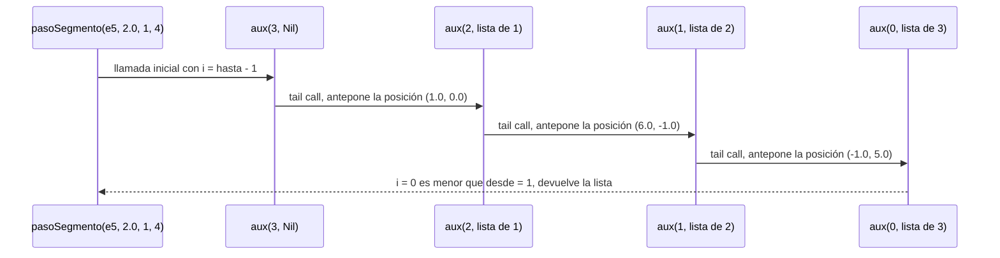
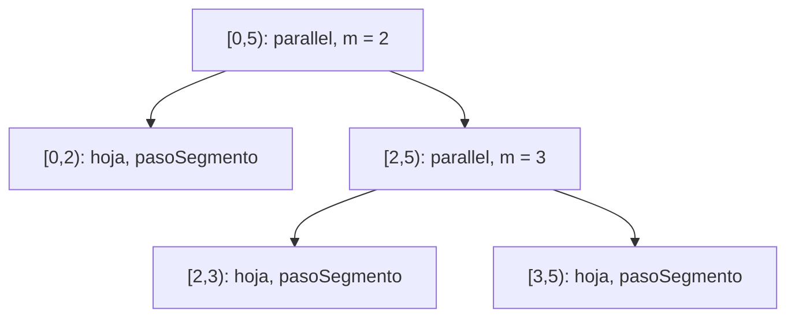
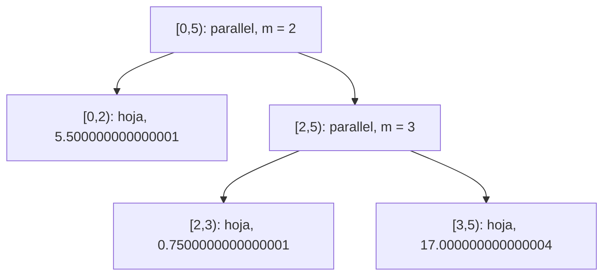
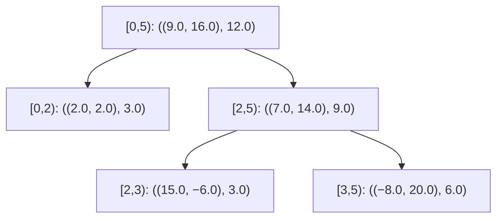

# Informe de proceso — Taller 4: simulación de partículas

## 0. Sistema de ejemplo

Se usa un sistema de cinco partículas, llamado `e5`, con `dt = 2.0` en el punto 1:

| índice | posición | velocidad | masa |
|---:|---|---|---:|
| 0 | (0, 0) | (1, 0) | 1.0 |
| 1 | (1, 1) | (−1, 2) | 2.0 |
| 2 | (5, −2) | (0.5, 0.5) | 3.0 |
| 3 | (−3, 4) | (2, −2) | 4.0 |
| 4 | (2, 2) | (0, −1) | 2.0 |

## 1. Punto 1: un paso de la simulación

### 1.1 `mover`

```Scala
def mover(p: Particula, dt: Double): Particula =
  Particula(p.pos + p.vel * dt, p.vel, p.masa)
```

Recibe una partícula y devuelve otra con la posición avanzada `vel * dt`. La velocidad y la masa se copian
sin cambios. No usa recursión, porque trabaja sobre una sola partícula.

### 1.2 `pasoSegmento`

```Scala
def pasoSegmento(s: Sistema, dt: Double, desde: Int, hasta: Int): Sistema = {
  // Recorre de hasta - 1 hacia desde anteponiendo, así la lista queda en orden.
  @tailrec
  def aux(i: Int, acc: List[Particula]): List[Particula] =
    if (i < desde) acc
    else aux(i - 1, mover(s(i), dt) :: acc)

  aux(hasta - 1, Nil).toArray
}
```

Es una **recursión de cola** (`@tailrec`) con un acumulador `acc`, la lista del resultado parcial.
Un estado es el par `(i, acc)`:

1. Empieza en `i = hasta - 1`, el último índice del tramo, con `acc = Nil`.
2. Si `i < desde`, el tramo ya se recorrió completo y devuelve `acc`.
3. Si no, calcula `mover(s(i), dt)`, lo **antepone** a `acc` y pasa a `i - 1`.
4. Como se recorre de derecha a izquierda y se antepone, la lista final queda en el **mismo orden** del tramo.
5. Al final `.toArray` convierte la lista en el `Sistema` que se devuelve.

Traza real de `pasoSegmento(e5, 2.0, 1, 4)`, el tramo de los índices 1, 2 y 3:

| llamado de `aux` | `i` | `acc` al entrar (solo posiciones) | qué ocurre |
|---:|---:|---|---|
| 1 | 3 | `[]` | `3 >= desde`: antepone mover(s(3)) = (1.0, 0.0) |
| 2 | 2 | `[(1.0, 0.0)]` | antepone mover(s(2)) = (6.0, −1.0) |
| 3 | 1 | `[(6.0, -1.0), (1.0, 0.0)]` | antepone mover(s(1)) = (−1.0, 5.0) |
| 4 | 0 | `[(-1.0, 5.0), (6.0, -1.0), (1.0, 0.0)]` | `0 < desde = 1`: **caso base**, devuelve `acc` |

Resultado ejecutado: posiciones `(-1.0, 5.0)`, `(6.0, -1.0)`, `(1.0, 0.0)` con las velocidades y masas originales de las
partículas 1, 2 y 3. Son tres partículas: ni se pierde ni se repite ninguna del tramo, y la partícula 0 y la 4 no
se tocan.



### 1.3 `pasoSecuencial`

```Scala
def pasoSecuencial(s: Sistema, dt: Double): Sistema =
  pasoSegmento(s, dt, 0, s.length)
```

Es el mismo cálculo sobre el tramo completo: de `0` incluido a `s.length` excluido. Traza real de
`pasoSecuencial(e5, 2.0)`:

| `i` | `acc` al entrar (solo posiciones) |
|---:|---|
| 4 | `[]` |
| 3 | `[(2.0, 0.0)]` |
| 2 | `[(1.0, 0.0), (2.0, 0.0)]` |
| 1 | `[(6.0, -1.0), (1.0, 0.0), (2.0, 0.0)]` |
| 0 | `[(-1.0, 5.0), (6.0, -1.0), (1.0, 0.0), (2.0, 0.0)]` |
| −1 | `[(2.0, 0.0), (-1.0, 5.0), (6.0, -1.0), (1.0, 0.0), (2.0, 0.0)]` → caso base |

Resultado ejecutado: `(2.0, 0.0)`, `(-1.0, 5.0)`, `(6.0, -1.0)`, `(1.0, 0.0)`, `(2.0, 0.0)`. Con el sistema vacío
el primer estado ya es `i = -1`, así que devuelve un arreglo vacío.

### 1.4 `pasoParalelo`

```Scala
def pasoParalelo(s: Sistema, dt: Double, umbral: Int): Sistema = {
  def aux(desde: Int, hasta: Int): Sistema =
    if (hasta - desde <= umbral || hasta - desde <= 1)
      pasoSegmento(s, dt, desde, hasta)
    else {
      val m = desde + (hasta - desde) / 2
      val (izq, der) = parallel(aux(desde, m), aux(m, hasta))
      izq ++ der
    }

  aux(0, s.length)
}
```

Aquí la recursión **no es de cola**: es una recursión **en árbol**, porque cada llamado lanza dos llamados
con `parallel`. La función auxiliar `aux(desde, hasta)` resuelve el tramo `[desde, hasta)`:

1. Si el tramo tiene a lo sumo `umbral` elementos, o a lo sumo un elemento, es una **hoja** y lo resuelve en
   secuencial con `pasoSegmento`.
2. Si no, calcula el punto medio `m = desde + (hasta - desde) / 2`, resuelve `[desde, m)` y `[m, hasta)`
   **a la vez** con `parallel`, y une los resultados con `izq ++ der`.

La condición «a lo sumo un elemento» garantiza que un tramo de una sola partícula nunca se parta, aunque el umbral
sea 0 o negativo (ver el informe de corrección).

**Traza real de `pasoParalelo(e5, 2.0, 2)`.** Qué tramo resuelve cada llamado:

| llamado | tramo | tamaño | decisión | resultado (posiciones) |
|---|---|---:|---|---|
| 1 | `[0,5)` | 5 | 5 > 2: parte con m = 2 | se arma al unir los dos hijos |
| 2 | `[0,2)` | 2 | hoja: `pasoSegmento` | `[(2.0, 0.0), (-1.0, 5.0)]` |
| 3 | `[2,5)` | 3 | 3 > 2: parte con m = 3 | se arma al unir los dos hijos |
| 4 | `[2,3)` | 1 | hoja | `[(6.0, -1.0)]` |
| 5 | `[3,5)` | 2 | hoja | `[(1.0, 0.0), (2.0, 0.0)]` |

La combinación se hace de abajo hacia arriba. `[2,5)` se obtiene con `[2,3) ++ [3,5)`, de tamaños 1 + 2 = 3, y
`[0,5)` con `[0,2) ++ [2,5)`, de tamaños 2 + 3 = 5. Resultado ejecutado, igual al de `pasoSecuencial`:
`(2.0, 0.0)`, `(-1.0, 5.0)`, `(6.0, -1.0)`, `(1.0, 0.0)`, `(2.0, 0.0)`.



> Como las dos mitades corren en hilos distintos, el orden en que aparecen las líneas en la consola cambia de una
> ejecución a otra. La tabla anterior está ordenada por tramo, no por orden de impresión. El resultado final
> no depende de ese orden.

**Con umbral 1** (`pasoParalelo(e5, 2.0, 1)`, ejecutado) el árbol se parte hasta tener cinco hojas de un elemento
(`[0,1)`, `[1,2)`, `[2,3)`, `[3,4)`, `[4,5)`) y cuatro particiones: `[0,5)` con m = 2, `[0,2)` con m = 1,
`[2,5)` con m = 3 y `[3,5)` con m = 4. El resultado es el mismo. En un árbol binario con 5 hojas hay 4 nodos
internos, y eso es lo que se observó.

## 2. Punto 2: magnitudes globales (secuencial)

Las tres funciones son recursiones de cola sobre el índice `i`, con acumuladores.

### 2.1 `energiaSecuencial`

```Scala
def energiaSecuencial(s: Sistema): Double = {
  @tailrec
  def aux(i: Int, acc: Double): Double =
    if (i >= s.length) acc
    else {
      val v = s(i).vel.norma
      aux(i + 1, acc + 0.5 * s(i).masa * v * v)
    }

  aux(0, 0.0)
}
```

En cada paso suma a `acc` la energía cinética de la partícula `i`: media masa por el cuadrado de la norma de su
velocidad. Se detiene cuando `i >= s.length`. Traza real sobre `e5`:

| `i` | `acc` al entrar | partícula que se suma |
|---:|---:|---|
| 0 | 0.0 | índice 0 |
| 1 | 0.5 | índice 1 |
| 2 | 5.500000000000001 | índice 2 |
| 3 | 6.250000000000001 | índice 3 |
| 4 | 22.250000000000004 | índice 4 |
| 5 | 23.250000000000004 | **caso base**: devuelve `acc` |

El resultado ejecutado es `23.250000000000004`. El valor exacto en los reales es 23.25 y la diferencia
es el redondeo de `Double`; por eso las pruebas comparan con tolerancia. Con el sistema vacío devuelve `0.0`
sin sumar nada.

### 2.2 `masaTotal`

```Scala
def masaTotal(s: Sistema): Double = {
  @tailrec
  def aux(i: Int, acc: Double): Double =
    if (i >= s.length) acc
    else aux(i + 1, acc + s(i).masa)

  aux(0, 0.0)
}
```

Misma estructura que la anterior, pero sumando `s(i).masa`. Traza real: `acc` vale 0.0, 1.0, 3.0, 6.0, 10.0 y 12.0 al
entrar con `i` = 0, 1, 2, 3, 4 y 5. Resultado ejecutado: `12.0`.

### 2.3 `centroDeMasaSecuencial`

```Scala
def centroDeMasaSecuencial(s: Sistema): Vector2 = {
  @tailrec
  def aux(i: Int, ponderada: Vector2, masa: Double): (Vector2, Double) =
    if (i >= s.length) (ponderada, masa)
    else aux(i + 1, ponderada + s(i).pos * s(i).masa, masa + s(i).masa)

  val (ponderada, masa) = aux(0, Vector2(0, 0), 0.0)
  if (masa == 0.0) Vector2(0, 0)
  else Vector2(ponderada.x / masa, ponderada.y / masa)
}
```

La auxiliar lleva **dos** acumuladores en un solo recorrido: la suma de las posiciones ponderadas por la masa
(`ponderada`) y la masa acumulada (`masa`). Cuando termina el recorrido, la función divide **una sola vez**:
si `masa == 0.0` devuelve el origen `Vector2(0, 0)` y si no, divide cada componente entre `masa`. Traza real
sobre `e5`:

| `i` | `ponderada` al entrar | `masa` al entrar |
|---:|---|---:|
| 0 | (0.0, 0.0) | 0.0 |
| 1 | (0.0, 0.0) | 1.0 |
| 2 | (2.0, 2.0) | 3.0 |
| 3 | (17.0, −4.0) | 6.0 |
| 4 | (5.0, 12.0) | 10.0 |
| 5 | (9.0, 16.0) | 12.0 → **caso base** |

Resultado ejecutado: `Vector2(0.75, 1.3333333333333333)`, que es (9.0 / 12.0, 16.0 / 12.0).
Con el sistema vacío, o con todas las masas en cero, el estado final tiene `masa = 0.0` y
se devuelve el origen sin dividir 0 entre 0.

## 3. Punto 3: las magnitudes en paralelo

Las dos funciones siguen el mismo árbol de `pasoParalelo` de la sección 1.4: mismo criterio de hoja
(`hasta - desde <= umbral || hasta - desde <= 1`), mismo punto de partición `m = desde + (hasta - desde) / 2`,
mismo `parallel` con la espera de la mitad derecha al final. Lo que cambia es lo que devuelve cada llamado y
con qué se combinan los resultados parciales.

### 3.1 `energiaParalela`

```Scala
def energiaParalela(s: Sistema, umbral: Int): Double = {
  // Hoja: el mismo recorrido de cola de energiaSecuencial, con el
  // acumulador acc, pero detenido en el tramo [desde, hasta).
  @tailrec
  def hoja(i: Int, hasta: Int, acc: Double): Double =
    if (i >= hasta) acc
    else {
      val v = s(i).vel.norma
      hoja(i + 1, hasta, acc + 0.5 * s(i).masa * v * v)
    }

  // Mismo árbol de pasoParalelo: mismo criterio de hoja, misma mitad.
  // Lo que combina los parciales es la suma, que es asociativa.
  def aux(desde: Int, hasta: Int): Double =
    if (hasta - desde <= umbral || hasta - desde <= 1)
      hoja(desde, hasta, 0.0)
    else {
      val m = desde + (hasta - desde) / 2
      val (e1, e2) = parallel(aux(desde, m), aux(m, hasta))
      e1 + e2
    }

  aux(0, s.length)
}
```

Cada llamada devuelve un número. La hoja es el recorrido de cola de `energiaSecuencial` (sección 2.1) con el
mismo acumulador `acc`, detenido en el tramo; el nodo interior suma las dos mitades. La suma es asociativa, y
ese es el permiso para repartir: el orden en que lleguen los parciales no cambia el resultado.

**Traza real de `energiaParalela(e5, 2)`.** Mismo árbol que `pasoParalelo(e5, 2.0, 2)` de la sección 1.4:

| llamado | tramo | tamaño | decisión | resultado |
|---|---|---:|---|---:|
| 1 | `[0,5)` | 5 | 5 > 2: parte con m = 2 | se arma al sumar los dos hijos |
| 2 | `[0,2)` | 2 | hoja | 5.500000000000001 |
| 3 | `[2,5)` | 3 | 3 > 2: parte con m = 3 | se arma al sumar los dos hijos |
| 4 | `[2,3)` | 1 | hoja | 0.7500000000000001 |
| 5 | `[3,5)` | 2 | hoja | 17.000000000000004 |

La combinación sube igual que en el punto 1: `[2,5) = 0.7500000000000001 + 17.000000000000004 =
17.750000000000004`, y `[0,5) = 5.500000000000001 + 17.750000000000004 = 23.250000000000004`. Resultado
ejecutado: **23.250000000000004**, la misma cifra de `energiaSecuencial` (sección 2.1): el árbol agrupa las
mismas sumas de otra manera y, en este sistema, el redondeo coincidió bit a bit. En general la igualdad se
garantiza **hasta el redondeo** de la suma en `Double`, y por eso las pruebas comparan con tolerancia (ver el
informe de corrección, sección 6.1).



### 3.2 `centroDeMasaParalelo`

```Scala
def centroDeMasaParalelo(s: Sistema, umbral: Int): Vector2 = {
  // Hoja: el mismo recorrido de dos acumuladores de centroDeMasaSecuencial,
  // sobre el tramo. Cada llamada devuelve la pareja (ponderada, masa) del
  // tramo, que es lo que se puede combinar sumando; el promedio no.
  @tailrec
  def hoja(i: Int, hasta: Int, ponderada: Vector2, masa: Double): (Vector2, Double) =
    if (i >= hasta) (ponderada, masa)
    else hoja(i + 1, hasta, ponderada + s(i).pos * s(i).masa, masa + s(i).masa)

  def aux(desde: Int, hasta: Int): (Vector2, Double) =
    if (hasta - desde <= umbral || hasta - desde <= 1)
      hoja(desde, hasta, Vector2(0, 0), 0.0)
    else {
      val m = desde + (hasta - desde) / 2
      val ((pi, mi), (pd, md)) = parallel(aux(desde, m), aux(m, hasta))
      (pi + pd, mi + md)
    }

  val (ponderada, masa) = aux(0, s.length)
  if (masa == 0.0) Vector2(0, 0)
  else Vector2(ponderada.x / masa, ponderada.y / masa)
}
```

Lo que viaja por el árbol **no es el promedio**: cada llamada devuelve la **pareja de sumas** del tramo,
(ponderada, masa) — los mismos dos acumuladores de `centroDeMasaSecuencial` (sección 2.3), pero sin dividir —,
la combinación suma componente a componente, y la división única al final es la misma de la secuencial. Por
qué la suma sí se puede combinar y el promedio no, está argumentado en el informe de corrección (sección
6.2); aquí, los números.

**Traza real de `centroDeMasaParalelo(e5, 2)`:**

| llamado | tramo | decisión | pareja devuelta (ponderada, masa) |
|---|---|---|---|
| 1 | `[0,5)` | parte con m = 2 | `((9.0, 16.0), 12.0)` |
| 2 | `[0,2)` | hoja | `((2.0, 2.0), 3.0)` |
| 3 | `[2,5)` | parte con m = 3 | `((7.0, 14.0), 9.0)` |
| 4 | `[2,3)` | hoja | `((15.0, −6.0), 3.0)` |
| 5 | `[3,5)` | hoja | `((−8.0, 20.0), 6.0)` |

La combinación: `[2,5) = ((15.0, −6.0), 3.0) ⊕ ((−8.0, 20.0), 6.0) = ((7.0, 14.0), 9.0)` y `[0,5) =
((2.0, 2.0), 3.0) ⊕ ((7.0, 14.0), 9.0) = ((9.0, 16.0), 12.0)`. Resultado ejecutado:
**Vector2(0.75, 1.3333333333333333)**, exactamente lo que da `centroDeMasaSecuencial` (sección 2.3).

**La trampa, con estos números.** Las mitades `[0,2)` y `[2,5)` no pesan igual: masas 3 y 9. Si cada mitad
devolviera su promedio, tendrían centros (0.6666666666666666, 0.6666666666666666) y
(0.7777777777777778, 1.5555555555555556), y el promedio de los dos promedios daría
(0.7222222222222222, 1.1111111111111112), que no es el centro de nada. El correcto, el de la versión de
sumas, es (0.75, 1.3333333333333333). La prueba
`centroDeMasaParalelo: con mitades de masas 3 y 9, la suma da el centro y el promedio de promedios no`
ejecuta este caso exacto.



## 4. Punto 4: trabajo, profundidad y tiempo estimado

```Scala
def trabajo(n: Int): Int = n

def profundidad(n: Int, umbral: Int): Int =
  if (n <= umbral || n <= 1) n
  else 1 + profundidad(n - n / 2, umbral)

def tiempoEstimado(n: Int, p: Int, umbral: Int): Double =
  profundidad(n, umbral) + trabajo(n).toDouble / p
```

`trabajo` es la identidad: una operación por partícula, que repartir no reduce. `profundidad` cuenta las
particiones del **camino más largo** del árbol de `pasoParalelo`, más el tramo que queda sin partir: la mitad
que se sigue partiendo es la mayor, `n - n/2`, porque es la que fija ese camino, y el tope `n <= 1` es el
mismo criterio de la guarda de `pasoParalelo`, por eso con umbral 0 tampoco se queda sin fondo.

**Traza real de `profundidad(1024, 512)`:**

| llamado | `n` | decisión |
|---:|---:|---|
| 1 | 1024 | 1024 > 512: una partición; se sigue con la mitad mayor, 512 |
| 2 | 512 | 512 <= 512: **caso base**, devuelve el tramo de 512 |

Resultado: `1 + 512 = 513`.

**Traza real de `profundidad(5, 2)`:** 5 > 2 → `1 + profundidad(3, 2)`; 3 > 2 → `1 + profundidad(2, 2)`;
`2 <= 2` → `2`. Total `1 + 1 + 2 = 4`. Coincide con el árbol de `pasoParalelo(e5, 2.0, 2)` de la sección 1.4,
que se ejecutó con 3 hojas y 2 particiones: el camino más largo cruza dos particiones y termina en una hoja
de tamaño 2, y `2 + 2 = 4`.

**Traza real de `tiempoEstimado(1024, 4, 1)`:** `profundidad(1024, 1) = 11` (diez particiones y un elemento;
es el mismo árbol que `pasoParalelo(e5, 2.0, 1)` de la sección 1.4 pero con 1024 partículas) y
`trabajo(1024) / 4 = 256.0`. Resultado ejecutado: **267.0**. El uso de esta estimación contra los tiempos
medidos está en el informe de paralelización.