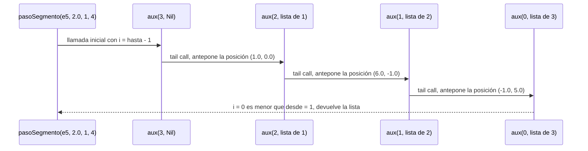
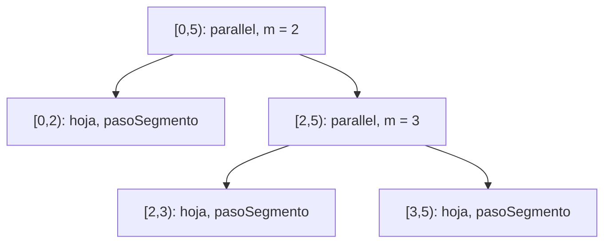

# Informe de proceso — Taller 4: simulación de partículas

## 0. Sistema de ejemplo

Se usa un sistema de cinco partículas, llamado `e5`, con `dt = 2.0` en el punto 1:

| índice | posición | velocidad | masa |
|---:|---|---|---:|
| 0 | (0, 0) | (1, 0) | 1.0 |
| 1 | (1, 1) | (−1, 2) | 2.0 |
| 2 | (5, −2) | (0.5, 0.5) | 3.0 |
| 3 | (−3, 4) | (2, −2) | 4.0 |
| 4 | (2, 2) | (0, −1) | 2.0 |

## 1. Punto 1: un paso de la simulación

### 1.1 `mover`

```Scala
def mover(p: Particula, dt: Double): Particula =
  Particula(p.pos + p.vel * dt, p.vel, p.masa)
```

Recibe una partícula y devuelve otra con la posición avanzada `vel * dt`. La velocidad y la masa se copian
sin cambios. No usa recursión, porque trabaja sobre una sola partícula.

### 1.2 `pasoSegmento`

```Scala
def pasoSegmento(s: Sistema, dt: Double, desde: Int, hasta: Int): Sistema = {
  // Recorre de hasta - 1 hacia desde anteponiendo, así la lista queda en orden.
  @tailrec
  def aux(i: Int, acc: List[Particula]): List[Particula] =
    if (i < desde) acc
    else aux(i - 1, mover(s(i), dt) :: acc)

  aux(hasta - 1, Nil).toArray
}
```

Es una **recursión de cola** (`@tailrec`) con un acumulador `acc`, la lista del resultado parcial.
Un estado es el par `(i, acc)`:

1. Empieza en `i = hasta - 1`, el último índice del tramo, con `acc = Nil`.
2. Si `i < desde`, el tramo ya se recorrió completo y devuelve `acc`.
3. Si no, calcula `mover(s(i), dt)`, lo **antepone** a `acc` y pasa a `i - 1`.
4. Como se recorre de derecha a izquierda y se antepone, la lista final queda en el **mismo orden** del tramo.
5. Al final `.toArray` convierte la lista en el `Sistema` que se devuelve.

Traza real de `pasoSegmento(e5, 2.0, 1, 4)`, el tramo de los índices 1, 2 y 3:

| llamado de `aux` | `i` | `acc` al entrar (solo posiciones) | qué ocurre |
|---:|---:|---|---|
| 1 | 3 | `[]` | `3 >= desde`: antepone mover(s(3)) = (1.0, 0.0) |
| 2 | 2 | `[(1.0, 0.0)]` | antepone mover(s(2)) = (6.0, −1.0) |
| 3 | 1 | `[(6.0, -1.0), (1.0, 0.0)]` | antepone mover(s(1)) = (−1.0, 5.0) |
| 4 | 0 | `[(-1.0, 5.0), (6.0, -1.0), (1.0, 0.0)]` | `0 < desde = 1`: **caso base**, devuelve `acc` |

Resultado ejecutado: posiciones `(-1.0, 5.0)`, `(6.0, -1.0)`, `(1.0, 0.0)` con las velocidades y masas originales de las
partículas 1, 2 y 3. Son tres partículas: ni se pierde ni se repite ninguna del tramo, y la partícula 0 y la 4 no
se tocan.



### 1.3 `pasoSecuencial`

```Scala
def pasoSecuencial(s: Sistema, dt: Double): Sistema =
  pasoSegmento(s, dt, 0, s.length)
```

Es el mismo cálculo sobre el tramo completo: de `0` incluido a `s.length` excluido. Traza real de
`pasoSecuencial(e5, 2.0)`:

| `i` | `acc` al entrar (solo posiciones) |
|---:|---|
| 4 | `[]` |
| 3 | `[(2.0, 0.0)]` |
| 2 | `[(1.0, 0.0), (2.0, 0.0)]` |
| 1 | `[(6.0, -1.0), (1.0, 0.0), (2.0, 0.0)]` |
| 0 | `[(-1.0, 5.0), (6.0, -1.0), (1.0, 0.0), (2.0, 0.0)]` |
| −1 | `[(2.0, 0.0), (-1.0, 5.0), (6.0, -1.0), (1.0, 0.0), (2.0, 0.0)]` → caso base |

Resultado ejecutado: `(2.0, 0.0)`, `(-1.0, 5.0)`, `(6.0, -1.0)`, `(1.0, 0.0)`, `(2.0, 0.0)`. Con el sistema vacío
el primer estado ya es `i = -1`, así que devuelve un arreglo vacío.

### 1.4 `pasoParalelo`

```Scala
def pasoParalelo(s: Sistema, dt: Double, umbral: Int): Sistema = {
  def aux(desde: Int, hasta: Int): Sistema =
    if (hasta - desde <= umbral || hasta - desde <= 1)
      pasoSegmento(s, dt, desde, hasta)
    else {
      val m = desde + (hasta - desde) / 2
      val (izq, der) = parallel(aux(desde, m), aux(m, hasta))
      izq ++ der
    }

  aux(0, s.length)
}
```

Aquí la recursión **no es de cola**: es una recursión **en árbol**, porque cada llamado lanza dos llamados
con `parallel`. La función auxiliar `aux(desde, hasta)` resuelve el tramo `[desde, hasta)`:

1. Si el tramo tiene a lo sumo `umbral` elementos, o a lo sumo un elemento, es una **hoja** y lo resuelve en
   secuencial con `pasoSegmento`.
2. Si no, calcula el punto medio `m = desde + (hasta - desde) / 2`, resuelve `[desde, m)` y `[m, hasta)`
   **a la vez** con `parallel`, y une los resultados con `izq ++ der`.

La condición «a lo sumo un elemento» garantiza que un tramo de una sola partícula nunca se parta, aunque el umbral
sea 0 o negativo (ver el informe de corrección).

**Traza real de `pasoParalelo(e5, 2.0, 2)`.** Qué tramo resuelve cada llamado:

| llamado | tramo | tamaño | decisión | resultado (posiciones) |
|---|---|---:|---|---|
| 1 | `[0,5)` | 5 | 5 > 2: parte con m = 2 | se arma al unir los dos hijos |
| 2 | `[0,2)` | 2 | hoja: `pasoSegmento` | `[(2.0, 0.0), (-1.0, 5.0)]` |
| 3 | `[2,5)` | 3 | 3 > 2: parte con m = 3 | se arma al unir los dos hijos |
| 4 | `[2,3)` | 1 | hoja | `[(6.0, -1.0)]` |
| 5 | `[3,5)` | 2 | hoja | `[(1.0, 0.0), (2.0, 0.0)]` |

La combinación se hace de abajo hacia arriba. `[2,5)` se obtiene con `[2,3) ++ [3,5)`, de tamaños 1 + 2 = 3, y
`[0,5)` con `[0,2) ++ [2,5)`, de tamaños 2 + 3 = 5. Resultado ejecutado, igual al de `pasoSecuencial`:
`(2.0, 0.0)`, `(-1.0, 5.0)`, `(6.0, -1.0)`, `(1.0, 0.0)`, `(2.0, 0.0)`.



> Como las dos mitades corren en hilos distintos, el orden en que aparecen las líneas en la consola cambia de una
> ejecución a otra. La tabla anterior está ordenada por tramo, no por orden de impresión. El resultado final
> no depende de ese orden.

**Con umbral 1** (`pasoParalelo(e5, 2.0, 1)`, ejecutado) el árbol se parte hasta tener cinco hojas de un elemento
(`[0,1)`, `[1,2)`, `[2,3)`, `[3,4)`, `[4,5)`) y cuatro particiones: `[0,5)` con m = 2, `[0,2)` con m = 1,
`[2,5)` con m = 3 y `[3,5)` con m = 4. El resultado es el mismo. En un árbol binario con 5 hojas hay 4 nodos
internos, y eso es lo que se observó.

## 2. Punto 2: magnitudes globales (secuencial)

Las tres funciones son recursiones de cola sobre el índice `i`, con acumuladores.

### 2.1 `energiaSecuencial`

```Scala
def energiaSecuencial(s: Sistema): Double = {
  @tailrec
  def aux(i: Int, acc: Double): Double =
    if (i >= s.length) acc
    else {
      val v = s(i).vel.norma
      aux(i + 1, acc + 0.5 * s(i).masa * v * v)
    }

  aux(0, 0.0)
}
```

En cada paso suma a `acc` la energía cinética de la partícula `i`: media masa por el cuadrado de la norma de su
velocidad. Se detiene cuando `i >= s.length`. Traza real sobre `e5`:

| `i` | `acc` al entrar | partícula que se suma |
|---:|---:|---|
| 0 | 0.0 | índice 0 |
| 1 | 0.5 | índice 1 |
| 2 | 5.500000000000001 | índice 2 |
| 3 | 6.250000000000001 | índice 3 |
| 4 | 22.250000000000004 | índice 4 |
| 5 | 23.250000000000004 | **caso base**: devuelve `acc` |

El resultado ejecutado es `23.250000000000004`. El valor exacto en los reales es 23.25 y la diferencia
es el redondeo de `Double`; por eso las pruebas comparan con tolerancia. Con el sistema vacío devuelve `0.0`
sin sumar nada.

### 2.2 `masaTotal`

```Scala
def masaTotal(s: Sistema): Double = {
  @tailrec
  def aux(i: Int, acc: Double): Double =
    if (i >= s.length) acc
    else aux(i + 1, acc + s(i).masa)

  aux(0, 0.0)
}
```

Misma estructura que la anterior, pero sumando `s(i).masa`. Traza real: `acc` vale 0.0, 1.0, 3.0, 6.0, 10.0 y 12.0 al
entrar con `i` = 0, 1, 2, 3, 4 y 5. Resultado ejecutado: `12.0`.

### 2.3 `centroDeMasaSecuencial`

```Scala
def centroDeMasaSecuencial(s: Sistema): Vector2 = {
  @tailrec
  def aux(i: Int, ponderada: Vector2, masa: Double): (Vector2, Double) =
    if (i >= s.length) (ponderada, masa)
    else aux(i + 1, ponderada + s(i).pos * s(i).masa, masa + s(i).masa)

  val (ponderada, masa) = aux(0, Vector2(0, 0), 0.0)
  if (masa == 0.0) Vector2(0, 0)
  else Vector2(ponderada.x / masa, ponderada.y / masa)
}
```

La auxiliar lleva **dos** acumuladores en un solo recorrido: la suma de las posiciones ponderadas por la masa
(`ponderada`) y la masa acumulada (`masa`). Cuando termina el recorrido, la función divide **una sola vez**:
si `masa == 0.0` devuelve el origen `Vector2(0, 0)` y si no, divide cada componente entre `masa`. Traza real
sobre `e5`:

| `i` | `ponderada` al entrar | `masa` al entrar |
|---:|---|---:|
| 0 | (0.0, 0.0) | 0.0 |
| 1 | (0.0, 0.0) | 1.0 |
| 2 | (2.0, 2.0) | 3.0 |
| 3 | (17.0, −4.0) | 6.0 |
| 4 | (5.0, 12.0) | 10.0 |
| 5 | (9.0, 16.0) | 12.0 → **caso base** |

Resultado ejecutado: `Vector2(0.75, 1.3333333333333333)`, que es (9.0 / 12.0, 16.0 / 12.0).
Con el sistema vacío, o con todas las masas en cero, el estado final tiene `masa = 0.0` y
se devuelve el origen sin dividir 0 entre 0.

## 3. Puntos 3, 4 y 5

> **Pendiente, a cargo de los demás integrantes del grupo:** `energiaParalela`, `centroDeMasaParalelo`
> (punto 3), `trabajo`, `profundidad`, `tiempoEstimado` (punto 4) y `aceleracion`, `umbralConveniente` (punto 5).
> Su traza y su diagrama van en esta sección, con el mismo formato.