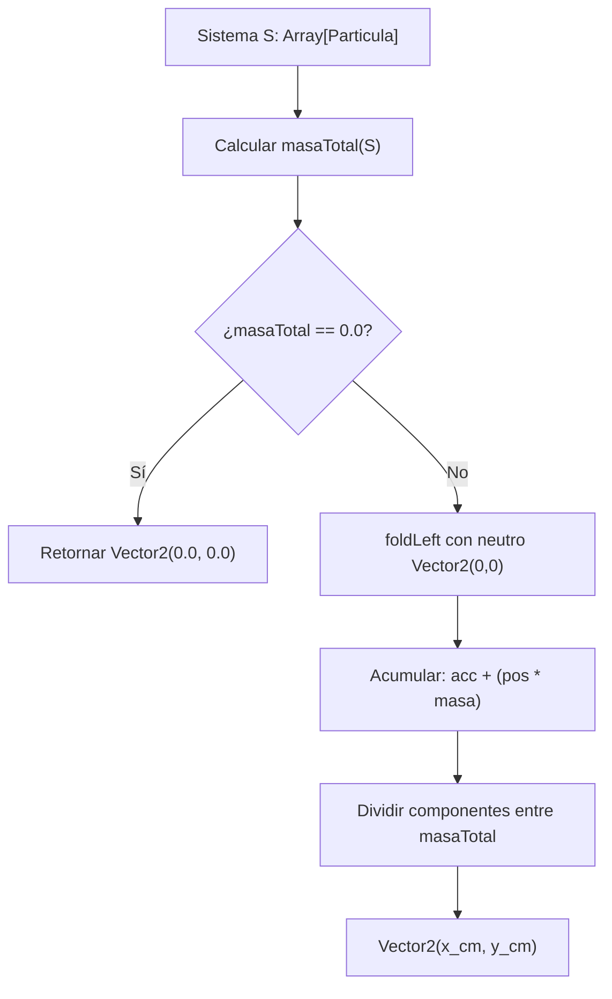

# Informe de Proceso — Taller 4: Simulación de Partículas en Paralelo

## 1. Punto 1: Un paso de la simulación
*(Implementado por DilanG26)*
- `mover(p: Particula, dt: Double)`: Actualiza la posición de una partícula según $\vec{r}_{nuevo} = \vec{r} + \vec{v} \cdot dt$. La velocidad y la masa permanecen invariantes.
- `pasoSecuencial(s: Sistema, dt: Double)`: Aplica `pasoSegmento` sobre el rango total $[0, n)$.
- `pasoSegmento(s: Sistema, dt: Double, desde: Int, hasta: Int)`: Transforma funcionalmente el subrango $[\text{desde}, \text{hasta})$ generando un nuevo arreglo con cada partícula movida.
- `pasoParalelo(s: Sistema, dt: Double, umbral: Int)`: Divide recursivamente el sistema en dos mitades con `parallel` mientras el tamaño del segmento sea mayor al umbral dado; por debajo de dicho umbral, resuelve el tramo en secuencial con `pasoSegmento`.

---

## 2. Punto 2: Magnitudes Globales (Secuencial)
*(Implementado por iRenly / Georsuans Giraldo)*

### 2.1. Definición y Enfoque Funcional
El Punto 2 calcula las magnitudes físicas fundamentales que resumen el estado global del sistema de partículas, garantizando pureza referencial, inmutabilidad y ausencia de efectos colaterales:

1. **`energiaSecuencial(s: Sistema): Double`**:
   Calcula la energía cinética total del sistema mediante la suma de la energía cinética de cada cuerpo:
   $$E = \sum_{p \in s} \frac{1}{2} m_p \|\vec{v}_p\|^2$$
   Se implementa transformando funcionalmente cada partícula con `map` a su energía escalar $\frac{1}{2} m v^2$ y agregando los valores con `.sum`. Si el sistema está vacío, la suma sobre la colección vacía retorna naturalmente `0.0`.

2. **`masaTotal(s: Sistema): Double`**:
   Calcula la masa escalar agregada de todo el sistema:
   $$M = \sum_{p \in s} m_p$$
   Se implementa proyectando la masa de cada partícula mediante `s.map(_.masa)` y calculando la suma escalar. Para un sistema sin partículas, retorna `0.0`.

3. **`centroDeMasaSecuencial(s: Sistema): Vector2`**:
   Calcula la posición promedio ponderada por la masa de todo el conjunto de partículas:
   $$\vec{R}_{cm} = \frac{1}{M} \sum_{p \in s} m_p \vec{r}_p$$
   - Si la masa total $M = 0$, retorna directamente el vector origen $\vec{0} = (0.0, 0.0)$, previniendo indeterminaciones o divisiones por cero.
   - Si $M > 0$, acumula vectorialmente la suma ponderada $\sum m_p \vec{r}_p$ mediante `foldLeft` partiendo del neutro aditivo `Vector2(0.0, 0.0)` y divide el vector acumulado entre la masa escalar total $M$.

### 2.2. Traza de Ejecución Paso a Paso
Consideremos el sistema físico $S = [p_1, p_2]$:
* $p_1$: $\vec{r}_1 = (0.0, 0.0)$, $\vec{v}_1 = (3.0, 4.0)$, $m_1 = 2.0$ (con $\|\vec{v}_1\| = \sqrt{3^2 + 4^2} = 5.0$).
* $p_2$: $\vec{r}_2 = (4.0, 0.0)$, $\vec{v}_2 = (0.0, 0.0)$, $m_2 = 2.0$ (con $\|\vec{v}_2\| = 0.0$).

#### Traza de `energiaSecuencial(S)`:
1. Elemento 0 ($p_1$): $\frac{1}{2} \cdot 2.0 \cdot (5.0)^2 = 1.0 \cdot 25.0 = 25.0$.
2. Elemento 1 ($p_2$): $\frac{1}{2} \cdot 2.0 \cdot (0.0)^2 = 0.0$.
3. Suma agregada: $25.0 + 0.0 = 25.0$.

#### Traza de `masaTotal(S)`:
1. Elemento 0 ($p_1$): $m_1 = 2.0$.
2. Elemento 1 ($p_2$): $m_2 = 2.0$.
3. Suma agregada: $2.0 + 2.0 = 4.0$.

#### Traza de `centroDeMasaSecuencial(S)`:
1. Cálculo de $M = \text{masaTotal}(S) = 4.0 \neq 0.0$.
2. Inicialización del acumulador en `foldLeft`: `acc = Vector2(0.0, 0.0)`.
3. Paso 1 ($p_1$): `acc = Vector2(0.0, 0.0) + (Vector2(0.0, 0.0) * 2.0) = Vector2(0.0, 0.0)`.
4. Paso 2 ($p_2$): `acc = Vector2(0.0, 0.0) + (Vector2(4.0, 0.0) * 2.0) = Vector2(8.0, 0.0)`.
5. Normalización final: `Vector2(8.0 / 4.0, 0.0 / 4.0) = Vector2(2.0, 0.0)`.

### 2.3. Diagrama de Flujo del Proceso

