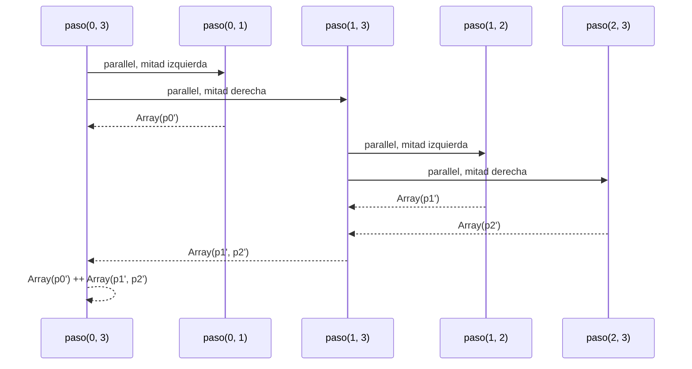
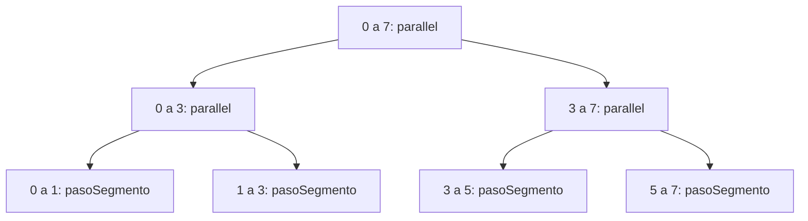

# Informe de proceso: un paso de la simulación de partículas

## Las funciones del punto 1

```Scala
def mover(p: Particula, dt: Double): Particula =
  p.copy(pos = p.pos + p.vel * dt)

def pasoSecuencial(s: Sistema, dt: Double): Sistema =
  pasoSegmento(s, dt, 0, s.length)

def pasoSegmento(s: Sistema, dt: Double, desde: Int, hasta: Int): Sistema =
  (for (i <- desde until hasta) yield mover(s(i), dt)).toArray

def pasoParalelo(s: Sistema, dt: Double, umbral: Int): Sistema = {
  val piso = Math.max(umbral, 1)

  def paso(desde: Int, hasta: Int): Sistema =
    if (hasta - desde <= piso) pasoSegmento(s, dt, desde, hasta)
    else {
      val mitad = desde + (hasta - desde) / 2
      val (izquierda, derecha) = parallel(paso(desde, mitad), paso(mitad, hasta))
      izquierda ++ derecha
    }

  paso(0, s.length)
}
```

* `mover` mueve **una** partícula: la posición nueva es la anterior más la
  velocidad por `dt`. `copy` cambia solo `pos`, así que la velocidad y la masa
  quedan como estaban.
* `pasoSegmento` aplica `mover` a las partículas de los índices `desde`
  (incluido) hasta `hasta` (excluido) y devuelve un arreglo **nuevo** con
  `hasta - desde` partículas. El sistema original `s` nunca se modifica.
* `pasoSecuencial` es `pasoSegmento` sobre todo el sistema. Así la versión
  secuencial y la paralela hacen el mismo trabajo de la misma forma.
* `pasoParalelo` parte el sistema por la mitad mientras el tramo tenga más
  elementos que el umbral. Los tramos que ya no se parten se resuelven con
  `pasoSegmento`, y las dos mitades de cada partición se entregan a `parallel`.

## Explicación paso a paso de `pasoParalelo`

### El piso del umbral

```Scala
val piso = Math.max(umbral, 1)
```

Un tramo de una sola partícula no se puede partir en dos tramos más chicos.
Con un umbral de 0 o negativo, la condición `hasta - desde <= umbral` nunca se
cumpliría y la función se llamaría a sí misma sin terminar. El piso hace que
cualquier umbral menor que 1 se comporte como 1.

### Caso base

```Scala
if (hasta - desde <= piso) pasoSegmento(s, dt, desde, hasta)
```

Si el tramo tiene `piso` partículas o menos, ya no se reparte: se resuelve en
secuencial con `pasoSegmento`. Esto incluye el tramo vacío (`desde == hasta`).

### Caso recursivo

```Scala
val mitad = desde + (hasta - desde) / 2
val (izquierda, derecha) = parallel(paso(desde, mitad), paso(mitad, hasta))
izquierda ++ derecha
```

En cada llamado:

* Se calcula `mitad`. La división entera hace que, si el tramo tiene un número
  impar de partículas, la mitad derecha quede con una más.
* `parallel` recibe los dos tramos, `[desde, mitad)` y `[mitad, hasta)`, y
  devuelve la pareja de resultados, el de la izquierda primero.
* `izquierda ++ derecha` pega los dos arreglos conservando el orden.

---

## Traza con tres partículas y umbral 1

Sea `s = Array(p0, p1, p2)`, `dt = 1.0` y `umbral = 1`. Escribimos `pi'` para
`mover(pi, dt)`.

### Paso 1: llamada inicial

```Scala
paso(0, 3)   // tamaño 3 > 1: se parte. mitad = 0 + 3/2 = 1
```

### Paso 2: se reparten `[0, 1)` y `[1, 3)`

```Scala
parallel(paso(0, 1), paso(1, 3))
```

### Paso 3: el tramo `[0, 1)` es una hoja

```Scala
paso(0, 1)   // tamaño 1 <= 1: pasoSegmento(s, dt, 0, 1) = Array(p0')
```

### Paso 4: el tramo `[1, 3)` se vuelve a partir

```Scala
paso(1, 3)   // tamaño 2 > 1: mitad = 1 + 2/2 = 2
parallel(paso(1, 2), paso(2, 3))
```

### Paso 5: las dos hojas

```Scala
paso(1, 2)   // Array(p1')
paso(2, 3)   // Array(p2')
```

### Paso 6: se pega de abajo hacia arriba

```Scala
paso(1, 3) = Array(p1') ++ Array(p2') = Array(p1', p2')
paso(0, 3) = Array(p0') ++ Array(p1', p2') = Array(p0', p1', p2')
```

El resultado es el mismo que el de `pasoSecuencial`, y en el mismo orden.



---

## Árbol de llamados con siete partículas y umbral 2

Con `n = 7` y `umbral = 2`, los tramos que no pasan de 2 partículas son hojas y
se resuelven con `pasoSegmento`. Las llamadas con más de 2 partículas se
parten:



Las hojas cubren `[0,1)`, `[1,3)`, `[3,5)` y `[5,7)`: 1 + 2 + 2 + 2 = 7
partículas, cada una en exactamente una hoja. Hay 3 llamados a `parallel`, uno
por cada tramo que se parte.

## Casos límite

* **Umbral igual al tamaño del sistema (o mayor):** `paso(0, n)` cumple
  `n <= piso` y se resuelve de una vez con `pasoSegmento(s, dt, 0, n)`. No se
  llama a `parallel` y el trabajo es exactamente el de `pasoSecuencial`.
* **Umbral 0 o negativo:** el piso lo convierte en 1. Se parte hasta tramos de
  una partícula.
* **Sistema vacío:** `paso(0, 0)` tiene tamaño 0, que no supera el piso, y
  devuelve un arreglo vacío.

## Ejemplo de uso

```Scala
val sim = new SimulacionParticulas()
val s = Array(
  Particula(Vector2(1, 1), Vector2(-1, 2), 1.5),
  Particula(Vector2(-2, 0), Vector2(0.5, 0.5), 4.0),
  Particula(Vector2(3, -3), Vector2(2, -2), 0.5))

val a = sim.pasoSecuencial(s, 1.0)
val b = sim.pasoParalelo(s, 1.0, 1)
// a.toList == b.toList
```