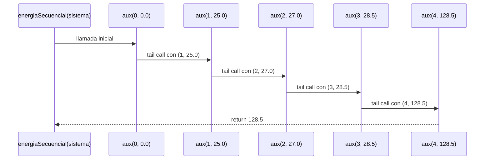
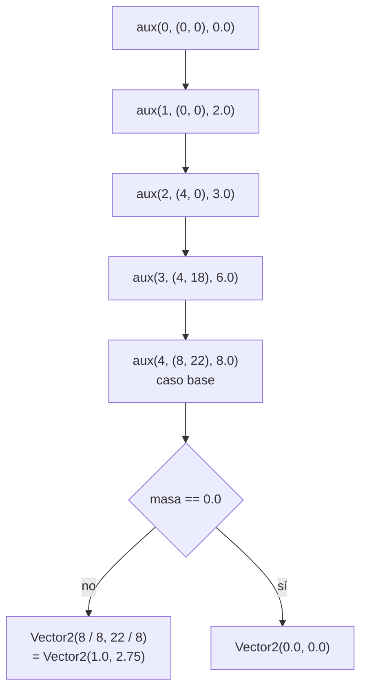
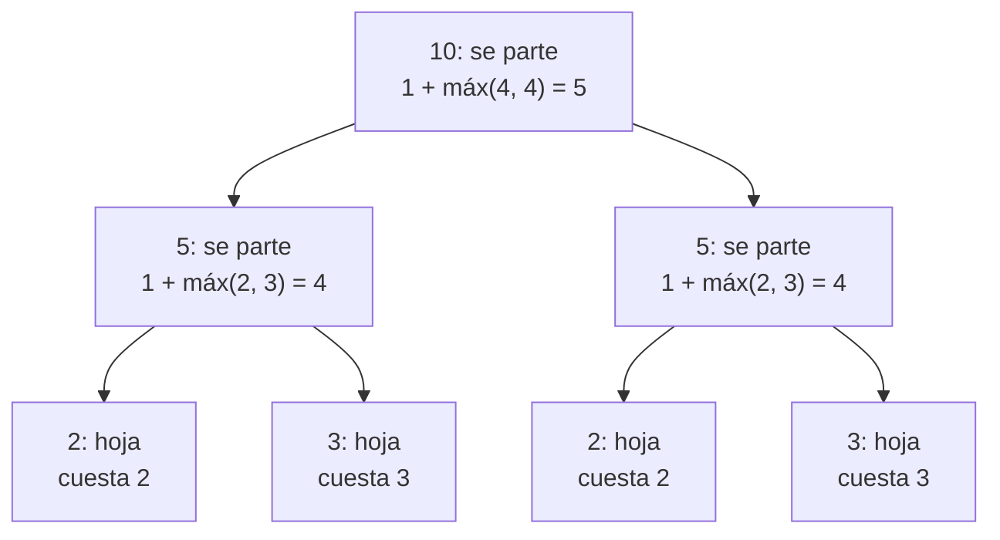
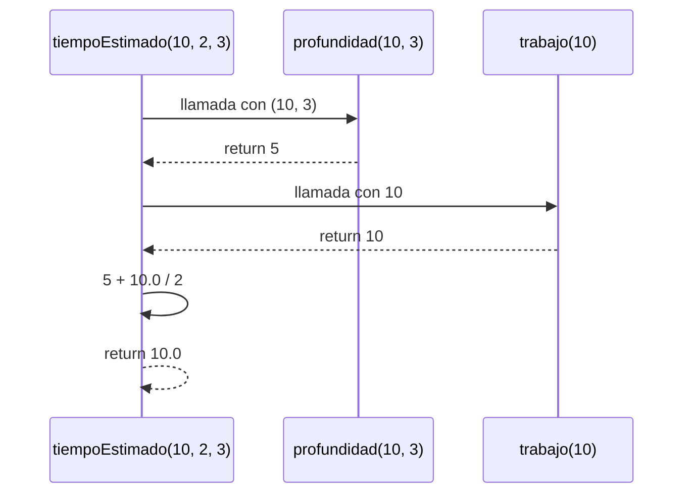
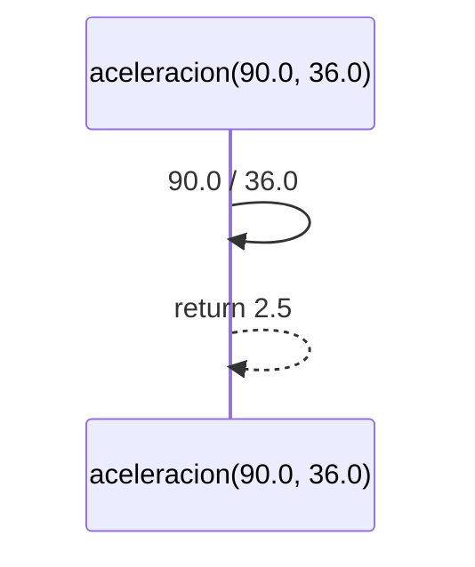
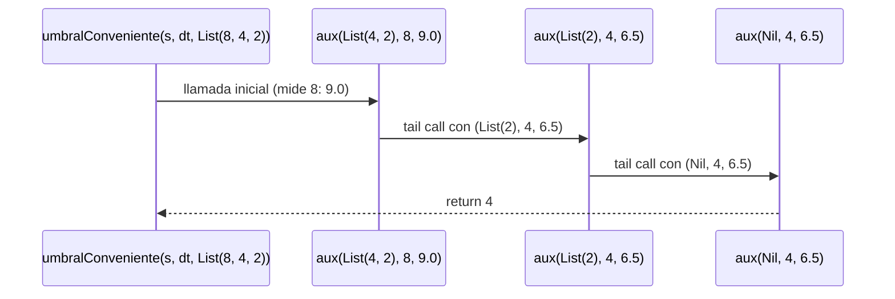
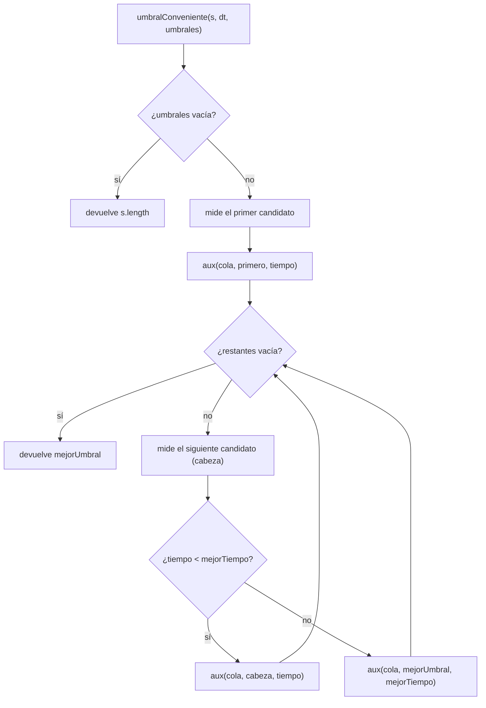

# Informe de proceso: Taller 4, simulación de partículas

Un sistema es un arreglo de partículas. Cada partícula tiene una posición, una velocidad y una masa. El taller
avanza el sistema un paso de tiempo, calcula magnitudes globales (energía, masa y centro de masa) y mide cuánto
se gana al repartir ese trabajo entre varios núcleos con `parallel`.

Este informe explica, paso a paso, cómo se ejecuta cada función y cómo queda la pila de llamados en cada punto.

## Modelo de datos y sistema de ejemplo

```Scala
case class Vector2(x: Double, y: Double) {
  def +(o: Vector2): Vector2 = Vector2(x + o.x, y + o.y)
  def *(k: Double): Vector2 = Vector2(x * k, y * k)
  def norma: Double = Math.sqrt(x * x + y * y)
}
case class Particula(pos: Vector2, vel: Vector2, masa: Double)
type Sistema = Array[Particula]
```

Los ejemplos de los puntos 2 y 4 usan este sistema. Las partículas se numeran del 1 al 4 solo para referirse a ellas en las trazas.

```scala
val sistema: Sistema = Array(
  Particula(Vector2(0, 0), Vector2(3, 4),  2.0),
  Particula(Vector2(4, 0), Vector2(0, 2),  1.0),
  Particula(Vector2(0, 6), Vector2(-1, 0), 3.0),
  Particula(Vector2(2, 2), Vector2(6, 8),  2.0))
```

| N.° | Posición | Velocidad | Masa |
|-----|----------|-----------|------|
| 1   | (0, 0)   | (3, 4)    | 2.0  |
| 2   | (4, 0)   | (0, 2)    | 1.0  |
| 3   | (0, 6)   | (-1, 0)   | 3.0  |
| 4   | (2, 2)   | (6, 8)    | 2.0  |

## Cómo se lee la pila de llamados

Las funciones de los puntos 2 y 4 recorren el sistema con una función interna `aux` de **recursión de cola**,
marcada con `@tailrec`. En una recursión de cola la llamada recursiva es lo último que hace la función, así que el
compilador la convierte en un ciclo y la **pila no crece**: en cada paso hay una sola activación de `aux`, con
otros valores en sus parámetros. Por eso en las tablas de pila se muestra el estado de esa única activación en cada paso.

# Punto 2. Magnitudes globales

Las tres funciones recorren el arreglo una sola vez, de la posición `0` a la última, llevando el resultado parcial en
un acumulador. Son la versión secuencial de las del punto 3, y sirven de referencia para comprobar las paralelas.

## 2.1 `energiaSecuencial`

### Definición del algoritmo

```Scala
def energiaSecuencial(s: Sistema): Double = {
    @tailrec
    def aux(i: Int, acc: Double): Double =
      if (i >= s.length) acc
      else {
        val v = s(i).vel.norma
        aux(i + 1, acc + 0.5 * s(i).masa * v * v)
      }
    aux(0, 0.0)
  }
```

* `energiaSecuencial` recibe el sistema `s` y devuelve la suma de las energías cinéticas, $\frac{1}{2} m v^2$, de
  todas sus partículas.
* La función interna `aux` recibe dos parámetros:
  * `i`: la posición de la partícula que se procesa.
  * `acc`: la energía acumulada de las partículas anteriores a `i`.
* La primera llamada es `aux(0, 0.0)`: se empieza en la partícula 0 con energía acumulada cero.

### Explicación paso a paso

#### Caso base

```Scala
if (i >= s.length) acc
```

Cuando `i` llega al tamaño del arreglo ya no quedan partículas, y la función devuelve el acumulador. Con un sistema
vacío esto ocurre de inmediato: `aux(0, 0.0)` devuelve `0.0` sin calcular nada.

#### Caso recursivo

```Scala
val v = s(i).vel.norma
aux(i + 1, acc + 0.5 * s(i).masa * v * v)
```

En cada llamada:

* Se calcula la rapidez `v`, que es la norma del vector velocidad de la partícula `i`
* Se suma al acumulador su energía, `0.5 * masa * v * v`.
* Se llama a `aux` con la partícula siguiente. Esa llamada es la última operación, por eso es recursión de cola.

### Seguimiento de la ejecución

Se evalúa `energiaSecuencial(sistema)`:

| `i` | Partícula | Rapidez `v` | Aporte `0.5 * m * v * v` | `acc` después |
|-----|-----------|-------------|--------------------------|---------------|
| 0   | 1         | 5           | 0.5 · 2 · 25 = 25        | 25.0          |
| 1   | 2         | 2           | 0.5 · 1 · 4 = 2          | 27.0          |
| 2   | 3         | 1           | 0.5 · 3 · 1 = 1.5        | 28.5          |
| 3   | 4         | 10          | 0.5 · 2 · 100 = 100      | 128.5         |
| 4   | no existe | no aplica   | `i >= s.length`          | devuelve 128.5 |

Resultado: `128.5`.

### Estado de la pila de llamados

| Paso | Llamada            | Activaciones en la pila | Qué hace                      |
|------|--------------------|-------------------------|-------------------------------|
| 1    | `aux(0, 0.0)`      | 1                       | suma 25 y llama a `aux(1, 25.0)`   |
| 2    | `aux(1, 25.0)`     | 1                       | suma 2 y llama a `aux(2, 27.0)`    |
| 3    | `aux(2, 27.0)`     | 1                       | suma 1.5 y llama a `aux(3, 28.5)`  |
| 4    | `aux(3, 28.5)`     | 1                       | suma 100 y llama a `aux(4, 128.5)` |
| 5    | `aux(4, 128.5)`    | 1                       | caso base, devuelve 128.5     |

La pila nunca pasa de una activación, sin importar cuántas partículas tenga el sistema.

### Diagrama de llamados de pila con recursión de cola



## 2.2 `masaTotal`

### Definición del algoritmo

```Scala
def masaTotal(s: Sistema): Double = {
    @tailrec
    def aux(i: Int, acc: Double): Double =
      if (i >= s.length) acc
      else aux(i + 1, acc + s(i).masa)

    aux(0, 0.0)
  }
```

* `masaTotal` devuelve la suma de las masas de todas las partículas.
* Tiene la misma forma de `energiaSecuencial`: cambia lo que suma en cada paso, que ahora es `s(i).masa`.
* Caso base: `i >= s.length` devuelve `acc`; un sistema vacío tiene masa `0.0`.

### Seguimiento de la ejecución

Se evalúa `masaTotal(sistema)`. La pila tiene una sola activación en cada paso, igual que en 2.1.

| Paso | Llamada           | Masa de la partícula | `acc` después |
|------|-------------------|----------------------|---------------|
| 1    | `aux(0, 0.0)`     | 2.0                  | 2.0           |
| 2    | `aux(1, 2.0)`     | 1.0                  | 3.0           |
| 3    | `aux(2, 3.0)`     | 3.0                  | 6.0           |
| 4    | `aux(3, 6.0)`     | 2.0                  | 8.0           |
| 5    | `aux(4, 8.0)`     | caso base            | devuelve 8.0  |

Resultado: `8.0`.

## 2.3 `centroDeMasaSecuencial`

### Definición del algoritmo

```Scala
def centroDeMasaSecuencial(s: Sistema): Vector2 = {
    @tailrec
    def aux(i: Int, suma: Vector2, masa: Double): (Vector2, Double) = {
      if (i >= s.length) (suma, masa)
      else aux(i + 1, suma + s(i).pos * s(i).masa, masa + s(i).masa)
    }

    val (suma, masa) = aux(0, Vector2(0.0, 0.0), 0.0)
    if (masa == 0.0) Vector2(0.0, 0.0)
    else Vector2(suma.x / masa, suma.y / masa)
  }
```

* `centroDeMasaSecuencial` devuelve la suma de las posiciones ponderadas por la masa, dividida entre la masa total.
* La función interna `aux` recibe tres parámetros:
  * `i`: la posición de la partícula que se procesa.
  * `suma`: la suma de `pos * masa` de las partículas anteriores a `i`, como un `Vector2`.
  * `masa`: la masa de las partículas anteriores a `i`.
* `aux` devuelve la pareja `(suma, masa)` en una sola pasada; no se recorre el arreglo dos veces.

### Explicación paso a paso

* **Caso base:** cuando `i >= s.length`, `aux` devuelve la pareja `(suma, masa)` acumulada.
* **Caso recursivo:** suma `pos * masa` de la partícula `i` a `suma`, suma su masa a `masa` y llama a `aux` con `i + 1`.
* **División al final:** fuera de `aux`, `val (suma, masa) = aux(...)` separa la pareja y se divide **una sola vez**:
  `Vector2(suma.x / masa, suma.y / masa)`.
* **Sin masa:** si `masa == 0.0` (sistema vacío, o partículas de masa cero) la división sería entre cero, así que
  la función devuelve el origen `Vector2(0.0, 0.0)`.

### Seguimiento de la ejecución

Se evalúa `centroDeMasaSecuencial(sistema)`:

| `i` | `pos * masa` de la partícula | `suma` después | `masa` después |
|-----|------------------------------|----------------|----------------|
| 0   | (0, 0) · 2 = (0, 0)          | (0, 0)         | 2.0            |
| 1   | (4, 0) · 1 = (4, 0)          | (4, 0)         | 3.0            |
| 2   | (0, 6) · 3 = (0, 18)         | (4, 18)        | 6.0            |
| 3   | (2, 2) · 2 = (4, 4)          | (8, 22)        | 8.0            |
| 4   | no existe                    | devuelve `((8, 22), 8.0)` |     |

Como `masa = 8.0` no es cero, el resultado es $\left(\frac{8}{8}, \frac{22}{8}\right)$ = `Vector2(1.0, 2.75)`.

### Estado de la pila de llamados

| Paso | Llamada                        | Activaciones en la pila |
|------|--------------------------------|-------------------------|
| 1    | `aux(0, (0, 0), 0.0)`          | 1                       |
| 2    | `aux(1, (0, 0), 2.0)`          | 1                       |
| 3    | `aux(2, (4, 0), 3.0)`          | 1                       |
| 4    | `aux(3, (4, 18), 6.0)`         | 1                       |
| 5    | `aux(4, (8, 22), 8.0)`         | 1, caso base: devuelve `((8, 22), 8.0)` |

### Diagrama de flujo



## Ejemplos de uso del punto 2

```Scala
val sim = new SimulacionParticulas()

println(sim.energiaSecuencial(sistema))      // 128.5
println(sim.masaTotal(sistema))              // 8.0
println(sim.centroDeMasaSecuencial(sistema)) // Vector2(1.0,2.75)
println(sim.energiaSecuencial(Array()))      // 0.0
println(sim.centroDeMasaSecuencial(Array())) // Vector2(0.0,0.0)
```

## Conclusión del punto 2

Las tres funciones son recursiones de cola sobre el índice `i`, con un acumulador: un `Double` para la energía y la
masa, y una pareja `(Vector2, Double)` para el centro de masa. La pila se mantiene en una activación. El centro de
masa lleva la suma ponderada y la masa en una sola pasada y divide una vez al final, con el origen como respuesta
cuando no hay masa.

# Punto 4. Trabajo y profundidad

El punto 4 estima cuánto debería tardar `pasoParalelo` sin ejecutarlo. Usa dos medidas del modelo de costos de `parallel`:

* El **trabajo** $W$ es el número total de operaciones, lo que costaría con un solo núcleo.
* La **profundidad** $D$ es la cadena más larga de operaciones que dependen unas de otras, lo que costaría con
  infinitos núcleos. En el modelo de costos de `parallel`: $D(\text{parallel}(e_1, e_2)) = \max(D(e_1), D(e_2)) + c_2$.

Con $P$ procesadores el tiempo se estima como $T_P \approx D + W / P$.

## 4.1 `trabajo`

### Definición del algoritmo

```Scala
def trabajo(n: Int): Int = n
```

* `trabajo` recibe el número de partículas `n` y devuelve el número de operaciones.
* Cada partícula cuesta una operación, así que $W(n) = n$. No hay recursión: la función devuelve su argumento.
* Ejemplo: `trabajo(10)` es `10`, y `trabajo(0)` es `0`.

## 4.2 `profundidad`

### Definición del algoritmo

```scala
def profundidad(n: Int, umbral: Int): Int = {
    val tope = math.max(umbral, 1)

    @tailrec
    def aux(tamanos: List[Int], nivel: Int, mejor: Int): Int =
      if (tamanos.isEmpty) mejor
      else {
        val (hojas, partibles) = tamanos.partition(_ <= tope)
        val nuevoMejor = (mejor :: hojas.map(nivel + _)).max
        aux(partibles.flatMap(k => List(k / 2, k - k / 2)).distinct, nivel + 1, nuevoMejor)
      }

    aux(List(n), 0, 0)
}
```
* `profundidad` recibe el número de partículas con `n` y el umbral, y devuelve cuántas veces se parte el sistema a la
  mitad más el tramo que queda sin partir.
* `tope = math.max(umbral, 1)`: un tramo de una sola partícula no se parte nunca, así un umbral menor que 1 no deja
  la recursión sin fondo.
* La función interna `aux` recibe tres parámetros:
    * `tamanos`: los tamaños de los tramos que hay en el nivel actual del árbol de particiones.
    * `nivel`: cuántas veces se ha partido para llegar a ese nivel.
    * `mejor`: el costo más alto visto hasta ahora entre las hojas ya encontradas.

### Explicación paso a paso

`pasoParalelo` parte un tramo de tamaño `k` en uno de tamaño `k / 2` y otro de `k - k / 2` mientras `k > tope`.
`profundidad` recorre ese árbol **nivel por nivel**:

* **Hoja:** un tramo con `k <= tope` no se parte y se resuelve en secuencial. Una hoja en el nivel `nivel` cuesta
  `nivel + k`: las particiones que hubo hasta llegar a ella más sus `k` operaciones.
* **Tramo partible:** con `k > tope` se reemplaza por sus dos mitades en el nivel siguiente.
* **Máximo:** como en $D(\text{parallel}(e_1, e_2)) = \max(D(e_1), D(e_2)) + c_2$, la profundidad es el mayor costo entre
  todas las hojas. `nuevoMejor` lo va guardando en `mejor`.
* **`distinct`:** en un nivel solo hay dos tamaños posibles (el piso y el techo de `n / 2^nivel`), así que se
  quitan los repetidos y la lista se mantiene corta.
* **Caso base:** cuando `tamanos` queda vacía todos los tramos fueron hojas, y `aux` devuelve `mejor`.

### Seguimiento de la ejecución

Se evalúa `profundidad(10, 3)`, con `tope = 3`:

| Llamada | `tamanos` | `nivel` | `mejor` | `hojas` | `partibles` | `nuevoMejor` | Siguiente `tamanos` |
|---------|-----------|---------|---------|---------|-------------|--------------|---------------------|
| 1       | [10]      | 0       | 0       | []      | [10]        | 0            | [5]                 |
| 2       | [5]       | 1       | 0       | []      | [5]         | 0            | [2, 3]              |
| 3       | [2, 3]    | 2       | 0       | [2, 3]  | []          | máx(0, 2 + 2, 2 + 3) = 5 | []      |
| 4       | []        | 3       | 5       | no aplica | no aplica | no aplica    | devuelve 5          |

Resultado: `5`. En la llamada 1, el 10 se parte en 5 y 5, y `distinct` deja un solo 5. En la llamada 2, el 5 se
parte en 2 y 3, que ya caben en el tope.

### Estado de la pila de llamados

| Paso | Llamada                  | Activaciones en la pila |
|------|--------------------------|-------------------------|
| 1    | `aux(List(10), 0, 0)`    | 1                       |
| 2    | `aux(List(5), 1, 0)`     | 1                       |
| 3    | `aux(List(2, 3), 2, 0)`  | 1                       |
| 4    | `aux(List(), 3, 5)`      | 1, caso base: devuelve 5 |

### Diagrama del árbol de particiones

Cada nodo muestra su tamaño y su costo. Una hoja cuesta su tamaño y un nodo partido cuesta
`1 + máx(costo de sus hijos)`.



La tabla y el diagrama calculan lo mismo. La tabla recorre el árbol por niveles y guarda el mayor `nivel + tamaño`
entre las hojas; el diagrama lo recorre desde la raíz con `1 + máx(hijos)`. En ambos el resultado es `5`.

### Cuando la mitad menor domina: `profundidad(11, 5)`

Con tamaño impar las dos mitades no pesan igual: 11 se parte en 5 y 6. La mitad de 5 ya cabe en el tope y cuesta
`1 + 5`, mientras que la de 6 se sigue partiendo y cuesta `1 + 1 + 3`.

| Llamada | `tamanos` | `nivel` | `mejor` | `hojas` | `partibles` | `nuevoMejor`   | Siguiente `tamanos` |
|---------|-----------|---------|---------|---------|-------------|----------------|---------------------|
| 1       | [11]      | 0       | 0       | []      | [11]        | 0              | [5, 6]              |
| 2       | [5, 6]    | 1       | 0       | [5]     | [6]         | máx(0, 1 + 5) = 6 | [3]              |
| 3       | [3]       | 2       | 6       | [3]     | []          | máx(6, 2 + 3) = 6 | []               |
| 4       | []        | 3       | 6       | no aplica | no aplica | no aplica      | devuelve 6          |

Resultado: `6`. Por eso no basta con seguir siempre la mitad mayor: la hoja de 5 en el nivel 1 cuesta 6 y gana a la
hoja de 3 en el nivel 2, que cuesta 5.

## 4.3 `tiempoEstimado`

### Definición del algoritmo

```Scala
def tiempoEstimado(n: Int, p: Int, umbral: Int): Double =
  profundidad(n, umbral) + trabajo(n).toDouble / p
```

* `tiempoEstimado` recibe `n` partículas, `p` procesadores y el umbral, y devuelve el tiempo estimado como un `Double`.
* Suma la profundidad, que es lo que no se puede repartir, con el trabajo entre `p`, que es lo que sí se reparte:
  $T_P \approx D + W / P$.
* `trabajo(n).toDouble` convierte el trabajo a `Double` **antes** de dividir. Con `Int` la división sería entera y perdería
  los decimales.

### Seguimiento de la ejecución

Se evalúa `tiempoEstimado(10, 2, 3)`. La función no es recursiva: llama a `profundidad` y a `trabajo` y combina
sus resultados.

| Paso | Operación                    | Resultado |
|------|------------------------------|-----------|
| 1    | `profundidad(10, 3)`         | 5         |
| 2    | `trabajo(10)`                | 10        |
| 3    | `10.toDouble / 2`            | 5.0       |
| 4    | `5 + 5.0`                    | 10.0      |

Resultado: `10.0`.

### Estado de la pila de llamados

`profundidad` y `trabajo` se llaman una después de la otra, así que nunca están las dos en la pila a la vez.

| Paso | Pila (de abajo hacia arriba)                      | Qué ocurre                  |
|------|---------------------------------------------------|-----------------------------|
| 1    | `tiempoEstimado`                                  | empieza                     |
| 2    | `tiempoEstimado`, `profundidad`                   | `profundidad` calcula su `aux` y devuelve 5 |
| 3    | `tiempoEstimado`                                  | recibe 5                    |
| 4    | `tiempoEstimado`, `trabajo`                       | `trabajo` devuelve 10       |
| 5    | `tiempoEstimado`                                  | calcula `5 + 10.0 / 2` y devuelve 10.0 |

### Diagrama de llamados



## Ejemplos de uso del punto 4

```Scala
val sim = new SimulacionParticulas()

println(sim.trabajo(10))                      // 10
println(sim.profundidad(10, 3))               // 5
println(sim.profundidad(11, 5))               // 6
println(sim.tiempoEstimado(10, 2, 3))         // 10.0
println(sim.profundidad(1000000, 1000))       // 987
println(sim.tiempoEstimado(1000000, 8, 1000)) // 125987.0
```

El último ejemplo muestra el efecto del reparto a escala: con un millón de partículas y un umbral de 1000 la
profundidad es solo `987`, y el trabajo entre 8 procesadores es `125000`; la estimación está dominada por el trabajo.

## Conclusión del punto 4

`trabajo` devuelve `n`. `profundidad` es una recursión de cola que recorre el árbol de particiones nivel por nivel
y se queda con la hoja más costosa, de costo `nivel + tamaño`, que es el máximo de $D(\text{parallel}(e_1, e_2))$.
`tiempoEstimado` suma esa profundidad con el trabajo repartido entre `p` procesadores, usando división decimal.

# Punto 5. Medir la aceleración

Las dos funciones de este punto no recorren el sistema: trabajan con tiempos, que son números. `aceleracion` compara dos tiempos y `umbralConveniente` compara los tiempos de varios umbrales y se queda con el menor. Los tiempos se toman con `medir`, que viene escrita en el taller, y la tabla completa la produce `App.scala`.

## 5.1 `aceleracion`

### Definición del algoritmo

```Scala
def aceleracion(tSecuencial: Double, tParalelo: Double): Double =
  tSecuencial / tParalelo
```
* Recibe el tiempo de la versión secuencial y el de la paralela, los dos en milisegundos, y devuelve cuántas veces más rápida fue la paralela.
* Un resultado mayor que 1 quiere decir que repartir ganó tiempo; igual a 1, que tardaron lo mismo; menor que 1, que repartir costó más de lo que ahorró.
* No es recursiva: hace una sola división de `Double` entre `Double`, así que no pierde decimales.

### Seguimiento de la ejecución

Ejemplo principal: `aceleracion(90.0, 36.0)`.

| Paso | Operación | Resultado |
|---|---|---|
| 1 | `90.0 / 36.0` | 2.5 |

Resultado: `2.5`. El paralelo fue 2.5 veces más rápido.

Otros dos casos, para ver los tres significados:

| Llamado | Cálculo | Resultado | Lectura |
|----|----|----|----|
| `aceleracion(48.0, 48.0)` | `48.0 / 48.0` | 1.0 | tardaron lo mismo |
| `aceleracion(10.0, 16.0)` | `10.0 / 16.0` | 0.625 | el paralelo fue más lento |

### Estado de la pila de llamados

La función no llama a otras: la pila tiene un solo elemento.

| Paso | Pila (de abajo hacia arriba) | Qué ocurre|
|---|---|---|
| 1 | `aceleracion` | calcula `90.0 / 36.0` y devuelve 2.5 |

### Diagrama de llamados


El diagrama representa el cálculo dentro de la única llamada a `aceleracion`; no es una llamada recursiva.

## 5.2 `umbralConveniente`

### Definición del algoritmo

```Scala
def umbralConveniente(s: Sistema, dt: Double, umbrales: List[Int]): Int = {
  // Recorre los candidatos que faltan y recuerda el mejor umbral y su tiempo.
  @tailrec
  def aux(restantes: List[Int], mejorUmbral: Int, mejorTiempo: Double): Int =
    restantes match {
      case Nil => mejorUmbral
      case cabeza :: cola =>
        val tiempo = medir(5)(pasoParalelo(s, dt, cabeza))
        if (tiempo < mejorTiempo) aux(cola, cabeza, tiempo)
        else aux(cola, mejorUmbral, mejorTiempo)
    }
    
  umbrales match {
    case Nil => s.length
    case cabeza :: cola => aux(cola, cabeza, medir(5)(pasoParalelo(s, dt, cabeza)))
  }
}
```

* Si la lista de candidatos está vacía, devuelve `s.length`: un umbral igual al tamaño del sistema no parte nada, que equivale a no repartir.
* Si no está vacía, mide el primer candidato y lo deja como el mejor por ahora. `aux` recorre los candidatos que faltan.
* Cada candidato se mide **una sola vez** con `medir(5)`: son cinco repeticiones, cada una con su calentamiento de `withWarmer(new Warmer.Default)`, y `medir` devuelve la mediana en milisegundos. Su tiempo se compara con `mejorTiempo`, que ya está guardado y no se vuelve a medir.
* Si el candidato tarda estrictamente menos, pasa a ser el mejor. Si empatan, se queda el que ya estaba, es decir, el primero de la lista.
* `aux` es una recursión de cola `@tailrec`: la llamada recursiva es lo último, así que la pila no crece.

### Explicación paso a paso

#### Caso base

`restantes` es `Nil`: ya se midieron todos los candidatos y `mejorUmbral` es el que menos tardó.

#### Caso recursivo

`restantes` es `cabeza :: cola`, se mide `cabeza` y se compara su tiempo con `mejorTiempo`. En los dos casos se llama a `aux` con `cola`, que tiene un candidato menos.

### Seguimiento de la ejecución

Los tiempos reales dependen de la máquina; para ver cómo avanza `aux` se suponen estos tiempos medidos: el umbral 8 tarda 9.0 ms, el 4 tarda 6.5 ms y el 2 tarda 7.0 ms. Se evalúa `umbralConveniente(s, dt, List(8, 4, 2))`.

| Paso| `restantes`| `mejorUmbral` | `mejorTiempo`| Operación |
|----|----|----|----|----|
| 0 | `List(4, 2)` | 8| 9.0| Estado inicial, después de medir el umbral 8 |
| 1| `List(4, 2)`| 8| 9.0 | Mide 4: `6.5 < 9.0`, actualiza el mejor|
| 2 | `List(2)` | 4 | 6.5 | Mide 2: `7.0 < 6.5` es falso, conserva el mejor | 
| 3 | `Nil` | 4 | 6.5 | Caso base: devuelve 4 |

Resultado: `4`

Con la lista vacía: `umbralConveniente(s, dt, Nil)` devuelve `s.length`; si el sistema tiene 4 partículas, devuelve `4`.

### Estado de la pila de llamados

| Paso | Pila (de abajo hacia arriba)| Qué ocurre|
|---|---|---|
| 0 | `umbralConveniente`| mide el candidato 8 y llama a `aux` |
| 1 | `umbralConveniente`, `aux(List(4,2), 8, 9.0)` | mide 4: 6.5 < 9.0, llama a `aux` |
| 2 | `umbralConveniente`, `aux(List(2), 4, 6.5)`  | mide 2: 7.0 no es menor que 6.5 |
| 3 | `umbralConveniente`, `aux(Nil, 4, 6.5)` | caso base: devuelve 4|

La tabla representa los estados sucesivos de `aux`, no niveles que se acumulan en la pila. Como la llamada recursiva es lo último que hace cada caso y `@tailrec` lo comprueba, el compilador reemplaza cada llamada por la siguiente iteración: en cada paso hay una sola activación de `aux` con otros valores en sus parámetros. Por eso la pila no crece aunque la lista tenga muchos umbrales.

### Diagrama de llamados de pila con recursión de cola



### Diagrama de flujo



## 5.3 La medición en `App.scala`

`App.scala` arma la tabla del informe de paralelización. Para cada tamaño de sistema hace estos pasos:
1. Define los tamaños `1000000`, `1500000` y `2000000`, el paso de tiempo `dt = 0.01` y las repeticiones (`5`).
2. `crear(n)` construye un sistema de `n` partículas con `Array.tabulate`, sin azar: el mismo `n` da siempre el mismo sistema.
3. Para cada tamaño prepara los umbrales `n`, `n/2`, `n/8`, `n/64`, `n/512`.
4. Mide `pasoSecuencial` con `medir(5)`: cada una de las cinco repeticiones calienta primero con ScalaMeter, sin tomar el tiempo, para que la máquina virtual optimice el código, y `medir` devuelve la mediana en milisegundos.
5. Para cada umbral mide `pasoParalelo` con el mismo `medir(5)` (mismo calentamiento y misma mediana) y calcula la aceleración medida con `aceleracion`.
6. Calcula también la aceleración estimada con el punto 4 y la fracción serial con la ley de Amdahl.
7. Imprime una fila de la tabla por cada pareja (tamaño, umbral).

El primer umbral de cada tamaño es el propio `n`: no reparte nada y es la **fila de control**, donde la aceleración debe dar cerca de 1.

### Seguimiento con una fila

Para `n = 1000000` y umbral `125000`, con tiempos supuestos de 24.0 ms el secuencial y 10.0 ms el paralelo, en una máquina de 8 núcleos. Estos valores son ilustrativos, no una medición real:

| Paso | Cálculo| Resultado |
|---|---|---|
| 1 | `aceleracion(24.0, 10.0)` | 2.4|
| 2 | `tiempoEstimado(1000000, 8, 125000)` | `125003 + 125000.0 = 250003.0`|
| 3 | aceleración estimada = `trabajo(n) / tiempoEstimado` | `1000000 / 250003` ≈ 4.0|
| 4 | `fraccionSerial(2.4, 8)` = `(1/2.4 - 1/8) / (1 - 1/8)` | 1/3 ≈ 0.33|

La profundidad `125003` es 3 particiones más la hoja de `125000` partículas que cada tarea recorre sin repartir; por eso la estimación da cerca de 4 y no de 8. La aceleración medida (2.4) queda por debajo de la estimada (≈ 4.0) porque el modelo del punto 4 no cuenta costos reales como crear las tareas, coordinarlas y combinar resultados. La fracción serial sale de la ley de Amdahl a partir de la aceleración observada: es una estimación, no una medición directa del código secuencial.

## Ejemplos de uso del punto 5

```scala
val sim = new SimulacionParticulas()

println(sim.aceleracion(90.0, 36.0)) // 2.5
println(sim.aceleracion(48.0, 48.0)) // 1.0
println(sim.aceleracion(10.0, 16.0)) // 0.625
println(sim.umbralConveniente(Array.empty[Particula], 0.5, Nil)) // 0
```

El último ejemplo muestra el caso límite: sin partículas y sin candidatos, el tamaño del sistema es cero y eso es lo que devuelve.

## Conclusión del punto 5

`aceleracion` es el cociente entre el tiempo secuencial y paralelo: dice si repartir el trabajo ganó o perdió tiempo.

`umbralConveniente` recorre los candidatos con una recursión de cola, mide cada uno una sola vez y conserva el de menor tiempo; con la lista vacía devuelve el tamaño del sistema.

`App.scala` hace las mediciones con varios tamaños y umbrales y usa `aceleracion` para comparar los tiempos. Imprime una tabla con la aceleración medida, la estimada con el punto 4 y la fracción serial. La fila de control, donde el umbral es igual al tamaño del sistema, muestra que sin repartir el trabajo la aceleración queda cerca de 1.

