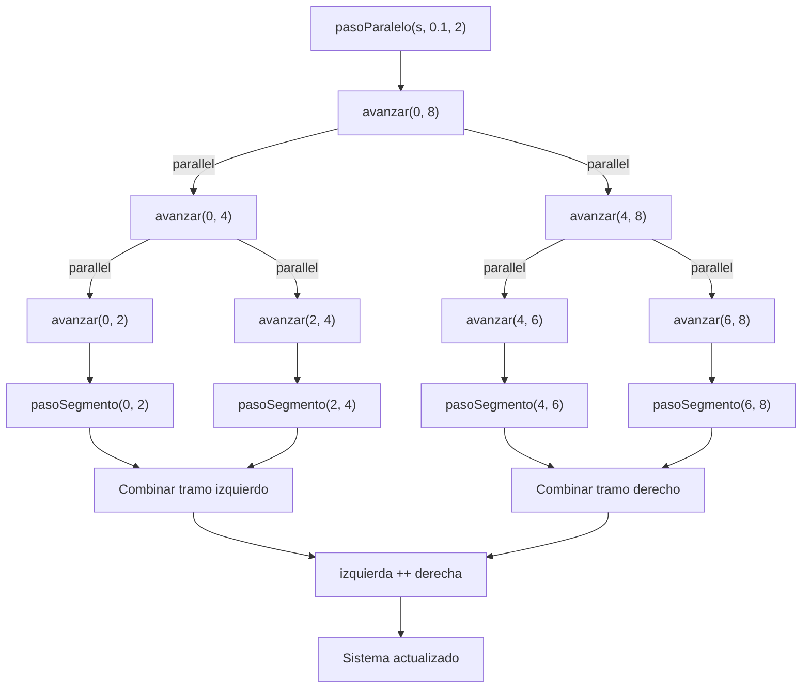

# Algoritmo Factorial con Recursión de Cola

## Definición del Algoritmo

```Scala
def pasoParalelo(s: Sistema, dt: Double, umbral: Int): Sistema = {
  def avanzar(desde: Int, hasta: Int): Sistema =
    if (hasta - desde <= umbral || hasta - desde <= 1)
      pasoSegmento(s, dt, desde, hasta)
    else {
      val mitad = desde + (hasta - desde) / 2
      val (izquierda, derecha) = parallel(
        avanzar(desde, mitad),
        avanzar(mitad, hasta))
      izquierda ++ derecha
    }

  avanzar(0, s.length)
}
```

La función `pasoParalelo` actualiza las posiciones de las partículas de un sistema utilizando la estrategia de **dividir y vencer** mediante paralelización.
- Recibe tres parámetros:
  - `s`: el sistema que contiene las partículas.
  - `dt`: el intervalo de tiempo del movimiento.
  - `umbral`: el tamaño máximo de un tramo para resolverlo secuencialmente.
- La función interna `avanzar` es la que realiza la recursión:
  - Recibe dos parámetros:
    - `desde`: el índice inicial del tramo, incluido.
    - `hasta`: el índice final del tramo, excluido.
- La función `parallel` permite ejecutar las dos mitades del sistema en paralelo.
- Cuando el tamaño del tramo es menor o igual al umbral, o tiene como máximo un elemento, se utiliza `pasoSegmento` para resolverlo secuencialmente.
- El operador `++` une los resultados de ambas mitades, conservando el orden original de las partículas.
- A diferencia de la recursión de cola, esta función debe esperar los resultados de los llamados recursivos para combinarlos.
## Explicación paso a paso

### Caso base

```Scala
if (hasta - desde <= umbral || hasta - desde <= 1)
  pasoSegmento(s, dt, desde, hasta)
```

Cuando el tamaño del tramo es menor o igual al umbral, o contiene como máximo una partícula, la función deja de dividir el sistema y ejecuta `pasoSegmento`, actualizando las partículas del tramo de manera secuencial y evitando más llamadas recursivas.

### Caso recursivo

```Scala
val mitad = desde + (hasta - desde) / 2
val (izquierda, derecha) = parallel(
  avanzar(desde, mitad),
  avanzar(mitad, hasta))
izquierda ++ derecha
```

En cada llamada:

- Se calcula el punto medio del tramo mediante la variable `mitad`.
- Se divide el tramo en dos partes:
  - La primera comprende desde `desde` hasta `mitad`, sin incluir esta última.
  - La segunda comprende desde `mitad` hasta `hasta`, sin incluir esta última.
- Se ejecutan ambas llamadas recursivas en paralelo mediante la función `parallel`.
- Cada mitad continúa dividiéndose hasta alcanzar el caso base.
- Se combinan los resultados mediante `izquierda ++ derecha`, conservando el orden original de las partículas.
-  No es recursión de cola, ya que después de las llamadas recursivas todavía se deben combinar los resultados

---

## Llamados recursivos en paralelo 

Ejemplo: un sistema de 8 partículas, con un intervalo de tiempo de 0.1 y un umbral de 2.

```Scala
pasoParalelo(s, 0.1, 2)
```

### Paso 1: Llamada inicial

```Scala
avanzar(0, 8)
```


El tramo contiene 8 partículas. Como supera el umbral, se calcula la mitad, que es 4.

### Paso 2: Primera division

```Scala
parallel(
  avanzar(0, 4),
  avanzar(4, 8)
)
```
Se divide el sistema en dos tramos de 4 partículas que se ejecutan en paralelo.

### Paso 3: Segunda division

El tramo izquierdo se divide en:


```Scala
parallel(
  avanzar(0, 2),
  avanzar(2, 4)
)
```

El tramo derecho se divide en:

```scala
parallel(
  avanzar(4, 6),
  avanzar(6, 8)
)
```

### Paso 4: caso base
Como cada tramo contiene 2 partículas, se alcanza el umbral y se ejecuta:

```Scala
pasoSegmento(s, 0.1, 0, 2)
pasoSegmento(s, 0.1, 2, 4)
pasoSegmento(s, 0.1, 4, 6)
pasoSegmento(s, 0.1, 6, 8)
```
Cada llamado actualiza las partículas de su respectivo tramo de manera secuencial.

### Paso 5:  Combinación de resultados parciales
Mediante el operador `++`, se combinan los resultados de los tramos:
- Los tramos (0, 2) y (2, 4) forman el resultado de (0, 4).
- Los tramos (4, 6) y (6, 8) forman el resultado de (4, 8).


### Paso 6: Resultado final
Se combinan los resultados de las dos mitades mediante:

```scala
izquierda ++ derecha
```

Finalmente, se retorna el sistema completo con las 8 partículas actualizadas, conservando su orden original.


## Diferencia con la recursión secuencial


- En la **recursión secuencial**, las llamadas recursivas se ejecutan una después de la otra, por lo que cada mitad del sistema debe esperar a que termine la anterior.
- En la **recursión paralela**, las dos mitades del sistema pueden ejecutarse simultáneamente mediante la función `parallel`, aprovechando los núcleos disponibles del procesador.
- La función `pasoParalelo` no utiliza recursión de cola, debido a que necesita combinar los resultados de las llamadas recursivas mediante el operador `++`.
- El uso del umbral permite controlar la cantidad de divisiones y evitar la creación excesiva de tareas paralelas.
- Ambas estrategias buscan obtener el mismo resultado, pero la versión paralela puede reducir el tiempo de ejecución cuando el sistema contiene una cantidad considerable de partículas.
---

## Ejemplo de uso

```Scala
```scala
val resultado = pasoParalelo(s, 0.1, 2)
println(resultado.mkString("\n"))
```

Para un sistema `s` de 8 partículas, la función divide el sistema hasta obtener cuatro tramos de dos partículas cada uno.

El resultado es un sistema de 8 partículas con sus posiciones actualizadas después de un intervalo de tiempo de 0.1, conservando el orden original de las partículas..


## Diagrama de llamados recursivos en paralelo




